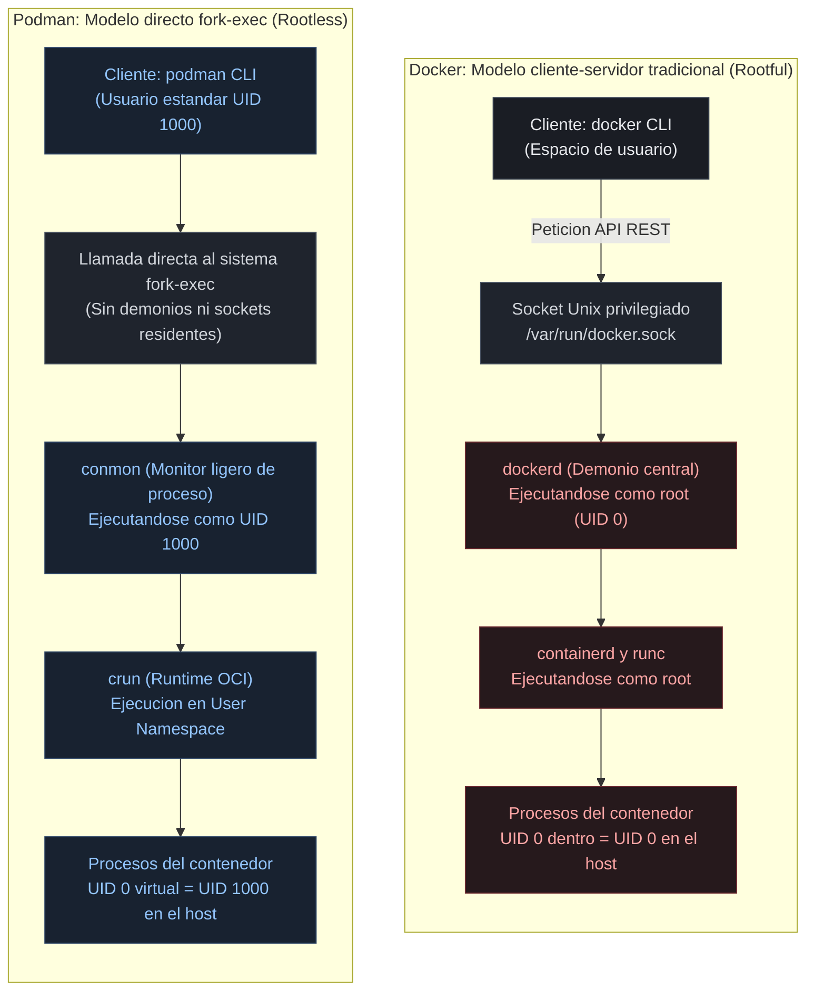
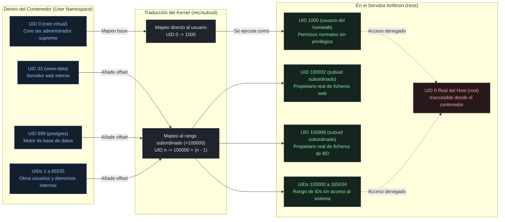
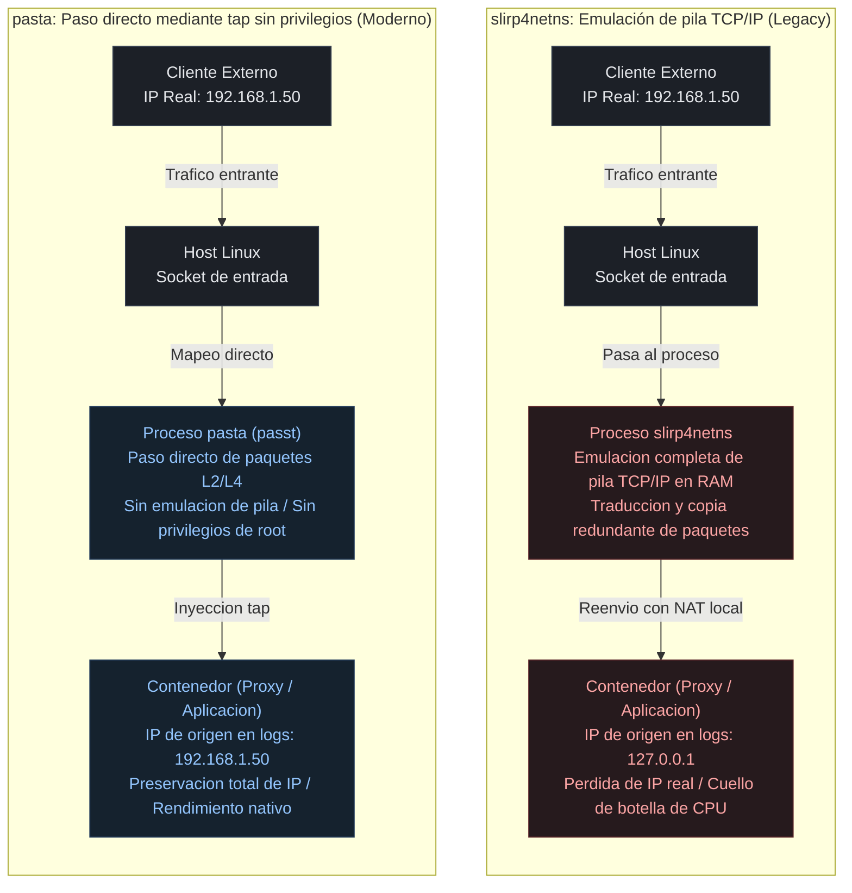
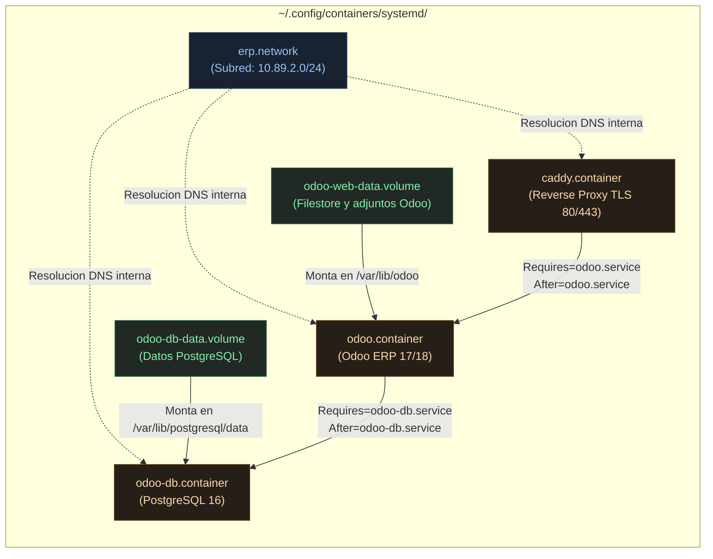

import TerminalWindow from '../../components/TerminalWindow.astro';
import CodeBlockWindow from '../../components/CodeBlockWindow.astro';

---

## Índice de Contenidos

1. [Introducción](#introducción)
2. [Requisitos previos](#requisitos-previos)
3. [Los riesgos ocultos del socket de Docker ejecutándose como root](#1-los-riesgos-ocultos-del-socket-de-docker-ejecutándose-como-root)
4. [Configuración de Podman Rootless: subuid, subgid y permisos de red](#2-configuración-de-podman-rootless-subuid-subgid-y-permisos-de-red)
5. [Migración de stacks Docker Compose a Podman Quadlets y systemd](#3-migración-de-stacks-docker-compose-a-podman-quadlets-y-systemd)
6. [Gestión del ciclo de vida como servicio nativo de usuario](#4-gestión-del-ciclo-de-vida-como-servicio-nativo-de-usuario)
7. [Docker vs Podman Rootless: tabla comparativa y matriz de decisión](#5-docker-vs-podman-rootless-tabla-comparativa-y-matriz-de-decisión)
8. [Mi experiencia personal en el homelab](#6-mi-experiencia-personal-en-el-homelab)
9. [Problemas habituales y troubleshooting práctico](#7-problemas-habituales-y-troubleshooting-práctico)
10. [Conclusión y próximos pasos](#8-conclusión-y-próximos-pasos)

---

## Introducción

¿Nunca te ha pasado que vas a ejecutar un comando de Docker sin `sudo` y te sale esto?

<TerminalWindow title="docker compose up -d">
```bash
Got permission denied while trying to connect to the Docker daemon socket at unix:///var/run/docker.sock
```
</TerminalWindow>

Seguro que sí, todos lo hemos hecho. Y seguro que hiciste lo mismo que yo: copiar el primer comando que encontraste o que la búsqueda con IA devolvió (`sudo usermod -aG docker $USER`), cerrar sesión, volver a entrar o poner `newgrp docker`, y seguir a lo tuyo. Y el problema se resuelve, ¿no?

Pues no del todo. Lo que acabamos de hacer, sin darnos cuenta, es darle a tu usuario permisos equivalentes a `root` sobre todo tu sistema. En este post vamos a ver por qué pasa eso, qué riesgo real tiene y cómo puedes seguir usando contenedores sin comprometer la seguridad.

### El punto de partida: la falsa sensación de aislamiento

Cuando empezamos a desplegar servicios en un homelab o en una empresa, Docker parece pura magia. Con un simple `docker compose up -d` levantamos en cuestión de segundos un stack con **Nextcloud**, **Pi-hole**, un proxy inverso como **Caddy** o **Nginx**, y una base de datos **PostgreSQL** sin tener que pelearnos con dependencias del sistema operativo.

Sin embargo, en ese proceso solemos adoptar una creencia equivocada y muy peligrosa: **creer que un contenedor es una máquina virtual aislada**.

No lo es. Un contenedor es simplemente un conjunto de procesos comunes y corrientes que corren directamente sobre el mismo kernel de Linux que tu sistema anfitrión, aislados mediante *namespaces* y delimitados por *cgroups*. Y aquí tenemos el problema: en una instalación estándar de Docker, el demonio principal (`dockerd`) se ejecuta con privilegios de **root** (`UID 0`).

Por lo que, si cualquier servicio que tengamos expuesto a Internet sufre una vulnerabilidad de ejecución remota de código (RCE) o un fallo de escape de contenedor (*container breakout*), el atacante no se encuentra en una jaula inofensiva: aterriza con un pie dentro del núcleo de tu servidor. La frontera de seguridad entre tus contenedores y la máquina física es mucho más pequeña de lo que parece.

### La promesa de Podman Rootless

Aquí es donde entra en juego **Podman** (*Pod Manager*), el motor de contenedores impulsado por Red Hat y diseñado desde su base bajo los estándares abiertos de la OCI (*Open Container Initiative*).

A diferencia de Docker, Podman propone un cambio radical: **el modelo sin demonio (*daemonless*) y sin privilegios (*rootless*)**.

En modo rootless no existe ningún servicio con superpoderes corriendo en segundo plano como superusuario. Cada contenedor, cada interfaz de red virtual y cada capa de almacenamiento se instancian íntegramente bajo el espacio de nombres de un usuario común y corriente de Linux (`UID >= 1000`).

La magia aquí es que, aunque la aplicación dentro del contenedor crea que se está ejecutando como `root` (para instalar paquetes o gestionar procesos), para el kernel del anfitrión es un proceso sin ningún tipo de privilegio especial. Si alguien compromete tu aplicación, únicamente tendrá acceso a los ficheros a los que tu usuario tenga permiso de lectura o escritura. Tu anfitrión, tu kernel y el resto de servicios del sistema quedan completamente a salvo.

### Qué aprenderás en este artículo

Migrar de Docker a Podman en un entorno real suele generar dudas porque la mayoría de tutoriales se quedan en lo más superficial: enseñarte cuatro comandos en la consola o decirte que crees un alias (`alias docker=podman`, basado en hechos reales). Pero cuando intentas gestionar una infraestructura seria con volúmenes persistentes, redes compartidas y arranque automático de los contenedores, aparecen los problemas reales: permisos de ficheros denegados, problemas con puertos por debajo del 1024 y la duda de qué hacer con los `docker-compose.yml`.

En esta guía vamos a recorrer todo el camino técnico necesario:

1. **Entenderemos a fondo la superficie de ataque** del socket de Docker y por qué pertenecer al grupo `docker` es una mala idea de seguridad.
2. **Configuraremos Podman Rootless desde cero**, explicando cómo funcionan los rangos de UIDs subordinados (`/etc/subuid` y `/etc/subgid`) y la nueva pila de red con `pasta`.
3. **Migraremos stacks reales de Docker Compose a Quadlets**, la herramienta nativa que transforma la definición de tus contenedores en servicios del sistema de primer nivel.
4. **Administraremos todo el ciclo de vida con systemd a nivel de usuario**, logrando arranque en el boot desatendido, actualizaciones automáticas con rollback y monitorización centralizada en `journalctl`.

---

## Requisitos previos

### Entorno y dependencias del sistema

Para reproducir esta configuración y migrar todo de manera estable y fiable, no necesitas un hardware de gama empresarial ni una instalación compleja. Basta con un servidor doméstico, un mini PC o una máquina virtual que cumpla con los siguientes requisitos:

- **Distribución Linux moderna:** Se recomienda utilizar un kernel Linux **5.11 o superior** (si tus sistemas tienen algo más viejo que esto, que sepas que tienes un coladero de vulnerabilidades), presente por defecto en distribuciones como Debian 12 (Bookworm), Ubuntu 22.04/24.04 LTS, Fedora 39/40 o AlmaLinux/Rocky Linux 9. Los kernels modernos permiten utilizar el controlador de almacenamiento `overlay` nativo sin necesidad de capas intermedias de FUSE.
- **Jerarquía unificada de grupos de control (cgroups v2):** Prácticamente todas las distribuciones actuales lo traen activado. Es indispensable para que systemd pueda supervisar y limitar los recursos de los contenedores en el espacio del usuario.
- **Paquetes esenciales del sistema:** Necesitaremos `podman` (versión 4.4 en adelante, idealmente 5.x para disfrutar del backend de red `pasta`), las utilidades `shadow-utils` o `uidmap` (que proporcionan las herramientas `newuidmap` y `newgidmap`) y `dbus-user-session`.
- **Cuenta de usuario estándar:** Una cuenta de usuario normal con privilegios de `sudo` para las configuraciones iniciales a nivel de kernel, pero con la que trabajaremos exclusivamente sin privilegios para gestionar los contenedores.

---

## 1. Los riesgos ocultos del socket de Docker ejecutándose como root 

### El mito del grupo `docker`: sudo encubierto sin contraseña

Uno de los primeros pasos que enseñan casi todos los tutoriales de iniciación a Docker en Internet tras instalar el paquete es el siguiente:

```bash
sudo usermod -aG docker $USER
```

La intención es inocente: ahorrarnos la molestia de teclear `sudo` cada vez que queremos listar un contenedor o consultar unos logs. Sin embargo, lo que muchos administradores de sistemas pasan por alto es que pertenecer al grupo `docker` es, a efectos prácticos de seguridad, **exactamente equivalente a tener acceso root sin contraseña en el sistema anfitrión**.

El socket Unix `/var/run/docker.sock` es el canal de comunicación a través del cual el CLI de Docker gestiona y da órdenes a `dockerd`. Este fichero especial pertenece al usuario `root` y al grupo `docker`, con permisos `0660`. Si tu usuario forma parte de este grupo, tiene permiso de lectura y escritura en ese socket. Y si puedes comunicarte con él, puedes pedirle al demonio que levante un contenedor con cualquier privilegio que quieras, incluido el montaje directo del disco del sistema.

Fíjate en lo sencillo que resulta realizar una escalada de privilegios total desde un usuario normal del sistema utilizando un simple contenedor `alpine`:


<p style="text-align: center; font-size: 0.88rem; color: var(--text-muted); margin-top: -0.5rem; margin-bottom: 1.5rem;"><em>Capturas realizadas en una máquina virtual Debian con una instalación limpia de Docker</em></p>

<TerminalWindow title="usuario@homelab:~$ (PoC escalada a root en host con Docker)">
```bash
# El usuario estándar sin privilegios ejecuta:
usuario@homelab:~$ id
uid=1000(usuario) gid=1000(usuario) groups=1000(usuario),998(docker)

# Lanzamos un contenedor montando toda la raíz del host en /host:
usuario@homelab:~$ docker run --rm -it -v /:/host alpine chroot /host

# Comprobamos la identidad dentro del anfitrión:
# whoami
root
# cat /etc/shadow | head -n 3
root:$6$rounds=656000$saltextremo...:19820:0:99999:7:::
```
</TerminalWindow>

> ⚠️ **Nota:** Esta prueba de concepto asume una instalación convencional de Docker Rootful (con el usuario en el grupo `docker`). Si estás leyendo esto y cuentas con Docker en modo Rootless o con `userns-remap`, el kernel devolverá *Permission denied* y mostrará los archivos de root como `nobody` (UID 65534), demostrando la eficacia del aislamiento de espacios de nombres.

En una sola línea de comando, un usuario restringido o un script comprometido en la sesión puede saltar a una shell de root en la máquina física, modificar `/etc/sudoers`, inyectar claves SSH públicas en `/root/.ssh/authorized_keys` o crear tareas en cron que le garanticen persistencia total. No ha hecho falta explotar ninguna vulnerabilidad compleja del kernel: el diseño de Docker lo permite de forma deliberada.

### Arquitectura client-server frente al modelo fork-exec (daemonless)

La raíz de todo esto se encuentra sobre la base de cómo se construyó Docker hace más de una década. Docker utiliza un modelo cliente-servidor monolítico:

1. **Docker CLI:** Es solo un cliente ligero de terminal que emite llamadas a una API REST.
2. **dockerd:** Es el demonio central. Corre de manera continua como un servicio del sistema gobernado por `root` (`UID 0`). Es quien realmente descarga imágenes, gestiona la red, crea volúmenes e invoca al runtime (`containerd` y `runc`).

Este diseño presenta dos problemas arquitectónicos graves: en primer lugar, si el demonio se bloquea, experimenta una fuga de memoria o muere, la supervisión de todos los contenedores se debilita. En segundo lugar, `dockerd` representa una superficie de ataque alta, ejecutándose con privilegios máximos en el sistema.

Podman rompe por completo con este esquema adoptando la filosofía clásica de Unix basada en llamadas **fork/exec**:



En Podman **no hay ningún demonio en segundo plano**. Cuando ejecutas un comando de Podman con tu usuario habitual, el binario realiza una llamada al sistema para generar un proceso hijo directo. Dicho proceso utiliza `conmon` (un monitor ultraligero escrito en C que supervisa la entrada/salida y el estado del contenedor) y el runtime de bajo nivel `crun` para levantar el contenedor. Todo el árbol de procesos pertenece exclusivamente a tu usuario, sin necesidad de hablar con ninguna entidad privilegiada.

### Escenarios reales de ataque: cuando el contenedor expone el socket

Muchos pensarán: *"Bueno, pero en mi infraestructura soy el único que tiene un usuario en el servidor, así que pertenecer al grupo docker no me afecta"*. Lamento decir que el verdadero peligro en una infraestructura no suele ser un usuario local malintencionado, sino los contenedores que conectamos al exterior.

Existe un patrón de diseño extraordinariamente habitual en muchas infraestructuras que consiste en **montar el socket de Docker dentro de otros contenedores**. Esto se hace de manera habitual para que:

- **Traefik** o **Nginx Proxy Manager** detecten nuevos contenedores y configuren sus rutas y certificados SSL automáticamente.
- **Portainer** proporcione un panel web para arrancar, detener y borrar imágenes.
- **Watchtower** actualice los contenedores automáticamente cada noche comprobando si hay versiones nuevas.
- **Agentes de CI/CD (GitLab Runner, Woodpecker, Jenkins)** levanten entornos de prueba efímeros.

Para que estos servicios funcionen, sus ficheros Docker Compose suelen contener:

```yaml
volumes:
  - /var/run/docker.sock:/var/run/docker.sock
```

Aquí es donde se produce el desastre para la seguridad: si un atacante descubre una vulnerabilidad de ejecución remota de código en la aplicación web del contenedor (o si una librería de terceros de Portainer, Traefik o el runner de CI/CD se ve comprometida mediante un ataque a la cadena de suministro), el atacante pasa a controlar el socket de Docker. Y como ya hemos visto anteriormente, **controlar el socket equivale inmediatamente a tener root en el servidor físico**, sin necesidad de buscar vulnerabilidades *0-day* en el kernel de Linux.

### La solución de Podman: User Namespaces (Espacios de nombres de usuario)

Podman resuelve este problema de raíz apoyándose en una característica nativa del kernel de Linux: los **User Namespaces** (`CLONE_NEWUSER`).

Para entenderlo sin tecnicismos, imagina que es una **tabla de traducción de identidades**, igual que el router traduce las IPs locales de tu casa a una IP pública:

- **Dentro del contenedor:** La aplicación se ve a sí misma como `root` (`UID 0`). Esto le permite hacer sus tareas normales sin quejarse: instalar dependencias, abrir puertos internos o crear carpetas de configuración.
- **Fuera del contenedor (en tu servidor):** El kernel de Linux sabe que esa identidad es una ilusión. En la tabla de procesos real de tu máquina, ese contenedor corre con tu usuario habitual (`UID 1000`).

Esta separación cambia por completo las reglas del juego. Si un atacante consigue romper la aplicación web o escapar del contenedor, **en el servidor real no es root**. Aterriza como un usuario estándar sin privilegios: no puede leer `/etc/shadow`, no puede instalar malware en el sistema ni acceder a los discos de otros usuarios. El radio de impacto del posible ataque queda limitado a un usuario.

---

## 2. Configuración de Podman Rootless: subuid, subgid y permisos de red 

### Instalación de Podman y comprobación del entorno

La instalación de Podman en distribuciones Linux modernas es prácticamente inmediata, ya que forma parte de los repositorios oficiales de la mayoría de sistemas operativos. Sin embargo, para que el modo *rootless* funcione de la manera más óptima, es fundamental instalar también las utilidades de gestión de espacios de nombres y las sesiones de usuario de D-Bus.

Dependiendo de la distribución que utilices en tu infraestructura, ejecuta los siguientes comandos:

<TerminalWindow title="usuario@servidor:~$ (Instalación y comprobación de Podman)">
```bash
# En Debian / Ubuntu:
usuario@homelab:~$ sudo apt update && sudo apt install -y podman dbus-user-session slirp4netns uidmap

# En Fedora / RHEL 9:
usuario@homelab:~$ sudo dnf install -y podman shadow-utils

# Verificación de la configuración rootless:
usuario@homelab:~$ podman info --format 'Rootless: {{.Host.Security.Rootless}} | Backend de Red: {{.Host.NetworkBackend}} | Driver: {{.Store.GraphDriverName}}'
Rootless: true | Red: netavark | Driver: overlay
```
</TerminalWindow>


Al ejecutar el comando anterior de `podman info`, debemos prestar atención a tres campos clave que están resaltados:
- `Rootless: true`: Confirma que el motor se está ejecutando en espacio de usuario sin privilegios.
- `Red: netavark`: Confirma que estamos utilizando el backend de red moderno de Podman (escrito en Rust).
- `Driver: overlay`: Indica que el kernel está gestionando las capas de almacenamiento de forma nativa sin sobrecarga de emulación FUSE.

> **Aclaración sobre Netavark y pasta:** Es muy común confundir términos. **Netavark** es el gestor de red interno (crea las redes virtuales, administra iptables/nftables y gestiona el DNS local mediante Aardvark-dns). Por su parte, **pasta** (o `slirp4netns`) es la utilidad auxiliar que Netavark utiliza en modo rootless para enrutar y canalizar los paquetes entre el anfitrión y el espacio de usuario sin requerir privilegios de root.

### Entendiendo a fondo `/etc/subuid` y `/etc/subgid`

Para que un usuario sin privilegios pueda ejecutar procesos dentro de un contenedor que necesiten identificarse de manera interna como distintos usuarios (por ejemplo, `root` para instalar paquetes, `www-data` para un servidor web o `postgres` para una base de datos), el kernel de Linux necesita saber qué rango de identificadores reales del anfitrión puede asignarle a ese usuario.

Aquí es donde entran en juego dos ficheros críticos del sistema: `/etc/subuid` (identificadores de usuario subordinados) y `/etc/subgid` (identificadores de grupo subordinados).

La estructura de estos ficheros sigue un formato muy sencillo:

```text
nombre_usuario:rango_inicial:cantidad_de_ids
```



<CodeBlockWindow title="/etc/subuid y /etc/subgid">
```text
# Formato: usuario:inicio_rango:longitud
user:100000:65536
```
</CodeBlockWindow>

En este ejemplo, al usuario se le delegan 65.536 identificadores virtuales a partir del UID real `100000` del host. Cuando un contenedor corre bajo su cuenta:
- El proceso `root` dentro del contenedor se mapea a tu propio UID (`1000`).
- Cualquier otro usuario dentro del contenedor (UIDs 1 al 65535) se mapeará a los UIDs reales `100000` a `165534` en la máquina anfitriona.

> **Atención:** Si editas estos ficheros a mano y dejas líneas duplicadas, solapamientos entre distintos usuarios del sistema o fallos de sintaxis, Podman fallará de inmediato al intentar crear contenedores con un error del tipo `newuidmap failed`. La forma más segura de configurarlo es utilizar el comando `usermod`:

<TerminalWindow title="usuario@servidor:~$ (Asignación segura de rangos subordinados)">
```bash
# Asignar rangos subordinados con usermod:
usuario@homelab:~$ sudo usermod --add-subuids 100000-165535 user
usuario@homelab:~$ sudo usermod --add-subgids 100000-165535 user

# Aplicar los cambios inmediatamente a la sesión activa:
usuario@homelab:~$ podman system migrate
```
</TerminalWindow>

El comando `podman system migrate` limpia los espacios de nombres existentes y sincroniza la base de datos de Podman con las nuevas definiciones de `/etc/subuid`.

### Almacenamiento: overlay nativo frente a fuse-overlayfs

En Docker tradicional, todo el almacenamiento de imágenes y capas se guarda en `/var/lib/docker/` bajo el control directo de root. En Podman Rootless, el almacenamiento reside íntegramente dentro del directorio del usuario:

```bash
~/.local/share/containers/storage/
```

Durante muchos años, la gran desventaja del modo rootless era el rendimiento de disco. El kernel de Linux no permitía montar el sistema de ficheros de capas `overlay` sin privilegios de superusuario, lo que obligaba a Podman a utilizar `fuse-overlayfs` (una implementación en espacio de usuario a través de FUSE). Aunque funcional, `fuse-overlayfs` penalizaba las operaciones intensivas de lectura y escritura con un incremento del uso de CPU.

Por suerte, a partir de la versión **5.11 del kernel de Linux**, se añadió soporte nativo para montar `overlay` sin privilegios dentro de *user namespaces*. Si tu servidor corre sobre una distribución actual, Podman utilizará el controlador `overlay` nativo del kernel de manera transparente, alcanzando la misma velocidad de lectura y escritura que Docker rootful.

Si necesitas forzar o verificar la configuración del motor de almacenamiento, puedes definir el fichero de configuración de usuario:

<CodeBlockWindow title="~/.config/containers/storage.conf">
```toml
[storage]
driver = "overlay"
runroot = "/run/user/1000/containers"
graphroot = "/home/user/.local/share/containers/storage"

[storage.options]
# En kernels 5.11+ se puede omitir mount_program para usar el overlay nativo del kernel.
# En kernels muy antiguos (< 5.11), descomentar la siguiente línea:
# mount_program = "/usr/bin/fuse-overlayfs"
```
</CodeBlockWindow>

Ahora te explico qué hace cada línea, porque lo habrás leído y te habrás quedado con la misma cara que yo la primera vez que lo vi:

- **`[storage]`**: Cabecera de la sección principal en formato TOML que define las directivas globales de almacenamiento para tu usuario.
- **`driver = "overlay"`**: Selecciona el controlador de sistema de ficheros en capas (**OverlayFS**).
- **`runroot = "/run/user/1000/containers"`**: Ruta donde residen los datos **temporales y volátiles** mientras los contenedores están encendidos (bloqueos *locks*, sockets de comunicación y puntos de montaje activos). En Linux, `/run/` es un sistema de archivos en RAM (`tmpfs`), lo que ofrece cero latencia y garantiza que, si el servidor se reinicia o se apaga abruptamente, la carpeta se vacíe sola, eliminando bloqueos huérfanos que impidan volver a levantar los servicios. *(El número 1000 corresponde al UID de tu usuario)*.
- **`graphroot = "/home/user/.local/share/containers/storage"`**: Ruta donde se almacena la información **permanente y persistente** en el disco físico. Es el equivalente directo a la clásica carpeta `/var/lib/docker/` de Docker, pero confinada en tu propio *home*. Aquí es donde se guardan las capas base de las imágenes que descargas de registros remotos y los datos modificados de los contenedores.
- **`[storage.options]`**: Subsección dedicada a los parámetros avanzados de configuración del controlador `overlay`.
- **`# mount_program = "/usr/bin/fuse-overlayfs"` *(comentada)***: La línea clave para el rendimiento. En versiones antiguas del kernel (< 5.11), montar OverlayFS requería permisos de superusuario, por lo que Podman debía emularlo en espacio de usuario mediante `fuse-overlayfs`, afectando de manera apreciable a la CPU y la velocidad del disco. Al dejarla comentada en kernels modernos (>= 5.11), le indicamos a Podman que monte `overlay` directamente a través del soporte nativo del kernel dentro de tu *user namespace*, logrando exactamente la misma velocidad de lectura y escritura de disco que Docker rootful.

### Pila de red rootless: la revolución de `pasta` sobre `slirp4netns`

El mayor reto a nivel técnico de los contenedores sin privilegios siempre ha sido la red. Un usuario común no tiene permisos para crear puentes de red virtuales (`veth pairs`), manipular interfaces físicas ni alterar las reglas de cortafuegos (`iptables` o `nftables`) del servidor.

Durante años, la solución estándar fue **slirp4netns**. Esta utilidad emula una pila TCP/IP completa por software en espacio de usuario. Sin embargo, en una infraestructura real presentaba dos inconvenientes frustrantes:

1. **Cuello de botella de rendimiento:** En transferencias a velocidades de red local Gigabit o 2.5 GbE (copias masivas de seguridad o acceso simultáneo de varios clientes a un servicio), `slirp4netns` consumía una cantidad desproporcionada de CPU al tener que traducir cada paquete en espacio de usuario.
2. **Pérdida de la IP de origen:** Al realizar traducción NAT en espacio de usuario, todo el tráfico externo que llegaba a un proxy inverso o servidor web parecía proceder de `127.0.0.1`. Esto rompía completamente herramientas de seguridad como **Fail2ban** y dejaba los registros de acceso de Nginx o Caddy sin información real de auditoría.



A partir de Podman 5.x, el estándar absoluto es **pasta** (parte del proyecto *passt*). `pasta` conecta el espacio de nombres de red del contenedor directamente con el espacio de nombres del anfitrión utilizando interfaces *tap* virtuales sin requerir privilegios de root ni emulación de pila. 

El resultado es notablemente superior: un consumo de CPU mínimo, rendimiento prácticamente indistinguible de la red nativa del anfitrión y, lo más importante, **preservación total de la dirección IP real de los clientes** que se conectan a tus servicios.

### El obstáculo de los puertos privilegiados (menores de 1024)

Si intentas levantar un contenedor de Nginx, Caddy o Traefik mapeando los puertos `80:80` o `443:443`, te toparás con un error inmediato:

```text
Error: rootlessport cannot expose privileged port 80, you can add 'net.ipv4.ip_unprivileged_port_start=80' to /etc/sysctl.conf
```

Por motivos históricos de seguridad en los sistemas tipo Unix, todos los puertos TCP/UDP por debajo del 1024 se consideran "privilegiados" y solo `root` puede enlazar sockets a ellos.

Para solucionar esto de forma limpia y permanente en tu servidor sin tener que conceder capacidades elevadas al binario, ajustamos el parámetro de sysctl `net.ipv4.ip_unprivileged_port_start`:

<CodeBlockWindow title="/etc/sysctl.d/99-podman-ports.conf">
```ini
# Permitir que usuarios sin privilegios abran puertos a partir del 80 (HTTP y HTTPS)
net.ipv4.ip_unprivileged_port_start = 80
```
</CodeBlockWindow>

Aplicamos el cambio en el sistema operativo anfitrión:

<TerminalWindow title="usuario@servidor:~$ (Aplicar sysctl en el host)">
```bash
usuario@homelab:~$ sudo sysctl --system
* Applying /etc/sysctl.d/99-podman-ports.conf ...
net.ipv4.ip_unprivileged_port_start = 80
```
</TerminalWindow>

A partir de este instante, cualquier contenedor rootless podrá publicar los puertos 80 y 443 sin problemas.

### Volúmenes, permisos y SELinux

El principal motivo de frustración al migrar desde Docker a Podman es el temido error `Permission Denied` al escribir en volúmenes montados desde el host (las típicas carpetas locales como `~/odoo/datos`).

En Docker, como el contenedor corre como root en el host, tiene permiso para escribir en cualquier carpeta que pertenezca a tu usuario. En Podman Rootless, el proceso dentro del contenedor tiene un UID subordinado que no tiene permisos de escritura en tu carpeta personal.

Para solucionar esto de manera limpia, Podman ofrece tres mecanismos esenciales:

1. **La opción `--userns=keep-id` (o directiva `UserNS=keep-id`):** Mapea directamente el UID de tu usuario del anfitrión (`1000`) al mismo UID dentro del contenedor. Es la solución ideal para servicios como Nextcloud o gestores de descargas donde necesitas que los ficheros generados pertenezcan exactamente a tu usuario local.
2. **La bandera de volumen `:U`:** Indica a Podman que, en el momento de montar el directorio en el contenedor, ajuste recursivamente la propiedad de los ficheros del volumen para que coincidan con el usuario interno del contenedor, ahorrándote comandos manuales de `chown`.
3. **Las banderas SELinux `:z` y `:Z`:** Si utilizas distribuciones de la familia Red Hat (Fedora, RHEL, AlmaLinux) con SELinux en modo *Enforcing*, el contenedor no podrá acceder a ficheros del host a menos que tengan el contexto de seguridad adecuado (`container_file_t`). Añadir `:Z` al volumen reetiqueta el directorio de forma automática y privada para ese contenedor.

---

## 3. Migración de stacks Docker Compose a Podman Quadlets y systemd 

### ¿Qué ocurre con `podman-compose`?

Cuando alguien decide dar el salto de Docker a Podman en su infraestructura, el primer instinto suele ser buscar un sustituto directo de `docker compose`. Es ahí donde aparece **podman-compose**, un proyecto comunitario que intenta emular la sintaxis del fichero `docker-compose.yml` traduciendo cada servicio a comandos de Podman.

Aunque `podman-compose` puede resultar útil para levantar un contenedor rápido de pruebas durante una tarde, **no es la solución recomendada para un servidor en producción o un homelab que aspire a ser estable**. 

¿Por qué?
1. **Es una capa externa:** Se trata de un script en Python independiente que no forma parte del núcleo de Podman. Depende de que sus desarrolladores mantengan el ritmo con las novedades de la especificación Compose de Docker.
2. **Inconsistencias en redes y dependencias:** Suele presentar fallos al resolver nombres DNS internos entre contenedores de una misma red o al gestionar condiciones de espera complejas (`depends_on: condition: service_healthy`).
3. **No resuelve el arranque en boot:** Al final, sigue requiriendo trucos para arrancar al iniciar el sistema, recreando contenedores de forma frágil.

Si de verdad queremos dar un salto óptimo y de calidad en la gestión de nuestra infraestructura, la herramienta definitiva diseñada por el equipo de Podman se llama **Quadlet**.

### Qué es Podman Quadlet y por qué transforma la administración

Introducido en Podman 4.4 y perfeccionado en las versiones 5.x, **Quadlet** es un generador nativo de **systemd** que cambia las reglas del juego.

En lugar de tener un demonio externo interpretando ficheros YAML o ejecutando bucles de comprobación, Quadlet te permite escribir ficheros de configuración declarativos muy limpios y legibles en formato INI (el formato estándar de systemd) y guardarlos en:

```bash
~/.config/containers/systemd/
```

Cada vez que ejecutas `systemctl --user daemon-reload` o cuando el servidor arranca, el generador de Quadlet lee automáticamente esos ficheros y los compila en unidades `.service` nativas de systemd ubicadas en memoria (`/run/user/1000/systemd/generator/`). 

Esto significa que:
- **Tus contenedores son como servicios normales en Linux:** Se inician, supervisan, reinician y detienen exactamente igual que `sshd`, `cron` o cualquier otro servicio del sistema operativo.
- **Sin capas intermedias:** No hay procesos de Python ni demonios de Docker vigilando; es el propio init del kernel (`systemd`) quien se encarga de todo mediante cgroups.
- **Tipos de recursos modulares:** Puedes definir no solo contenedores (`.container`), sino también redes virtuales aisladas (`.network`), volúmenes persistentes (`.volume`), pods agrupados (`.pod`) o incluso manifiestos de Kubernetes (`.kube`).

### Anatomía de un fichero Quadlet: tabla de correspondencias

La transición desde un fichero `docker-compose.yml` a la sintaxis de Quadlet es muy intuitiva una vez que comprendes cómo se mapean las directivas tradicionales a las secciones de systemd:

| Directiva Docker Compose | Directiva Quadlet (.container) | Sección Quadlet | Propósito |
| :--- | :--- | :--- | :--- |
| `image: postgres:16` | `Image=postgres:16` | `[Container]` | Imagen base del registro OCI |
| `ports: ["80:80"]` | `PublishPort=80:80` | `[Container]` | Exposición y mapeo de puertos |
| `volumes: ["data:/var/lib/..."]`| `Volume=data.volume:/var/lib/...:Z`| `[Container]` | Montaje de volúmenes persistentes |
| `networks: ["homelab"]` | `Network=erp.network` | `[Container]` | Conexión a red virtual interna |
| `restart: always` | `Restart=always` | `[Service]` | Política de reinicio de systemd |
| `depends_on: [db]` | `Requires=odoo-db.service` / `After=odoo-db.service` | `[Unit]` | Ordenación y dependencias estrictas |
| `env_file: [.env]` | `EnvironmentFile=%h/ruta/.env` | `[Container]` | Carga de variables de entorno |

### Caso práctico: Migración de un stack empresarial (Odoo ERP + PostgreSQL + Caddy)

Para ver la potencia de Quadlet en un entorno real y exigente, vamos a migrar un stack empresarial estándar: el sistema de planificación de recursos empresariales **Odoo ERP**, respaldado por una base de datos relacional **PostgreSQL 16** y protegido tras un proxy inverso **Caddy** con certificados TLS automáticos.

En empresas y organizaciones, aplicaciones críticas como Odoo (que gestionan contabilidad, facturas, clientes y nóminas) jamás deberían ejecutarse bajo un demonio de Docker con privilegios de `root`. Si un atacante explotara una vulnerabilidad RCE en un módulo web o en un plugin de terceros, en Docker tradicional obtendría acceso de superusuario al servidor físico completo. 

Con Podman Rootless y Quadlet conseguimos aislamiento por capas:
1. **Sin privilegios en el host:** Todo el stack corre confinado en el espacio de usuario; cualquier escape del contenedor solo obtiene los permisos de tu usuario regular.
2. **Aislamiento de red:** La base de datos PostgreSQL no publica ningún puerto al exterior; solo es accesible por Odoo a través de una red virtual privada interna (`erp.network`).
3. **Orden y supervisión determinista con systemd:** Odoo no puede arrancar hasta que PostgreSQL esté en ejecución (`Requires=` y `After=`), y Caddy solo enruta tráfico una vez que Odoo está listo.
4. **Almacenamiento seguro y módulos personalizados:** Los volúmenes persistentes y las carpetas de módulos (`extra-addons`) se gestionan limpiamente con las opciones de SELinux (`:Z`) y reasignación de permisos (`:U`).

La arquitectura de ficheros que crearemos en `~/.config/containers/systemd/` queda estructurada de la siguiente manera:



#### Paso previo indispensable: Creación de la estructura de carpetas y secretos

En una instalación limpia de Linux o en una cuenta de usuario nueva, la ruta de Quadlet no existe por defecto en el sistema de ficheros. Si intentas guardar directamente un archivo con `nano` u otro editor sin haber creado previamente las carpetas intermedias, la terminal devolverá el error `«El directorio ... no existe»`.

Ejecuta el siguiente bloque para crear de golpe toda la jerarquía necesaria y el fichero de credenciales protegido:

<TerminalWindow title="usuario@servidor:~$ (Preparación de directorios y secretos)">
```bash
# 1. Crear la ruta de Quadlet y la carpeta para secretos protegidos:
usuario@servidor:~$ mkdir -p ~/.config/containers/systemd/secrets

# 2. Crear las carpetas locales en el host para módulos de Odoo y configuración de Caddy:
usuario@servidor:~$ mkdir -p ~/odoo/extra-addons ~/odoo/caddy

# 3. Generar el fichero de credenciales con permisos restringidos (chmod 600):
usuario@servidor:~$ cat << 'EOF' > ~/.config/containers/systemd/secrets/odoo-db.env
POSTGRES_PASSWORD=SuperPasswordOdoo2026!
PASSWORD=SuperPasswordOdoo2026!
EOF
usuario@servidor:~$ chmod 600 ~/.config/containers/systemd/secrets/odoo-db.env
```
</TerminalWindow>

#### 1. Definición de la red virtual privada (`erp.network`)
Creamos una red virtual interna aislada con su propia subred para que Odoo y PostgreSQL se comuniquen resolviendo directamente sus nombres de contenedor mediante el DNS integrado de Netavark:

<CodeBlockWindow title="~/.config/containers/systemd/erp.network">
```ini
[Network]
NetworkName=erp
Subnet=10.89.2.0/24
Gateway=10.89.2.1
```
</CodeBlockWindow>

#### 2. Definición de los volúmenes persistentes (`odoo-db-data.volume` y `odoo-web-data.volume`)
Declaramos dos volúmenes gestionados por Podman: uno para los datos transaccionales del motor de base de datos y otro para el filestore de Odoo (donde se almacenan documentos adjuntos, informes en PDF y logotipos de la empresa):

<CodeBlockWindow title="~/.config/containers/systemd/odoo-db-data.volume">
```ini
[Volume]
VolumeName=odoo-db-data
```
</CodeBlockWindow>

<CodeBlockWindow title="~/.config/containers/systemd/odoo-web-data.volume">
```ini
[Volume]
VolumeName=odoo-web-data
```
</CodeBlockWindow>

#### 3. Definición de la base de datos (`odoo-db.container`)
Configuramos PostgreSQL 16 aislando sus credenciales mediante un fichero de entorno protegido con permisos restringidos (`chmod 600`). Si necesitas realizar copias de seguridad locales con `pg_dump`, publicamos el puerto `5432` exclusivamente en `127.0.0.1` (evitando cualquier exposición en interfaces públicas del host):

<CodeBlockWindow title="~/.config/containers/systemd/odoo-db.container">
```ini
[Unit]
Description=Base de Datos PostgreSQL de Odoo
After=local-fs.target network.target

[Container]
ContainerName=odoo-db
Image=docker.io/library/postgres:16-alpine
Environment=POSTGRES_DB=postgres
Environment=POSTGRES_USER=odoo
EnvironmentFile=%h/.config/containers/systemd/secrets/odoo-db.env
Volume=odoo-db-data.volume:/var/lib/postgresql/data:Z
Network=erp.network
PublishPort=127.0.0.1:5432:5432

[Service]
Restart=always
TimeoutStartSec=300

[Install]
WantedBy=default.target
```
</CodeBlockWindow>

#### 4. Definición del servidor de aplicaciones ERP (`odoo.container`)
Aquí aprovechamos toda la potencia de la orquestación nativa de systemd:
- `Requires=odoo-db.service` y `After=odoo-db.service` impiden que Odoo arranque hasta que PostgreSQL esté plenamente disponible, evitando caídas durante el arranque del servidor.
- Montamos el filestore en `odoo-web-data.volume` y añadimos la carpeta local `%h/odoo/extra-addons` montada en `/mnt/extra-addons` con `:Z,U`, lo que permite incorporar módulos comunitarios (OCA) o desarrollos internos ajustando automáticamente los permisos de usuario dentro del contenedor.
- Activamos `AutoUpdate=registry` para aplicar actualizaciones de seguridad de Odoo de forma supervisada.

<CodeBlockWindow title="~/.config/containers/systemd/odoo.container">
```ini
[Unit]
Description=Servicio Odoo
After=odoo-db.service
Requires=odoo-db.service

[Container]
ContainerName=odoo
Image=docker.io/library/odoo:17
Environment=HOST=odoo-db
Environment=USER=odoo
EnvironmentFile=%h/.config/containers/systemd/secrets/odoo-db.env
Volume=odoo-web-data.volume:/var/lib/odoo:Z
Volume=%h/odoo/extra-addons:/mnt/extra-addons:Z,U
Network=erp.network
AutoUpdate=registry

[Service]
Restart=always

[Install]
WantedBy=default.target
```
</CodeBlockWindow>

#### 5. Definición del proxy inverso (`caddy.container`)
Para exponer Odoo hacia clientes y trabajadores remotos de forma cifrada, desplegamos Caddy. Caddy recibe las peticiones en los puertos estándar HTTP (`80`) y HTTPS (`443`), gestiona los certificados TLS con Let's Encrypt de forma automática y reenvía el tráfico internamente hacia `odoo:8069`:

<CodeBlockWindow title="~/.config/containers/systemd/caddy.container">
```ini
[Unit]
Description=Proxy Inverso Caddy con SSL automático
After=odoo.service
Requires=odoo.service

[Container]
ContainerName=caddy
Image=docker.io/library/caddy:2-alpine
PublishPort=80:80
PublishPort=443:443
Volume=%h/odoo/caddy/Caddyfile:/etc/caddy/Caddyfile:ro,Z
Volume=%h/odoo/caddy/data:/data:Z
Network=erp.network
AutoUpdate=registry

[Service]
Restart=always

[Install]
WantedBy=default.target
```
</CodeBlockWindow>

El fichero `~/odoo/caddy/Caddyfile` correspondiente para este despliegue resulta tan conciso como esto:

<CodeBlockWindow title="~/odoo/caddy/Caddyfile">
```caddy
erp.jrodriiguezg.link {
    reverse_proxy odoo:8069
    encode gzip zstd
}
```
</CodeBlockWindow>

### Automatización de la conversión con `podlet`

Escribir ficheros Quadlet a mano es muy didáctico, pero si tienes decenas de servicios en tu homelab la tarea puede volverse repetitiva. Para solucionar esto existe **podlet**, una fantástica utilidad escrita en Rust diseñada específicamente para generar unidades de Quadlet automáticamente a partir de comandos `podman run` o ficheros `docker-compose.yml`.


<TerminalWindow title="usuario@homelab:~$ (Conversión con podlet)">
```bash
# Descarga del binario de podlet (escrito en Rust):
usuario@server:~$ cargo install podlet
# Conversión del docker-compose.yml:
usuario@server:~$ podlet compose ~/docker/odoo/docker-compose.yml

# Ejemplo de generación al vuelo desde podman run:
usuario@server:~$ podlet podman run -d --name vaultwarden -p 8080:80 -v vw-data:/data:Z vaultwarden/server:latest > ~/.config/containers/systemd/vaultwarden.container
```
</TerminalWindow>

`podlet` analiza las directivas de puertos, volúmenes, variables de entorno y políticas de reinicio del fichero Compose y emite directamente los bloques `[Unit]`, `[Container]` y `[Service]` con la sintaxis exacta que Quadlet espera recibir.

> [!TIP]
> **Detalles de sintaxis en Docker Compose para `podlet`:** 
> 1. **Sin virgulilla (`~`):** `podlet` sigue la especificación estricta de OCI y no realiza expansión de shell. Si defines montajes de carpetas locales (*bind mounts*), utiliza rutas relativas (`./extra-addons`) o absolutas (`/home/usuario/...`), nunca `~`.
> 2. **Sin la directiva `name:` en redes o volúmenes:** En Quadlet, el nombre del archivo (`erp.network` o `odoo-db-data.volume`) define la entidad, por lo que declarar `name:` dentro de las secciones `networks:` o `volumes:` de Compose provocará el error `«name is not supported»`. Basta con declarar la clave vacía o con su bloque de configuración (`ipam:`).

### Gestión segura de secretos y credenciales

En Docker Compose es muy común cometer la imprudencia de dejar contraseñas de bases de datos o tokens de API en texto plano dentro del propio fichero YAML. Con Quadlet y Podman tenemos dos alternativas mucho más seguras:

1. **Ficheros de entorno protegidos:** Mediante la directiva `EnvironmentFile=%h/ruta/.env`, donde `%h` en systemd apunta a la carpeta *home* del usuario. Con asignar permisos `chmod 600` a dicho archivo, ningún otro usuario del sistema podrá leer las credenciales.
2. **Gestión nativa de secretos de Podman:** Podman incluye un almacén cifrado de secretos en memoria. Puedes registrar un secreto con `podman secret create db_password -` y luego inyectarlo en tu contenedor mediante la directiva `Secret=db_password,type=env,target=POSTGRES_PASSWORD` en la sección `[Container]`. El secreto nunca se escribirá en el disco sin cifrarse.

---

## 4. Gestión del ciclo de vida como servicio nativo de usuario 

### El paso crítico e indispensable: `loginctl enable-linger`

Uno de los problemas más agobiantes cuando se empieza con Podman Rootless en un sistema ocurre al cerrar la terminal: configuras tus contenedores, los levantas, compruebas que tu aplicación web responde por el navegador, cierras la sesión SSH y, pocos segundos después, **todos los servicios se caen uno tras otro**.

La razón de esto la encontramos en el diseño estándar de **systemd para sesiones de usuario**. Por omisión en Linux, cuando un usuario sin privilegios inicia sesión (por SSH o consola), systemd levanta una instancia de control (`systemd --user`) y un directorio de ejecución temporal (`/run/user/1000/`). En el momento en que ese usuario cierra su última sesión activa, systemd interpreta que el usuario se ha marchado y destruye por completo su árbol de procesos para liberar memoria RAM.

Para convertir tu cuenta de usuario en el anfitrión permanente de tus contenedores, existe un comando fundamental del sistema:

<TerminalWindow title="usuario@servidor:~$ (Persistencia con loginctl linger)">
```bash
# Activar persistencia para nuestro usuario:
usuario@servidor:~$ loginctl enable-linger $USER

# Comprobar que el valor ha quedado fijado en 'yes':
usuario@servidor:~$ loginctl show-user $USER --property=Linger
Linger=yes
```
</TerminalWindow>

Al habilitar el *linger*, systemd crea un fichero en `/var/lib/systemd/linger/$USER`. A partir de ese momento, el gestor de servicios de usuario arrancará automáticamente durante el encendido del servidor (sin requerir el inicio de sesión) y mantendrá tus contenedores vivos de forma permanente.

### El flujo operativo con `systemctl --user`

Una vez configurado el entorno, la gestión cotidiana de tus contenedores resulta asombrosamente fácil porque ya no tienes que memorizar comandos específicos de contenedores: utilizas las mismas herramientas con las que se administra cualquier servicio de Linux.

El ciclo de trabajo estándar ante cualquier cambio en tus ficheros Quadlet es el siguiente:

<TerminalWindow title="usuario@servidor:~$ (Gestión del ciclo de vida con systemctl --user)">
```bash
# 1. Recargar generadores tras crear o modificar ficheros Quadlet:
usuario@servidor:~$ systemctl --user daemon-reload

# 2. Iniciar y habilitar el servicio:
usuario@servidor:~$ systemctl --user start odoo.service
usuario@servidor:~$ systemctl --user enable odoo.service

# 3. Comprobar el estado y árbol de procesos del servicio:
usuario@servidor:~$ systemctl --user status odoo.service
● odoo.service - Servicio Odoo
     Loaded: loaded (/home/user/.config/containers/systemd/odoo.container; generated)
     Active: active (running) since Fri 2026-10-30 11:35:12 CET; 2min ago
   Main PID: 4521 (conmon)
      Tasks: 22 (limit: 18920)
     Memory: 384.2M (peak: 420.5M)
        CPU: 2.140s
     CGroup: /user.slice/user-1000.slice/user@1000.service/odoo.service
             ├─4521 /usr/bin/conmon --api-version 1 -c 98a3b8...
             └─4525 python3 /usr/bin/odoo -c /etc/odoo/odoo.conf
```
</TerminalWindow>


Si nos fijamos en el bloque `CGroup`: el proceso monitor y la propia aplicación residen dentro del grupo de control de tu usuario. Si necesitas reiniciar el servicio, basta con un `systemctl --user restart odoo.service`, y si deseas detenerlo, `systemctl --user stop odoo.service`. 

### Logs unificados en el diario del sistema con `journalctl --user`

En Docker, la gestión de logs es históricamente problemática. Si no configuramos explícitamente opciones de rotación en el demonio o en cada compose (`max-size`, `max-file`), Docker almacena la salida en archivos de texto JSON dentro de `/var/lib/docker/containers/` que pueden crecer silenciosamente hasta agotar por completo el espacio en disco de tu servidor.

Con Quadlet y systemd, la salida estándar (`stdout`) y de error (`stderr`) de cada contenedor se redirige automáticamente hacia **systemd-journald**:


<TerminalWindow title="usuario@servidor:~$ (Seguimiento de logs en tiempo real)">
```bash
# Ver las últimas 50 líneas y seguir en tiempo real:
usuario@servidor:~$ journalctl --user -u caddy.service -n 50 -f

# Filtrar logs de errores ocurridos en la última hora:
usuario@servidor:~$ journalctl --user -u odoo.service --since "1 hour ago" -p err
```
</TerminalWindow>

Las ventajas son inmediatas:
- **Rotación y límites globales:** Los logs respetan los límites de retención y cuota de disco configurados en `/etc/systemd/journald.conf`, imposibilitando que un contenedor sature el almacenamiento.
- **Filtrado potente:** Puedes filtrar eventos por fecha, severidad o servicio sin tener que recurrir a tuberías complejas con `grep`.
- **Persistencia estructurada:** Los logs sobreviven a la recreación o actualización de los contenedores.

### Actualizaciones automáticas nativas con `AutoUpdate=registry`

En el ecosistema Docker es habitual recurrir a proyectos como **Watchtower** para actualizar imágenes de forma desatendida. Sin embargo, como vimos en el primer apartado, Watchtower exige montar el socket de Docker con privilegios de root, lo que agrega un riesgo de seguridad extra simplemente para actualizar contenedores.

Podman resuelve las actualizaciones automáticas directamente en el núcleo mediante la directiva `AutoUpdate=registry` en la sección `[Container]` del fichero Quadlet.

Cuando esta opción está presente, Podman se conecta al registro remoto de contenedores (Docker Hub, GitHub Container Registry, Quay.io), descarga el manifiesto y comprueba si el SHA256 ha cambiado respecto a la imagen local. Si hay una versión más reciente:
1. Descarga la nueva imagen en segundo plano.
2. Reinicia de forma ordenada la unidad de systemd correspondiente.
3. Si la unidad falla al iniciar o no supera la verificación de estado configurada, **Podman realiza automáticamente un rollback a la versión anterior funcional**, evitando que un contenedor roto deje tu infraestructura fuera de servicio mientras no estás.

<TerminalWindow title="usuario@servidor:~$ (Activación de actualizaciones desatendidas)">
```bash
# Habilitar el temporizador del sistema para actualizaciones periódicas:
usuario@servidor:~$ systemctl --user enable --now podman-auto-update.timer

# Ejecutar una comprobación manual de actualización al instante:
usuario@servidor:~$ podman auto-update --dry-run
```
</TerminalWindow>

El temporizador `podman-auto-update.timer` se encarga de ejecutar esta verificación una vez al día de forma completamente desatendida y sin aumentar el consumo de recursos del anfitrión.

---

## 5. Docker vs Podman Rootless: tabla comparativa y matriz de decisión 

Llegados a este punto, la pregunta que te estarás haciendo, seas administrador de sistemas, empresa o una persona curiosa: *¿merece la pena migrar absolutamente todo a Podman Rootless o hay situaciones donde Docker sigue siendo la opción por excelencia?*

Para responder a esto de manera objetiva, analicemos frente a frente ambas tecnologías bajo 14 puntos técnicos fundamentales:

### a) Tabla comparativa exhaustiva

| Criterio / Característica | Docker (Rootful por defecto) | Podman Rootless |
| :--- | :--- | :--- |
| **Arquitectura** | Cliente-servidor basada en demonio | Proceso directo fork-exec (daemonless) |
| **Demonio en ejecución** | Sí (`dockerd` activo permanentemente) | No (se apoya en utilidades del sistema) |
| **Modelo de privilegios** | `root` en anfitrión (`UID 0`) | Usuario sin privilegios (`UID 1000+`) mapeado |
| **Seguridad por defecto** | Baja (socket root permite escalada total) | Muy alta (aislado en user namespace) |
| **Compatibilidad Docker Compose** | Nativa y completa | Parcial/buena (`podman-compose` o socket rootless) |
| **Ecosistema y documentación** | Enorme, estándar absoluto en la industria | En rápido crecimiento, estándar en RHEL/Fedora |
| **Pila de red** | Puente de red estándar administrado por daemon | `pasta` (moderno) o `slirp4netns` en espacio usuario |
| **Rendimiento de red** | Máximo (interfaz virtual directa veth) | Ligera sobrecarga (~5-10% CPU en transferencias pico) |
| **Almacenamiento** | Overlay2 nativo con permisos de kernel | Overlay nativo (kernels modernos) o fuse-overlayfs |
| **Integración con systemd** | Débil (depende de directivas `restart:` en Docker) | Nativa de primer nivel mediante Quadlets |
| **Actualizaciones automáticas** | Depende de contenedores externos (Watchtower) | Nativa mediante `podman-auto-update.timer` |
| **Curva de aprendizaje** | Baja (tutoriales directos copy-paste) | Media (requiere entender UIDs, systemd y Quadlet) |
| **Soporte en distribuciones** | Excelente en casi cualquier Linux | De primer nivel en Fedora/RHEL/Arch; bueno en Debian/Ubuntu |
| **Facilidad de uso en Infraestructura** | Muy alta al empezar; problemática en seguridad | Alta una vez configurado; mantenimiento trivial |

### b) Ventajas, inconvenientes y casos de uso por opción

#### 1. Quedarme en Docker (rootful)
- **Ventajas:** Compatibilidad total e inmediata con cualquier repositorio de GitHub, sintaxis de `docker-compose.yml` nativa, rendimiento de red máximo nativo, alto soporte comunitario.
- **Inconvenientes:** Brecha de seguridad permanente en el sistema operativo; cualquier contenedor comprometido con acceso a volúmenes o al socket compromete la máquina física entera.
- **Cuándo tiene sentido:** En entornos de prueba efímeros, servidores aislados donde no residan datos personales ni servicios expuestos a Internet, o cuando se depende de extensiones complejas de Docker Swarm.

#### 2. Docker en modo rootless (*Docker Rootless Mode*)
- **Ventajas:** Permite seguir utilizando los comandos oficiales de Docker y Compose v2 sin que el demonio principal corra como `root`.
- **Inconvenientes:** Proceso de instalación independiente que requiere scripts externos de Docker; mantiene un demonio persistente consumiendo memoria por cada usuario; peor integración con el gestor de servicios del sistema operativo.
- **Cuándo tiene sentido:** En equipos de desarrollo donde se exige Docker pero las políticas de seguridad de la empresa impiden dar permisos de superusuario a los desarrolladores.

#### 3. Podman rootless con `podman-compose`
- **Ventajas:** Reutilización directa de ficheros `docker-compose.yml` existentes sin reescribir definiciones a mano; aprovecha el aislamiento sin privilegios de Podman.
- **Inconvenientes:** `podman-compose` es un proyecto comunitario externo que a menudo tropieza con construcciones sintácticas complejas de redes, volúmenes anónimos y dependencias de salud.
- **Cuándo tiene sentido:** Como puente temporal durante las primeras semanas de migración para validar que tus imágenes arrancan bien en modo rootless antes de convertirlas a Quadlets.

#### 4. Podman rootless con Quadlets y systemd
- **Ventajas:** La arquitectura más robusta, limpia y nativa en Linux; los contenedores son tratados como cualquier otro servicio del sistema operativo; orden de encendido y reinicio determinista; sin demonios innecesarios.
- **Inconvenientes:** Requiere invertir tiempo en traducir la sintaxis de Compose a ficheros declarativos `.container`; curva de aprendizaje inicial sobre directivas de systemd.
- **Cuándo tiene sentido:** La alternativa recomendada para cualquier servidor doméstico (homelab) o infraestructura de producción ligera que busque máxima estabilidad, seguridad y mantenimiento desatendido.

### Matriz comparativa de decisiones

| Opción de despliegue | Seguridad | Comodidad diaria | Esfuerzo de migración | Ideal para... |
| :--- | :--- | :--- | :--- | :--- |
| **Docker (Rootful)** | Baja | Máxima | Ninguno (estado actual) | Pruebas rápidas y homelabs sin servicios expuestos |
| **Docker Rootless** | Media-Alta | Media | Moderado | Quienes necesitan el CLI oficial de Docker sin root |
| **Podman + podman-compose** | Alta | Media | Mínimo | Pasarelas temporales de migración y pruebas |
| **Podman + Quadlets / systemd** | Máxima | Alta | Medio-Alto (requiere reescribir) | Homelabs definitivos, servidores estables y producción |

### c) Mini guía de decisión rápida ("Si te pasa X, elige Y")
- **Si tienes un stack de 25 contenedores interconectados que cambias semanalmente para probar software:** Quédate en *Docker Rootful* (o Podman con Compose temporalmente) para evitar tener que reescribir ficheros de manera constante.
- **Si tienes servicios expuestos a Internet mediante puertos públicos (Nextcloud, Vaultwarden, Plex, Home Assistant):** Elige *Podman Rootless con Quadlets*; el aislamiento del kernel protege tu servidor en caso de vulnerabilidad crítica.
- **Si tu homelab se reinicia con frecuencia por cortes o mantenimiento y necesitas orden estricto de arranque:** Elige *Podman con Quadlets*; las directivas `Requires=` y `After=` de systemd gestionan dependencias de manera estricta.
- **Si requieres máximo ancho de banda en transferencias masivas continuas (almacenamiento NAS a 10Gbps directo sobre el contenedor):** Evalúa *Docker Rootful* o Podman con red en modo *host*, midiendo el impacto del modo rootless en la tasa de transferencia.
- **Si quieres olvidarte del mantenimiento y que los servicios se actualicen solos de noche de forma limpia:** Elige *Podman con Quadlets*; `podman-auto-update.timer` hace el pull, recrea el servicio y verifica el estado automáticamente.

---

## 6. Mi experiencia personal en el homelab 

### La chispa del cambio: de Fedora al alias erróneo

Conocí Podman casi por accidente: venía preinstalado por defecto en **Fedora**. Al principio no sabía ni qué era; busqué un tutorial rápido para empezar a usarlo viniendo yo de Docker, y no lo voy a negar: caí en lo simple. Creé un alias en la terminal (`alias docker-compose='podman-compose'`) y empecé a trabajar así con mis ficheros `docker-compose.yml` habituales como si nada hubiese cambiado.

Al principio todo bien; es decir, la infraestructura era pequeña: contenedores que encendía y apagaba, con pocas cosas. Pero, como todo, la infraestructura crece y empecé a desplegar stacks más complejos. Enseguida empezaron a aparecer los problemas con volúmenes que no mapeaban bien, rutas inaccesibles y servicios de red que se negaban a comunicar entre sí. 

Ahí me dije: *«o aprendo Podman o vuelvo a Docker»*. Pero soy una persona curiosa, así que preferí aprender. Podman, aunque compatible, no es lo mismo que Docker: tiene una arquitectura completamente distinta. Si quería aprovechar sus ventajas de seguridad y ejecución sin privilegios, tenía que dejar de hacer trucos de brujería informática para que los archivos funcionaran y aprender cómo funcionan los namespaces de usuario y el ciclo de vida real de los contenedores en Linux.

### La realidad del homelab: reinicios térmicos, WireGuard rebelde y logs del año 300 a.C.

En mi homelab cuento actualmente con dos servidores. En ambos mantengo Docker funcionando con aislamiento de espacios de nombres de usuario (`userns-remap`), lo que me aporta una primera capa de contención. Sin embargo, no todo es bonito: con el hardware en casa siempre pasa algo, y uno de mis servidores se reinicia con bastante frecuencia debido a problemas de temperatura. 

En un escenario así, el comportamiento de Docker no termina de ser el ideal para mí. Tras cada reinicio forzado, los contenedores intentan arrancar todos a la vez sin un orden, provocando fallos en cascada en las aplicaciones que dependen de una base de datos.

A eso se suma que tengo un contenedor "rebelde": tengo en uno de los servidores un contenedor de WireGuard que lleva literalmente un mes en un bucle infinito de reinicios (*crashloop*). Da igual lo que busque en foros o lo que pruebe en su configuración: no hay manera de levantarlo. Y lo más frustrante es que, por más que le ordeno a Docker que no lo reinicie más, el daemon parece que hace lo que quiere y sigue resucitándolo para verlo morir a los pocos segundos. No consume recursos; ha llegado un punto en que simplemente está ahí, con un constante estado de *Reiniciando*.

Y luego están los logs. El otro día me encontré analizando un log de Jellyfin desastroso: acumulaba más de 30.000 líneas y, por alguna razón, después de decirle a Docker *«no almacenes logs en el disco principal de más de 30 días (muévelos al de copias de seguridad)»*, ahí había fácilmente líneas de la época mesopotámica. Intentar filtrar errores y buscar un patrón coherente en medio de semejante archivo fue una experiencia que me llevó a replantearme qué hacía a las 3 de la mañana buscando por dónde agarrar ese fichero... y entonces pensé en la necesidad de contar con herramientas como systemd (`RestartSec=`, `StartLimitBurst=`, `journalctl`), que gestionan el ciclo de vida y los fallos de manera predecible sin depender de lo que decida un socket centralizado.

### Migración a fuego lento y aprendizaje continuo

A día de hoy, mi transición hacia Podman se encuentra en curso y avanza muy despacio. Tiempo no tengo mucho y tampoco quiero estar todo el día frente a la pantalla, así que voy abordando la migración durante las noches y los fines de semana.

Para no comprometer ni interrumpir mi flujo diario, he adoptado una estrategia mixta:
- Mantengo los servicios esenciales que uso a diario en Docker con aislamiento de namespaces para asegurar que sigan operativos.
- Los servicios secundarios o prescindibles están directamente apagados, esperando su turno para ser migrados limpiamente a ficheros Quadlet de systemd.

Prefiero avanzar paso a paso y configurar cada servicio con sus dependencias de arranque (`After=` / `Requires=`) y permisos de la mejor manera; ya que hago una migración así, mejor hacerla bien. Sigo descubriendo a diario nuevas posibilidades de Podman y su integración nativa con el sistema; al final, esa es la verdadera esencia de tener un homelab: experimentar, equivocarse y aprender a construir una infraestructura cada vez más robusta.

---

## 7. Problemas habituales y troubleshooting práctico 

A continuación repasamos los cuatro fallos más frecuentes a los que te enfrentarás al migrar a Podman Rootless y su solución inmediata:

### Error 1: "Permission Denied" al escribir en carpetas del host

- **Causa raíz:** Dentro del contenedor, la aplicación corre con un usuario que se cree `root` (`UID 0`), pero para el sistema operativo es un usuario normal con un UID de un rango subordinado definido (por ejemplo, `UID 100000`). Como tu carpeta personal pertenece a tu usuario local (`UID 1000`), el kernel deniega la escritura.
- **Solución:**
  1. En ficheros Quadlet, añade `UserNS=keep-id` dentro de la sección `[Container]` para que el UID interno coincida exactamente con tu UID de host.
  2. Alternativamente, añade la bandera `:U` en la directiva `Volume=` para que Podman ajuste recursivamente la propiedad del volumen en el arranque.
  3. Si necesitas manipular ficheros preexistentes generados por contenedores anteriores que quedaron bloqueados con IDs subordinados, utiliza `podman unshare`:
  4. En RHEL y sus derivados, añade las banderas `:z` o `:Z` para que SELinux permita el acceso de escritura al contenedor.

<TerminalWindow title="usuario@servidor:~$ (Corregir permisos de volúmenes con podman unshare)">
```bash
# Entrar en el espacio de nombres de usuario para modificar la propiedad de la carpeta:
usuario@servidor:~$ podman unshare chown -R 1000:1000 ~/odoo/extra-addons

# O restablecer la propiedad interna a root virtual:
usuario@servidor:~$ podman unshare chown -R 0:0 ~/odoo/extra-addons
```
</TerminalWindow>

### Error 2: La IP de origen en los logs aparece siempre como 127.0.0.1

- **Causa raíz:** Si utilizas una versión antigua de Podman o una distribución que no tiene instalado el paquete `pasta`, Podman recurre por defecto a `slirp4netns`. Al realizar la traducción de direcciones en espacio de usuario, la IP del cliente externo se pierde y todo el tráfico llega marcado con la dirección de bucle local (`127.0.0.1`), dejando inservibles sistemas como Fail2ban o CrowdSec.
- **Solución:** Instala el paquete `passt` (que incluye el binario `pasta`) en tu distribución (`sudo apt install passt` o `sudo dnf install passt`). En Podman 5.x `pasta` se utiliza automáticamente si el binario está instalado en el sistema. Puedes comprobar que un contenedor lo está usando inspeccionándolo con:
  ```bash
  podman inspect <nombre_contenedor> --format '{{.NetworkSettings.RootlessNetworkCmd}}'
  ```
  Debe devolver `pasta`.

### Error 3: Los contenedores se apagan al cerrar la sesión SSH

- **Causa raíz:** Por defecto en Linux, systemd finaliza todas las sesiones de usuario y mata sus procesos asociados en cuanto el usuario se desconecta del terminal SSH (`logout`), destruyendo la instancia de `systemd --user`.
- **Solución:** Activa el *lingering* permanente para tu usuario ejecutando:

```bash
loginctl enable-linger $USER
```

Verifica que el parámetro ha quedado fijado ejecutando `loginctl show-user $USER --property=Linger`. Debe devolver `Linger=yes`.

### Error 4: Fallos silenciosos en Quadlets al hacer daemon-reload

- **Causa raíz:** Si cometes un error tipográfico en el nombre de una directiva (por ejemplo, escribir `Volumen=` en vez de `Volume=`) o defines una ruta inválida, el generador de Quadlet no lanzará ningún error en la terminal interactiva: simplemente descartará el fichero y no creará la unidad de systemd en `/run/user/1000/systemd/generator/`.
- **Solución:** Invoca el binario generador directamente en modo de simulación en seco (*dry-run*) para inspeccionar la salida y los avisos de depuración en tiempo real:

<TerminalWindow title="usuario@servidor:~$ (Depuración de generadores Quadlet)">
```bash
# Ejecutar el generador en modo dry-run para localizar errores de sintaxis:
usuario@servidor:~$ /usr/lib/systemd/system-generators/podman-system-generator --user --dryrun

# O revisar los avisos del generador en el journal del sistema operativo:
usuario@servidor:~$ journalctl --user -u systemd-xdg-autostart-generator -b
```
</TerminalWindow>

---

## 8. Conclusión y próximos pasos 

### Resumen del cambio de paradigma

Dar el salto de Docker a Podman Rootless no es simplemente cambiar un comando de terminal por otro; es **adoptar la arquitectura correcta de contenedores en Linux**. 

Al prescindir de un demonio centralizado que corre como root permanente y delegar la orquestación directamente en **systemd** mediante **Quadlets**, mejoramos la infraestructura de manera determinista y segura. Si una aplicación expuesta a Internet es vulnerada, el atacante queda atrapado en un espacio de usuario sin privilegios, incapaz de poner en peligro el servidor anfitrión.

### Cuándo NO deberías migrar a Podman Rootless

A pesar de todas sus ventajas, es importante mantener la honestidad técnica: Podman no es el santo grial:

1. **Si dependes estrictamente de Docker Swarm:** Podman no incluye soporte para Swarm. Su filosofía se alinea con pods locales o la transición hacia Kubernetes.
2. **Pipelines de CI/CD altamente acoplados:** Si tus herramientas de integración continua dependen de patrones tradicionales de *Docker-in-Docker* (DinD) o plugins propietarios que exigen hablar con el socket de Docker rootful, la migración puede requerir adaptaciones complejas.
3. **Distribuciones sin systemd:** Si utilizas sistemas basados en Alpine puro con OpenRC o distribuciones ligeras sin el init de systemd, no podrás aprovechar la potencia de Quadlet.

### Próximos pasos para tu infraestructura

Una vez que tengas tus servicios funcionando de forma estable bajo Podman y Quadlets, puedes explorar mejoras avanzadas para llevar tu homelab al siguiente nivel:

- **Evolución hacia Kubernetes:** Utiliza el comando `podman generate kube` para exportar tus servicios a manifiestos estándar de Kubernetes (`.yaml`) y cargarlos con Quadlet mediante ficheros `.kube`.
- **Copias de seguridad atómicas en caliente:** Al no existir ningún demonio bloqueando descriptores de ficheros en el host, realizar copias de seguridad de tus volúmenes persistentes con herramientas como **Restic**, **Borg** o instantáneas de sistemas de ficheros **Btrfs/ZFS** es un proceso limpio, rápido y seguro.

---
