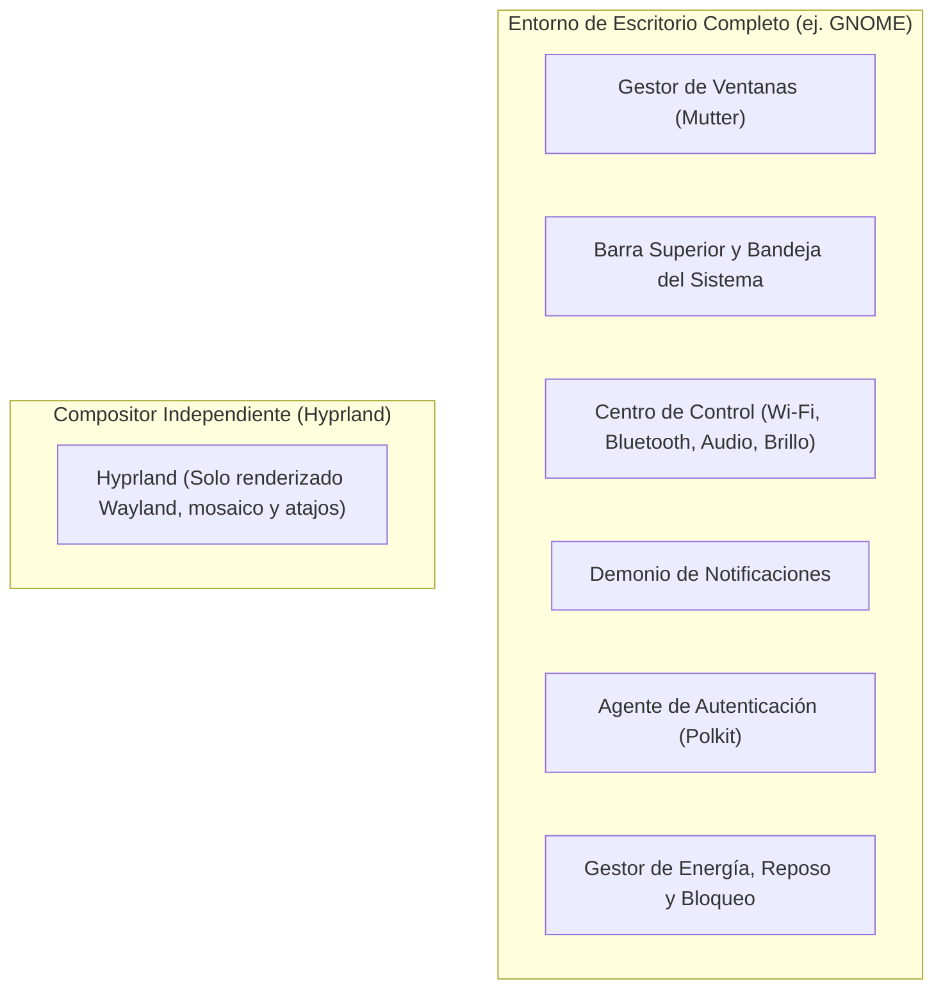

import TerminalWindow from '../../components/TerminalWindow.astro';
import CodeBlockWindow from '../../components/CodeBlockWindow.astro';

Llevo los últimos 7 años que he usado Linux como sistema en el día a día dependiendo de gestores de ventanas flotantes (GNOME, KDE, Cinnamon, etc.). No voy a engañar: he probado todos los que hay, y siempre volvía a GNOME. Es una relación de amor/odio: me gusta cómo se ve, ya que sigue su propio diseño, pero echando en falta la personalización que ofrece KDE al siguiente nivel y por el camino rompiendo GNOME tras cada actualización que dejaba las extensiones disfuncionales.

Después de tantos años llevaba tiempo con una voz en mi cabeza que me decía: *"tiling window"*. He visto muchas, pero que muchas personalizaciones en Reddit (r/unixporn) y ya era hora de dar el salto. Gracias a este cambio tengo justo la interfaz que quiero y como la quiero, pero no ha sido fácil.

---

## Índice de Contenidos

1. [El Detonante: ¿Por qué dejar GNOME?](#1-el-detonante-por-qué-dejar-gnome)
2. [El Choque de Realidad: DE vs. Compositor / Tiling WM](#2-el-choque-de-realidad-de-vs-compositor--tiling-wm)
3. [El Kit de Supervivencia: Armando las piezas del puzzle](#3-el-kit-de-supervivencia-armando-las-piezas-del-puzzle)
4. [Primeros Pasos en Fedora: Instalación, GDM y arranque](#4-primeros-pasos-en-fedora-instalación-gdm-y-arranque)
5. [Domando la Configuración: De .conf a Lua en Hyprland](#5-domando-la-configuración-de-conf-a-lua-en-hyprland)
6. [La Terminal: Kitty, Zsh y las herramientas que uso a diario](#6-la-terminal-kitty-zsh-y-las-herramientas-que-uso-a-diario)
7. [Las Batallas del Día a Día: Los mayores dolores de cabeza](#7-las-batallas-del-día-a-día-los-mayores-dolores-de-cabeza)
8. [La Gestión de Dotfiles: Orden dentro del caos](#8-la-gestión-de-dotfiles-orden-dentro-del-caos)
9. [Adaptación y Memoria Muscular: La primera semana](#9-adaptación-y-memoria-muscular-la-primera-semana)
10. [Conclusiones: ¿Mereció la pena la aventura?](#10-conclusiones-mereció-la-pena-la-aventura)
11. [Capturas de Pantalla](#11-capturas-de-pantalla)

---

## 1. El Detonante: ¿Por qué dejar GNOME?

Creo que la pregunta no es ¿por qué dejar GNOME?, sino ¿por qué dejar de usar gestores de ventanas flotantes? En mi caso han sido tres razones:
1. **Empezar a usar más la terminal:** Los *tiling window managers* se caracterizan por estar orientados al uso intensivo del teclado, por lo cual se tiende a usar mucho más la terminal.
2. **Curiosidad y aprendizaje:** Los gestores tradicionales te lo dan todo hecho; con un *tiling* tienes que pelearte algo más con cada componente del sistema y cada extra que le añadas.
3. **Personalización a mi gusto y medida:** No es que KDE o GNOME no me gusten, pero quería lo mejor de ambos mundos: de parte de GNOME su interfaz limpia que no se parece a Windows, y de parte de KDE, su enorme nivel de personalización.

Con una breve investigación sobre qué *tiling* usar, me lancé a **Hyprland**, que corre sobre Wayland por defecto y es algo que mi gráfica NVIDIA agradece.

---

## 2. El Choque de Realidad: DE vs. Compositor / Tiling WM

Bueno, para quien venga de entornos tradicionales como GNOME, KDE Plasma o de sistemas como Windows y macOS, estamos acostumbrados a que la palabra "escritorio" te lo dé todo hecho. Haces clic en la esquina superior derecha y tienes a mano el selector de volumen, la red Wi-Fi, el Bluetooth, el brillo de la pantalla, la batería y el botón de apagar. Conectas un pendrive y te sale la notificación lista para abrir el explorador de archivos. Si una aplicación te pide permisos de administrador, te salta la ventanita pidiéndote la contraseña.

Todo eso que vemos como algo normal no viene por arte de magia: es lo que se conoce como un **Desktop Environment (DE)** o Entorno de Escritorio, que no es más que un conjunto enorme de programas, servicios y demonios trabajando en segundo plano bajo un mismo diseño.

Pero cuando decides dar el salto a **Hyprland**, lo primero que tienes que tener claro es una diferencia importante: **Hyprland no es un entorno de escritorio completo; es única y exclusivamente un compositor Wayland con gestión de ventanas en mosaico (Tiling Window Manager)**.

Como sé que os gustan los diagramas para ver las cosas claras, os dejo este esquema para entender la diferencia:



Técnicamente hablando, Hyprland se encarga de lo suyo y poco más:
1. **Hablar con el protocolo Wayland y el driver gráfico** para dibujar y renderizar las ventanas aceleradas por hardware.
2. **Capturar las teclas y clics** del teclado y el ratón para mandar la orden a la ventana activa o ejecutar un atajo.
3. **Calcular la posición de las ventanas** para organizarlas automáticamente en mosaico (*tiling*) y que no se solapen, metiendo los bordes, animaciones y desenfoques (*blur*) que tú le digas.

Y ya está, no le pidas más. No sabe qué es el brillo de tu pantalla, no sabe si tienes internet, no gestiona si conectas unos auriculares Bluetooth y no tiene ni la más mínima idea de qué hora es.

### El primer susto al entrar: La pantalla vacía

No os voy a engañar: el primer momento en el que cerré sesión en GNOME tras haber visto capturas chulísimas en Reddit (r/unixporn), me quedé a cuadros. En la pantalla de login (GDM), elegí "Hyprland", metí mi contraseña y entré pensando que vería una interfaz futurista lista para usar.

La pantalla parpadeó un segundo y me encontré con un fondo neutro y un mensaje de texto arriba advirtiendo de que no había archivo de configuración propio.
* Hice clic derecho en el escritorio: **nada**.
* Busqué la barra superior para ver la hora o la batería: **no existía**.
* Le di a las teclas multimedia para subir el volumen: **silencio**.
* Pulsé la tecla `Super` esperando ver las aplicaciones: **no pasaba absolutamente nada**.

En ese momento te entra el sudor frío y piensas: *"¿me acabo de cargar la instalación del sistema?"*. La respuesta es no; simplemente te acabas de chocar con lo que es un *window manager* pelado.

Haciendo una comparación sencilla: usar GNOME es como comprarte un **piso completamente amueblado**. Llegas con las maletas, todo combina y todo funciona desde el minuto uno; eso sí, si pretendes tirar un tabique o cambiar los colores, a los creadores de GNOME no les va a hacer ninguna gracia. 
Instalar Hyprland, en cambio, es como si te dan **el solar con los cimientos de hormigón**: la estructura es la más rápida y moderna que hay, tienes total libertad para hacer lo que quieras, pero los muebles, las puertas, los cables y hasta el interruptor de la luz los tienes que elegir y montar tú mismo, archivo por archivo.

### ¿Por qué meterse en este jaleo?

Visto así, cualquiera pensaría que es complicarse la vida sin necesidad. Pero en mi caso había dos motivos claros:
* **Hacerlo todo con el teclado:** En un entorno *tiling* dejas de perder el tiempo arrastrando esquinas de ventanas con el ratón o buscando iconos minimizados. Abrir una terminal, partir la pantalla por la mitad o moverte entre 10 escritorios virtuales se convierte en memoria muscular inmediata.
* **Cero procesos fantasma y control total:** En un entorno tradicional tienes decenas de servicios comiendo recursos en segundo plano por si acaso algún día los usas. En Hyprland cada demonio, script y megabyte de memoria que corre en la máquina está ahí porque tú lo has puesto conscientemente.

Eso sí, para llegar a ese punto, primero toca reunir y configurar todas las piezas que sustituyen lo que GNOME te daba hecho.

---

## 3. El Kit de Supervivencia: Armando las piezas del puzzle

Para tener un sistema usable en el día a día, fue necesario buscar y configurar una alternativa para cada componente del escritorio:

| Necesidad | En GNOME | En mi setup de Hyprland |
| :--- | :--- | :--- |
| **Barra de estado** | GNOME Top Bar | Waybar (base de [HANCORE-linux/waybar-themes](https://github.com/HANCORE-linux/waybar-themes)) |
| **Lanzador de apps** | GNOME App Grid | Rofi-wayland (temas de [adi1090x/rofi](https://github.com/adi1090x/rofi)) |
| **Notificaciones** | GNOME Notification Center | SwayNC |
| **Fondo de pantalla** | Ajustes de GNOME | Hyprpaper  |
| **Bloqueo / Idle** | GDM / Lockscreen nativo | Hyprlock + Hypridle |
| **Terminal** | GNOME Terminal / Ptyxis | Kitty  |
| **Capturas y Pantalla** | Captura integrada de GNOME | Grim + Slurp + Swappy |
| **Portapapeles** | Clipboard nativo | wl-clipboard + cliphist |
| **Gestión de Red / BT** | Quick Settings | nmtui / blueman |
| **Explorador de archivos** | Nautilus | Yazi |


---

## 4. Primeros Pasos en Fedora: Instalación, GDM y arranque

Aquí no os voy a engañar: en mi primera instalación fui a lo fácil. Hay proyectos que te instalan ya todo y te lo personalizan; yo usé en un primer momento [ML4W](https://www.ml4w.com/), que tiene un instalador para Fedora. 
Por lo que sea, este no me terminó de convencer, ya fuera por los colores, las utilidades que me incluía o porque a fin de cuentas no lo había creado yo desde cero y eso no me daba todo el control. Al final reinstalé Fedora, aunque me dejé archivos residuales que en parte he aprovechado en la instalación que tengo ahora.

Mi siguiente paso fue instalar Hyprland sin scripts ni utilidades. En Fedora no está en los repositorios principales, sino que tendremos que recurrir a un repositorio *COPR*:

<TerminalWindow title="user@fedora:~$ Instalando Hyprland y utilidades">
```bash
# Ejemplo: instalación de Hyprland y herramientas base en Fedora
sudo dnf copr enable lionheartp/Hyprland -y 
sudo dnf install hyprland waybar rofi-wayland kitty grim slurp wl-clipboard
```
</TerminalWindow>

El primer inicio con archivos residuales fue un caos: archivos rotos, dependencias faltantes y herramientas que no respondían. Por suerte instalé Fedora con GNOME: no es que lo use a diario, pero si un día algo se rompe tengo un DE de rescate.
Ya de ahí seguí los pasos de desinstalación de ML4W para limpiar los paquetes que sobraban. 

El primer inicio de Hyprland te recibe con un aviso de que se ha generado un fichero con una configuración básica: sin barra de estado y sin lanzador. Toca buscar los atajos de teclado para lanzar la sagrada terminal: la tecla clave es **SUPER** (la del icono de Windows). Con **SUPER** + otra tecla se ejecutan los atajos de teclado; esto se puede cambiar, pero ya que tengo una tecla inútil con el símbolo de Windows, mejor usarla para algo provechoso. La terminal en mi caso se lanzaba con `SUPER + Q`.

Una vez tenemos una terminal abierta, ya podemos pasar a los siguientes pasos, que consisten en tocar cientos de archivos de configuración.

### 4.1 Reutilizando GDM: El Inicio de Sesión de GNOME como Salvavidas

Muchos usuarios, al migrar a un tiling WM, se obsesionan con cambiar de inmediato su gestor de pantalla (*Display Manager*) e instalar alternativas minimalistas como SDDM, Ly o Greetd. En mi caso decidí una estrategia mucho más práctica y segura: **mantener y reutilizar GDM (GNOME Display Manager)**.

¿Por qué es una gran idea conservar el login de GNOME?
1. **Detección nativa de Wayland:** GDM en Fedora reconoce automáticamente las sesiones instaladas en `/usr/share/wayland-sessions/`, entre ellas `hyprland.desktop`. En la esquina inferior de la pantalla de bienvenida solo tienes que pulsar la rueda dentada y seleccionar Hyprland.
2. **Desbloqueo transparente de credenciales:** GNOME Keyring se desbloquea al iniciar sesión con tu contraseña habitual, ahorrándote pop-ups molestos de permisos al abrir navegadores o clientes SSH.
3. **El salvavidas definitivo:** Cuando estás tocando configuraciones avanzadas, drivers propietarios de NVIDIA o scripts de Lua, es fácil cometer un error sintáctico que impida arrancar el compositor. Si eso ocurre, no tienes que lidiar a ciegas en una consola TTY: cierras sesión, seleccionas "GNOME" en GDM y entras a tu escritorio tradicional con interfaz gráfica para abrir un editor y reparar tus archivos con total tranquilidad.

---

## 5. Domando la Configuración: De .conf a Lua en Hyprland

El corazón de toda la experiencia. Tradicionalmente, Hyprland se configuraba mediante su propia sintaxis declarativa (`hyprlang` en `hyprland.conf`). Sin embargo, tras desinstalar el instalador guiado de ML4W para entender mi sistema tornillo a tornillo, decidí aprovechar la modernización de Hyprland (0.55+) y saltar a su configuración nativa en **Lua** (`~/.config/hypr/hyprland.lua`).

Configurar el compositor en un lenguaje de programación real como Lua te da superpoderes: estructuras limpias, funciones directas a la API del compositor (`hl.*`), bucles interactivos para autogenerar atajos y la tranquilidad de no depender de parsers rígidos.

### 5.1 Configuración de Monitores y Tasa de Refresco

En mi caso trabajo con un portátil conectado habitualmente a un monitor externo secundario. Con `hl.monitor`, defino la pantalla integrada (`eDP-1`) en la posición inicial y dejo que Hyprland ubique automáticamente el monitor HDMI externo a la derecha (`auto-right`), respetando la resolución nativa de cada panel:

<CodeBlockWindow title="~/.config/hypr/hyprland.lua (Monitores)">
```lua
------------------
---- MONITORS ----
------------------
-- Pantalla integrada del portátil
hl.monitor({
    output = "eDP-1",
    mode = "preferred",
    position = "0x0",
    scale = "auto",
})

-- Monitor externo HDMI situado a la derecha
hl.monitor({
    output = "HDMI-A-1",
    mode = "preferred",
    position = "auto-right",
    scale = "auto",
})
```
</CodeBlockWindow>

### 5.2 Atajos Clave y Flujo de Trabajo (Keybinds)

El salto a un *tiling* se sostiene o se cae por sus atajos de teclado. Todo gira en torno a la tecla `SUPER` (la tecla Windows). Aquí la ventaja de Lua brilla con luz propia: en lugar de escribir 20 líneas manuales para cambiar y mover ventanas entre los 10 espacios de trabajo, se resuelve con un bucle `for` de 5 líneas:

Yo por costumbre cambié los atajos de teclado rápidamente, ya que para mí `SUPER + Q` me sonaba más a cerrar ventanas. El resto es cuestión de ir acostumbrándose a usarlo: es todo memoria muscular.

Para el menú y lanzador de aplicaciones (`SUPER + CTRL + Return`), en lugar de empezar una plantilla de Rofi desde cero, utilicé una colección de temas de [adi1090x/rofi](https://github.com/adi1090x/rofi) (en concreto el script `launchers/type-1/launcher.sh`), que cuenta con diseños limpios y modernos fáciles de adaptar al resto del entorno.

<CodeBlockWindow title="~/.config/hypr/hyprland.lua (Atajos clave)">
```lua
---------------------
---- KEYBINDINGS ----
---------------------
local mainMod = "SUPER" -- Aquí podemos cambiar la tecla principal de los atajos
local terminal = "kitty"
local fileManager = "dolphin"
local menu = "~/.config/rofi/launchers/type-1/launcher.sh"

-- Lanzadores y gestión de ventanas
hl.bind(mainMod .. " + Return", hl.dsp.exec_cmd(terminal)) -- SUPER + RETURN(enter) = Abre Terminal
hl.bind(mainMod .. " + E", hl.dsp.exec_cmd(fileManager)) -- SUPER + E = Explorador de archivos
hl.bind(mainMod .. " + CTRL + Return", hl.dsp.exec_cmd(menu)) -- SUPER + CRTL + RETURN = Abre el launcher 
hl.bind(mainMod .. " + Q", hl.dsp.window.close()) -- SUPER + Q = Cierra ventana
hl.bind(mainMod .. " + F", hl.dsp.window.fullscreen()) -- SUPER + F = FullScreen
hl.bind(mainMod .. " + V", hl.dsp.window.float({ action = "toggle" })) -- SUPER + V = Pone la ventana en flotante
hl.bind(mainMod .. " + L", hl.dsp.exec_cmd("hyprlock")) -- SUPER + L = Bloqueo de pantalla

-- Gestor de archivos TUI en ventana dedicada de Kitty
hl.bind(mainMod .. " + Y", hl.dsp.exec_cmd(terminal .. " --title yazi -e yazi")) -- SUPER + Y 

-- Historial del portapapeles mediante Cliphist + Rofi
hl.bind(mainMod .. " + V", hl.dsp.exec_cmd("cliphist list | rofi -dmenu | cliphist decode | wl-copy")) -- SUPER + V

-- Capturas de pantalla interactivas con Hyprshot
hl.bind(mainMod .. " + PRINT", hl.dsp.exec_cmd("hyprshot -m region")) -- SUPER + PRINT = Captura de región y la guarda en archivos
hl.bind(mainMod .. " + SHIFT + PRINT", hl.dsp.exec_cmd("hyprshot -m region --clipboard-only")) -- SUPER + SHIFT + PRINT = Captura región y al portapapeles

-- Bucle dinámico en Lua para los 10 workspaces (SUPER + 1..0 y SUPER + SHIFT + 1..0)
for i = 1, 10 do
    local key = i % 10
    hl.bind(mainMod .. " + " .. key, hl.dsp.focus({ workspace = i })) -- SUPER + {1..10} = Cambia de espacio de trabajo 
    hl.bind(mainMod .. " + SHIFT + " .. key, hl.dsp.window.move({ workspace = i })) -- SUPER + SHIFT + {1..10} = Mueve ventanas a ese espacio de trabajo
end
```
</CodeBlockWindow>

### 5.3 Estética: Catppuccin Mocha, Bordes y Curvas Bézier

En cuanto a la estética, opté por la icónica paleta **Catppuccin Mocha**. Para los bordes de la ventana activa, en lugar de un color plano aburrido, configuré un degradado suave combinando **Catppuccin Blue** (`#89b4fa`) y **Mauve** (`#cba6f7`), manteniendo los bordes inactivos en un tono sutil translúcido.

En esto cada uno tiene sus propios gustos y colores favoritos: a mí personalmente me gustan los tonos azules y morados oscuros, pero es cuestión de ir probando para ver qué es lo que más encaja contigo.
<CodeBlockWindow title="~/.config/hypr/hyprland.lua (Apariencia y Colores)">
```lua
-----------------------
---- LOOK AND FEEL ----
-----------------------
hl.config({
    general = {
        gaps_in = 4,
        gaps_out = 10,
        border_size = 2,
        col = {
            -- Degradado a 45º Blue -> Mauve
            active_border = { colors = { "rgba(89b4faee)", "rgba(cba6f7ee)" }, angle = 45 },
            inactive_border = "rgba(595959aa)",
        },
        layout = "dwindle",
    },
    decoration = {
        rounding = 10,
        rounding_power = 2,
        active_opacity = 1.0,
        inactive_opacity = 0.95,
        shadow = {
            enabled = true,
            range = 4,
            render_power = 3,
            color = 0xee1a1a1a,
        },
        blur = {
            enabled = true,
            size = 3,
            passes = 2,
            vibrancy = 0.17,
        },
    },
    animations = {
        enabled = true,
        bezier = {
            { name = "wind",  cp = { 0.05, 0.9, 0.1, 1.05 } },
            { name = "winIn", cp = { 0.1, 1.1, 0.1, 1.1 } },
            { name = "winOut",cp = { 0.3, -0.3, 0, 1 } },
            { name = "liner", cp = { 0, 0, 1, 1 } },
        },
        animation = {
            "windows, 1, 4, wind, slide",
            "windowsIn, 1, 4, winIn, slide",
            "windowsOut, 1, 3, winOut, slide",
            "border, 1, 1, liner",
            "fade, 1, 4, default",
            "workspaces, 1, 3, wind, slide",
        },
    },
})
```
</CodeBlockWindow>

Y para coronar la interfaz, en **Waybar** tampoco empecé de una hoja en blanco: tomé como base y punto de partida los temas del repositorio [HANCORE-linux/waybar-themes](https://github.com/HANCORE-linux/waybar-themes). A partir de esa plantilla fui reorganizando los módulos por grupos (`group/center4`, `group/center3`, etc.), integrando mis propios scripts (como `tuned.sh` para el perfil de energía) y ajustando el archivo `style.css` para aplicar mi paleta **Catppuccin Mocha**, con bordes redondeados flotantes, fondo Catppuccin Base (`#1e1e2e`), texto en `#cdd6f4` y tipografía `JetBrainsMono Nerd Font Propo`:

<CodeBlockWindow title="~/.config/waybar/style.css (Paleta Catppuccin Mocha)">
```css
/* Catppuccin Mocha Palette */
@define-color base         #1e1e2e;
@define-color mantle       #181825;
@define-color crust        #11111b;
@define-color text         #cdd6f4;
@define-color mauve        #cba6f7;
@define-color blue         #89b4fa;
@define-color red          #f38ba8;
@define-color peach        #fab387;

/* Variables de entorno semánticas */
@define-color background   #1e1e2e;
@define-color foreground   #cdd6f4;
@define-color primary      #cba6f7;
@define-color accent       #89b4fa;

* {
  font-family: 'JetBrainsMono Nerd Font Propo';
  font-size: 11px;
}

#workspaces {
  border-radius: 11px;
  background-color: @background;
}
```
</CodeBlockWindow>

El bloqueo de pantalla no se queda atrás: en `~/.config/hypr/hyprlock.conf`, le tengo puesto que haga una captura de lo que tengo abierto (`screenshot`), le meta 3 pases de desenfoque gaussian para que no se lea nada privado, y pinte la hora digital en grande con `JetBrainsMono Bold` y el cuadro de contraseña en morado (`#cba6f7`).

### 5.4 Waybar: Mi menú de accesos rápidos (Quickapps)

Aunque en un *tiling* lo suyo es usar atajos de teclado para casi todo, hay momentos en los que da pereza, y más para las aplicaciones que más uso en mi día a día.

Para esos momentos, me creé en `~/.config/waybar/config.jsonc` un módulo propio llamado `group/quickapps`. Lo puse justo en el centro de la barra con iconos vectoriales de Nerd Font (``, `󰨞`, ``, etc.) para tener a golpe de un solo clic las 7 cosas que más abro a diario:

<CodeBlockWindow title="~/.config/waybar/config.jsonc (Módulo Quickapps)">
```jsonc
"group/quickapps": {
  "orientation": "horizontal",
  "modules": [
    "custom/app-chromium",
    "custom/app-code",
    "custom/app-feishin",
    "custom/app-obsidian",
    "custom/app-podman",
    "custom/app-kitty",
    "custom/app-lmstudio"
  ]
},

"custom/app-chromium": {
  "format": "",
  "tooltip": true,
  "tooltip-format": "Chromium",
  "on-click": "chromium-browser"
},
"custom/app-code": {
  "format": "󰨞",
  "tooltip": true,
  "tooltip-format": "VS Code",
  "on-click": "code"
},
"custom/app-feishin": {
  "format": "",
  "tooltip": true,
  "tooltip-format": "Feishin",
  "on-click": "flatpak run org.feishin.Feishin"
}
```
</CodeBlockWindow>

Así tengo Chromium (navegador), VS Code (para picar código), Feishin (el reproductor conectado a mi servidor de música Navidrome), Obsidian (notas y apuntes), Podman (para contenedores locales), Kitty y LM Studio (para cacharrear con modelos de IA en local) siempre a mano sin ocupar espacio de más.

---

## 6. La Terminal: Kitty, Zsh y las herramientas que uso a diario

En un gestor de ventanas en mosaico la terminal pasa a ser la reina de la casa: es donde vas a pasar el 80% del tiempo. Por eso quise dejarla bien montada y a mi gusto.

### 6.1 Kitty: Aceleración por GPU y buen rendimiento
Como emulador de terminal elegí **Kitty**. Al usar la gráfica (OpenGL) para renderizar el texto, la fluidez y respuesta son inmediatas frente a terminales tradicionales:

* **Fuente:** `JetBrainsMono Nerd Font` a tamaño 12, con soporte para ligaduras e iconos.
* **Transparencia:** `background_opacity 0.7` dinámica, para que se intuya el fondo de pantalla desenfocado sin perder legibilidad.
* **Limpia y sin bordes:** `hide_window_decorations yes` para quitar barras de título feas, con un margen interior de 10 píxeles (`window_padding_width 10`).
* **Estela en el cursor:** Un detalle visual que me encanta (`kitty-cursor-trail.conf`) que hace que una estela animada siga al cursor de texto cuando te mueves.

### 6.2 Zsh y cómo organizo los archivos
La organización de mi `.zshrc` es algo que arrastro de los archivos de ML4W: me gustaba su forma de tenerlo todo dividido en pequeños archivos sueltos dentro de `~/.config/zshrc/`, así que decidí mantenerlo:
- `00-init`: Las variables básicas del sistema como el editor (`EDITOR=nano` o `nvim`) y los PATHs locales y de Cargo.
- `20-customization`: Plugins de Oh My Zsh, prompts y motores de autocompletado.
- `25-aliases`: Todos los alias cortos que uso para no escribir comandos largos a diario.
- `30-autostart`: Scripts interactivos de bienvenida y funciones auxiliares.

De plugins de **Oh My Zsh** llevo los que de verdad me ahorran tiempo: `git`, `sudo` (pulsas Escape dos veces y te añade sudo al comando anterior), `zsh-autosuggestions` (te va sugiriendo comandos según escribes), `fast-syntax-highlighting` (te pinta el comando en verde si existe o en rojo si te has equivocado), `dirhistory` y los plugins de `docker` y `podman`.

### 6.3 Las utilidades CLI que me salvan la vida
Aquí es donde entran un puñado de herramientas modernas que dejan en pañales a los comandos clásicos de Unix:

1. **Atuin (`eval "$(atuin init zsh)"`):** Para mí es imprescindible. Cambia el tosco historial plano de la terminal por una base de datos SQLite indexada. Cuando pulsas la flecha arriba o `Ctrl+R`, se abre un menú interactivo donde puedes buscar comandos por fecha, por la carpeta donde los tiraste o ver si terminaron con error.
2. **Zoxide (`z`):** Olvídate de hacer `cd ../../carpeta/otra`. Zoxide aprende de memoria las carpetas a las que más entras; si quiero ir a mi blog, simplemente escribo `z blog` y salta directo esté donde esté.
3. **FZF (`source <(fzf --zsh)`):** Para buscar archivos o comandos al vuelo con búsqueda difusa en un parpadeo.
4. **Eza:** El sustituto moderno de `ls`. Lo tengo configurado con mis tres alias de siempre:
   ```bash
   alias ls='eza -a --icons=always'
   alias ll='eza -al --icons=always'
   alias lt='eza -a --tree --level=1 --icons=always'
   ```
   Te muestra iconos vectoriales según la extensión, colores claros para los permisos y árbol de carpetas limpio.
5. **Fastfetch con imagen:** Al abrir cada terminal interactiva, un script elige una imagen aleatoria de mi carpeta `~/.termicon` y la dibuja en alta definición directamente en Kitty gracias a su protocolo gráfico (`fastfetch --logo-type kitty --logo "$img"`), junto con la información de la máquina.
6. **Oh-My-Posh con tema Zen:** El prompt te muestra la rama de Git en la que estás, si hay cambios sin guardar y el tiempo que tardó el comando anterior, sin meter lag ni ralentizar la terminal.


La terminal es una de las herramientas que más uso a diario, y fue una de las razones principales para pasarme a un *tiling*: obligarme a usar más la línea de comandos y depender menos de interfaces gráficas. Por ello, prefiero hacerme la vida más fácil con utilidades como estas. En un futuro post enseñaré más a fondo cómo personalizar la terminal de esta manera.

---

## 7. Las Batallas del Día a Día: Los mayores dolores de cabeza

Toda aventura tiene sus problemas. En un sistema que viene vacío, hacer que todo funcione como en un escritorio comercial tiene su miga:

### 7.1 Aplicaciones Electron, Chromium y Gráfica NVIDIA en Wayland
El primer gran bache: programas como Google Chrome, Discord, VS Code o Spotify arrancando a través de la capa **XWayland**. El resultado es el de siempre: fuentes borrosas si tienes escalado en la pantalla, pequeños tirones al hacer scroll y mala sincronización con gráficas NVIDIA.

Para obligar a Electron y Chromium a renderizar en Wayland de forma nativa, la solución limpia es meter estos dos archivos en `~/.config/` (`electron-flags.conf` y `chromium-flags.conf`):

<CodeBlockWindow title="~/.config/electron-flags.conf & chromium-flags.conf">
```text
--ozone-platform-hint=auto
--enable-features=WaylandWindowDecorations
```
</CodeBlockWindow>

Y en `hyprland.lua` es indispensable exportar las variables de NVIDIA para que el driver se entienda bien con el compositor:

```lua
hl.env("LIBVA_DRIVER_NAME", "nvidia")
hl.env("GBM_BACKEND", "nvidia-drm")
hl.env("__GLX_VENDOR_LIBRARY_NAME", "nvidia")
hl.env("NVD_BACKEND", "direct")
```

(Y con todo esto alguna ventana Electron se sigue viendo borrosa de vez en cuando, pero es el peaje que toca pagar a día de hoy).

### 7.2 Compartir Pantalla y XDG Desktop Portal
El clásico susto: vas a compartir pantalla en Google Meet, Discord o Slack y la otra persona solo ve una pantalla negra o el navegador se te cierra de golpe.

La clave está en tener bien instalados y limpios los portales:
- `xdg-desktop-portal-hyprland`: para las capturas de ventanas y monitores nativos de Hyprland vía Pipewire.
- `xdg-desktop-portal-gtk`: para los cuadros de diálogo típicos de abrir y guardar archivos en aplicaciones GTK.

Para capturar pantalla rápido me instalé `hyprshot` (que por debajo usa `grim` y `slurp`), y le até dos atajos:
- `SUPER + PRINT`: Seleccionas con el ratón el trozo de pantalla que quieres y te lo guarda en un archivo.
- `SUPER + SHIFT + PRINT`: Lo mismo, pero directo al portapapeles para pegarlo en Telegram o Discord al vuelo.

### 7.3 Control de Audio, Brillo y Teclas Multimedia con OSD
Al pulsar las teclas de volumen o brillo en el portátil, en GNOME te sale una barrita visual en pantalla. En Hyprland no sale nada de nada.

Para no quedarme a oscuras tocando el volumen, le metí **SwayOSD** (`swayosd-client`), enlazándolo a las teclas en `hyprland.lua`. Así cada vez que toco el volumen o el brillo me sale una barrita flotante limpia y moderna.

Para la música de fondo utilizo `playerctl`, que me permite pausar o pasar de canción con las teclas multimedia sin tener que buscar la ventana donde esté sonando la música.

Y como extra, me hice un módulo en Waybar para conmutar perfiles de rendimiento (`tuned-adm`) entre ahorro, balanceado o máximo rendimiento, añadiendo una regla en `/etc/sudoers.d/99-tuned-waybar` para poder cambiar de modo con un clic sin tener que meter la contraseña de root cada vez.

### 7.4 El dilema del explorador de archivos y las contraseñas (Polkit)
¿Alguna vez has intentado formatear un pendrive, conectar una Wi-Fi o abrir una utilidad de administración y la aplicación se queda congelada sin hacer nada?

El motivo es que falta el **Agente Polkit** (el que levanta la ventanita gráfica para pedirte la contraseña de root). En GNOME viene integrado de serie, pero en Hyprland hay que lanzarlo en el arranque. En mi `hyprland.lua` lo arranco así:

```lua
hl.on("hyprland.start", function()
    -- Agente de autenticación para permisos elevados
    hl.exec_cmd("/usr/libexec/polkit-gnome-authentication-agent-1")
    hl.exec_cmd("waybar")
    hl.exec_cmd("hypridle")
    hl.exec_cmd("dunst")
    hl.exec_cmd("copyq --start-server")
    hl.exec_cmd("wl-paste --type text --watch cliphist store")
end)
```

Para navegar por carpetas combino lo mejor de dos mundos: **Dolphin** para cuando quiero mover archivos pesados entre discos con el ratón (`SUPER + E`), y **Yazi** en una terminal Kitty (`SUPER + Y`) para moverme por las carpetas a toda pastilla con el teclado.

---

## 8. La Gestión de Dotfiles: Orden dentro del caos

Después de invertir horas ajustando cada margen, color y regla de ventana, lo peor que puedes hacer es dejar esas configuraciones sin guardar. Si mañana reinstalas el sistema o un disco falla, volver a configurarlo todo de memoria es un dolor de cabeza.

Yo no uso programas con enlaces simbólicos raros tipo GNU Stow; gestiono mis dotfiles directamente con un **repositorio Git Bare** en `~/.dotfiles`. Todo el código, scripts y configuraciones los tengo subidos y públicos en mi repositorio de GitHub: [**github.com/jrodriiguezg/dotfiles**](https://github.com/jrodriiguezg/dotfiles).

### La ventaja del Git Bare
Con un repositorio bare tratas tu `$HOME` directamente como el directorio de trabajo (*work tree*), sin tener que mover carpetas a sitios raros ni crear enlaces simbólicos:

<TerminalWindow title="user@fedora:~$ Configuración del alias dotfiles">
```bash
# Inicializar o clonar el repositorio bare
git clone --bare git@github.com:jrodriiguezg/dotfiles.git $HOME/.dotfiles

# Alias para interactuar con tus configuraciones desde cualquier parte
alias dotfiles='/usr/bin/git --git-dir=$HOME/.dotfiles/ --work-tree=$HOME'

# Evitar que git marque todos los archivos del HOME como sin seguimiento
dotfiles config --local status.showUntrackedFiles no

# A partir de aquí, funciona como un git normal:
dotfiles status
dotfiles add .config/hypr/hyprland.lua
dotfiles commit -m "feat: ajustar degradado de bordes catppuccin"
dotfiles push
```
</TerminalWindow>

### Estructura real del entorno
Así queda organizado todo el ecosistema de configuración dentro de mi máquina:

<TerminalWindow title="user@fedora:~/.config">
```bash
~/.dotfiles (Repositorio bare central)
~/.config/
├── hypr/
│   ├── hyprland.lua          # Compositor principal en Lua
│   ├── hyprlock.conf         # Pantalla de bloqueo con blur
│   ├── hypridle.conf         # Tiempos de reposo y apagado de monitor
│   ├── hyprpaper.conf        # Fondos de pantalla
│   └── wallpapers/           # Wallpapers en alta resolución
├── waybar/
│   ├── config.jsonc          # Módulos agrupados (CPU, batería, tuned, audio)
│   ├── style.css             # Tema Catppuccin Mocha completo
│   └── scripts/              # Scripts personalizados (tuned, window, clock)
├── electron-flags.conf       # Wayland nativo para Discord/VSCode
├── chromium-flags.conf       # Wayland nativo para Chromium/Chrome
└── .dotfiles/
    └── install_dots.sh       # Script de despliegue y aprovisionamiento automático
```
</TerminalWindow>

Para automatizar la puesta a punto de un equipo nuevo en Fedora, mantengo el script `install_dots.sh`, que se encarga de habilitar los repositorios COPR (incluyendo el kernel optimizado CachyOS y el planificador `ananicy-cpp`), instalar todos los paquetes y utilidades de Wayland, respaldar automáticamente cualquier archivo en conflicto en una carpeta temporal con fecha (`~/.dotfiles-backup-YYYYMMDDHHMMSS`) y aplicar las reglas de sudoers necesarias. Este script está pensado para mí y no pretendo que nadie lo use a ciegas, pero es mi método rápido y fiable para volver a tenerlo todo a mi gusto si reinstalo el sistema.

---

## 9. Adaptación y Memoria Muscular: La primera semana

No os voy a mentir: los primeros tres días son horribles; quizás sí que hay que ser un poco masoquista para meterse en esto voluntariamente.

El cerebro tiene grabado a fuego el reflejo de mover la mano hacia el ratón en cuanto se abre una ventana, o mirar instintivamente a la esquina superior derecha de la pantalla para buscar el reloj o el control de volumen. Con un *tiling WM* recién instalado, te sorprendes a ti mismo buscando un botón de minimizar o cerrar que simplemente no existe.

Pero hacia el cuarto o quinto día ocurre el clic:
* ¿Quieres consultar documentación mientras programas? `SUPER + Return`, se abre Kitty dividiendo el monitor verticalmente con proporción perfecta.
* ¿Necesitas revisar un archivo de configuración rápido? `SUPER + Y`, se lanza Yazi en TUI, seleccionas el archivo y lo abres en un pestañeo.
* ¿Copiaste un trozo de texto hace un rato? `SUPER + V`, surge Rofi filtrando el historial de `cliphist` y con un Enter lo pegas donde quieras.
* ¿El espacio se llena? `SUPER + 2`, saltas al segundo espacio de trabajo limpio, o te llevas la ventana contigo con `SUPER + SHIFT + 2`.

(Aunque aún me lío con los atajos, alguna pestaña he cerrado por querer abrir una terminal).

---

## 10. Conclusiones: ¿Mereció la pena la aventura?

El balance tras semanas de uso intensivo es rotundamente positivo. Dar el salto de GNOME a Hyprland tiene su miga y no es un camino exento de fricción: exige paciencia, ganas de investigar por qué una aplicación no arranca o por qué una tecla no responde, y la disposición a crear tu propio escritorio pieza a pieza.

### Lo que he ganado:
* **Fluidez y rendimiento absoluto:** Respuesta instantánea, cero caídas de frames en animaciones y consumo mínimo de recursos en segundo plano.
* **Tenerlo justo como me gusta:** Con una paleta armónica (Catppuccin Mocha) que une terminal, barra, bordes y ventanas en un diseño unificado y propio.
* **Velocidad de trabajo:** El flujo de navegación mediante teclado reduce drásticamente las distracciones y el tiempo perdido redimensionando ventanas.
* **Aprender cómo funciona Linux por dentro:** Entender cómo interactúan Wayland, los portales XDG, Pipewire, D-Bus y los agentes Polkit te da un control total sobre tu sistema.

### La parte mala:
* **El tiempo de configuración inicial:** Tienes que dedicarle tardes enteras a afinar scripts, atajos y archivos CSS.
* **Mantenimiento ocasional:** Estar atento a cambios en versiones del compositor o del protocolo Wayland.

Si queréis ver todas las configuraciones al detalle, los temas, los scripts de Waybar o el instalador para Fedora, tenéis todo mi repositorio disponible en GitHub:
👉 [**jrodriiguezg/dotfiles en GitHub**](https://github.com/jrodriiguezg/dotfiles)

---

## 11. Capturas de pantalla

Para que podáis ver en acción cómo ha quedado todo el entorno integrado y funcionando en el día a día, os dejo aquí unas capturas reales del setup:

### 1. Ventanas divididas (Tiling simétrico)
Aquí tenemos dos ventanas divididas, que es lo común y característico del *tiling window manager*: ventanas divididas de forma simétrica aprovechando cada píxel de la pantalla sin solapamientos.


### 2. Waybar personalizada con barra de aplicaciones
Mi barra de Waybar con el tema retocado a mi gusto, la integración de Catppuccin Mocha y la barra central de apps con accesos directos a mis programas más usados (`group/quickapps`).


### 3. Lanzador Rofi
El menú lanzador con Rofi (personalizado a partir del repositorio de adi1090x), configurado para mostrar las aplicaciones más usadas al principio para abrirlas en un segundo con el teclado.


### 4. Espacio de trabajo habitual
Un espacio de trabajo normal y corriente en mi día a día: Visual Studio Code abierto a pantalla completa redactando este mismo artículo para el blog.


### 5. La terminal Kitty con Fastfetch
Mi terminal Kitty ejecutando Fastfetch con la imagen renderizada en alta resolución mediante el protocolo gráfico de Kitty, el prompt Oh-My-Posh y la estética de Catppuccin Mocha.


> [!TIP]
> Si estáis pensando en dar el paso hacia Hyprland en vuestra distribución habitual, **no borréis vuestro entorno actual de golpe**. Mantened GNOME o KDE instalado como salvavidas en la pantalla de inicio de sesión mientras construís y probáis vuestros dotfiles poco a poco. Cuando vuestra configuración esté madura, os daréis cuenta de que ya no volveréis a entrar en vuestro antiguo escritorio.

