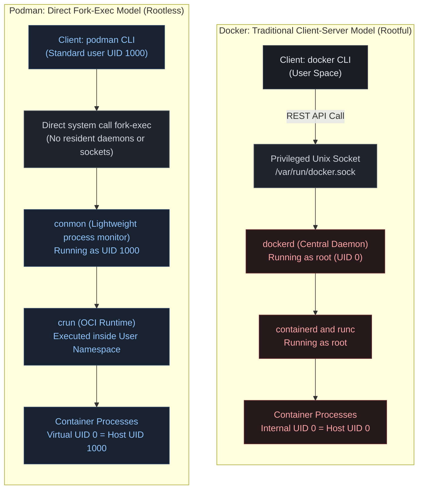
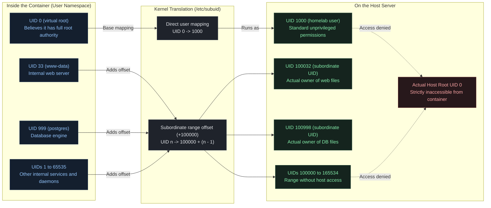
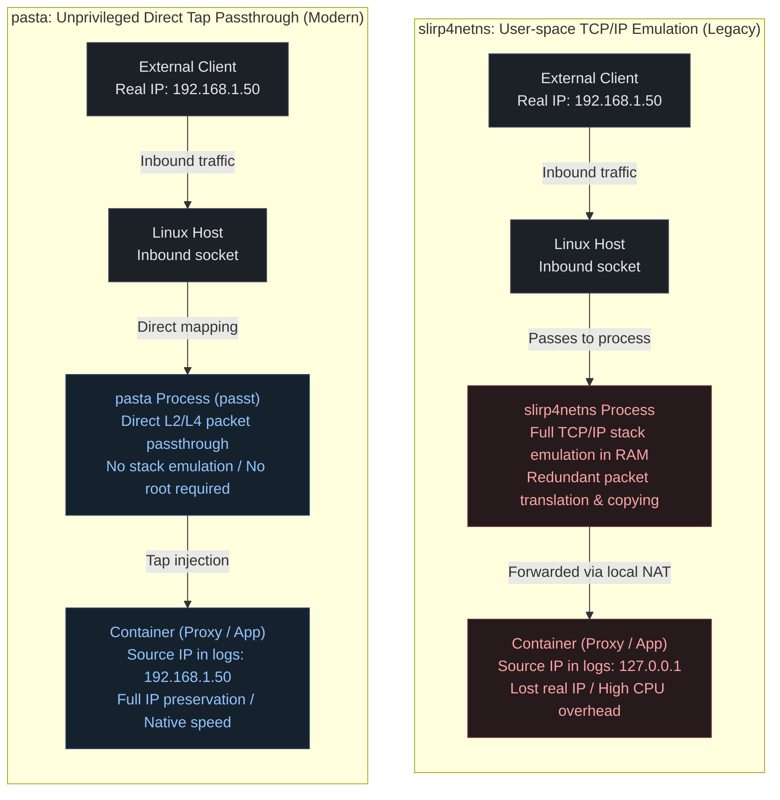
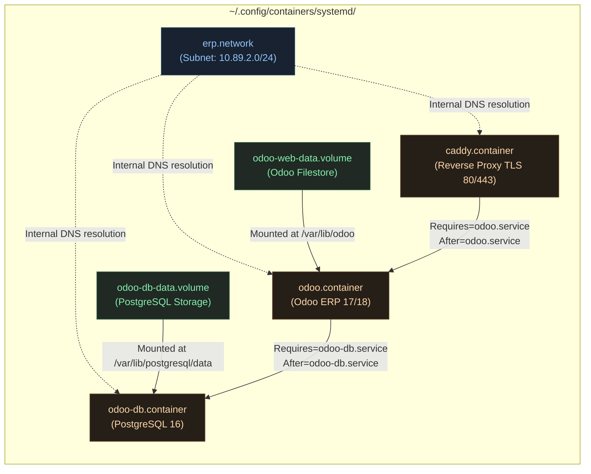

import TerminalWindow from '../../../components/TerminalWindow.astro';
import CodeBlockWindow from '../../../components/CodeBlockWindow.astro';

---

## Table of Contents

1. [Introduction](#introduction)
2. [Prerequisites](#prerequisites)
3. [1. The Hidden Risks of the Docker Socket Running as Root](#1-the-hidden-risks-of-the-docker-socket-running-as-root)
4. [2. Configuring Podman Rootless: subuid, subgid, and Network Permissions](#2-configuring-podman-rootless-subuid-subgid-and-network-permissions)
5. [3. Migrating Docker Compose Stacks to Podman Quadlets and systemd](#3-migrating-docker-compose-stacks-to-podman-quadlets-and-systemd)
6. [4. Lifecycle Management as a Native User Service](#4-lifecycle-management-as-a-native-user-service)
7. [5. Docker vs Podman Rootless: Comparison Table and Decision Matrix](#5-docker-vs-podman-rootless-comparison-table-and-decision-matrix)
8. [6. My Personal Experience in the Homelab](#6-my-personal-experience-in-the-homelab)
9. [7. Common Issues and Practical Troubleshooting](#7-common-issues-and-practical-troubleshooting)
10. [8. Conclusion and Next Steps](#8-conclusion-and-next-steps)

---

## Introduction

Has this ever happened to you when running a Docker command without `sudo`?

<TerminalWindow title="docker compose up -d">
```bash
Got permission denied while trying to connect to the Docker daemon socket at unix:///var/run/docker.sock
```
</TerminalWindow>

Sure it has—we have all been there. And chances are you did the exact same thing I did: copy the very first command you found on Google or that an AI suggested (`sudo usermod -aG docker $USER`), log out, log back in (or run `newgrp docker`), and get on with your day. Problem solved, right?

Well, not quite. What we just did, without realizing it, was hand our user account the exact security equivalent of passwordless `root` access over the entire system. In this article, we will examine why this happens, the real-world security risks it introduces, and how you can run containers securely without giving away the keys to the kingdom.

### The Starting Point: A False Sense of Isolation

When we first start deploying services in a homelab or business, Docker feels like pure magic. With a single `docker compose up -d`, we spin up a complete stack featuring **Nextcloud**, **Pi-hole**, a reverse proxy like **Caddy** or **Nginx**, and a **PostgreSQL** database in a matter of seconds, completely avoiding dependency conflicts on the host.

However, throughout that journey, we often adopt a dangerous misconception: **believing that a container is an isolated virtual machine**.

It is not. A container is simply a collection of standard processes running directly on the exact same Linux kernel as your host, isolated through *namespaces* and constrained by *cgroups*. And here lies the catch: in a standard Docker setup, the primary daemon (`dockerd`) runs with permanent **root** privileges (`UID 0`).

Consequently, if any Internet-facing service experiences a Remote Code Execution (RCE) vulnerability or a container breakout, the attacker does not land in an isolated sandbox: they land with both feet inside your host kernel. The security perimeter separating your containers from your physical machine is vastly thinner than it seems.

### The Promise of Podman Rootless

This is where **Podman** (*Pod Manager*) enters the equation—the container engine spearheaded by Red Hat and built from the ground up around open OCI (*Open Container Initiative*) standards.

Unlike Docker, Podman introduces a fundamental architectural shift: **the daemonless and rootless model**.

In rootless mode, there is no high-privileged background service running as superuser. Every single container, virtual network interface, and storage layer is instantiated entirely inside the user namespace of an unprivileged Linux user (`UID >= 1000`).

The brilliance here is that even if an application running inside the container believes it is `root` (in order to install packages or manage child processes), the host kernel treats it strictly as an unprivileged process. If an attacker breaches the application, they are confined to the exact files and permissions granted to that specific unprivileged user. Your host operating system, kernel, and neighboring services remain completely secure.

### What You Will Learn in This Article

Migrating from Docker to Podman in a real-world environment often brings hesitations because most tutorials remain superficial: showing four CLI flags or suggesting a quick alias (`alias docker=podman`, based on true events). But when you begin running a serious infrastructure with persistent storage, shared networks, and unattended autostart, real obstacles emerge: file permission denials, issues binding privileged ports below 1024, and the question of what to do with legacy `docker-compose.yml` files.

In this guide, we will walk through the entire technical transition:

1. **Understand the attack surface** of the Docker socket and why belonging to the `docker` group undermines system security.
2. **Configure Podman Rootless from scratch**, detailing subordinate UID ranges (`/etc/subuid` and `/etc/subgid`) and the modern `pasta` networking stack.
3. **Migrate real Docker Compose stacks to Quadlets**, the native systemd generator that converts container definitions into first-class system services.
4. **Manage the entire container lifecycle with user-level systemd**, achieving unattended boot autostart, automated updates with healthcheck rollback, and centralized logging with `journalctl`.

---

## Prerequisites

### Environment and System Dependencies

To follow this setup and achieve a stable, production-grade migration, you do not need enterprise server hardware or a convoluted setup. A modest home server, mini PC, or virtual machine meeting the following requirements is more than enough:

- **Modern Linux Distribution:** A Linux kernel **5.11 or higher** is strongly recommended (running an older kernel means you are likely sitting on unpatched security vulnerabilities). This is default in distributions like Debian 12 (Bookworm), Ubuntu 22.04/24.04 LTS, Fedora 39/40, or AlmaLinux/Rocky Linux 9. Modern kernels support native unprivileged `overlay` storage without needing FUSE emulation layers.
- **Unified Control Group Hierarchy (cgroups v2):** Standard across all modern distributions. Essential for systemd to monitor and limit container resources within user space.
- **Core System Packages:** You will need `podman` (v4.4+, ideally 5.x for `pasta` network backend support), `shadow-utils` or `uidmap` (providing `newuidmap` and `newgidmap`), and `dbus-user-session`.
- **Standard User Account:** A normal user account with `sudo` access for initial system-level parameters, but which will operate strictly unprivileged to run and manage containers.

---

## 1. The Hidden Risks of the Docker Socket Running as Root

### The Myth of the `docker` Group: Passwordless Sudo in Disguise

One of the first instructions almost every introductory Docker tutorial prescribes right after package installation is:

```bash
sudo usermod -aG docker $USER
```

The motivation is harmless on the surface: saving yourself the friction of typing `sudo` every time you inspect a container or review logs. However, what many sysadmins fail to realize is that being a member of the `docker` group is, in practice, **strictly identical to having passwordless root access on the host system**.

The Unix socket `/var/run/docker.sock` is the communication channel through which the Docker CLI sends control commands to `dockerd`. This special socket belongs to user `root` and group `docker`, with `0660` permissions. If your user is in that group, you have full read and write access to that socket. And if you can speak to it, you can instruct the daemon to launch a container with arbitrary privileges, including directly mounting the entire host root filesystem.

Notice how trivial it is to escalate privileges to full root from a restricted system user using a basic `alpine` image:


<p style="text-align: center; font-size: 0.88rem; color: var(--text-muted); margin-top: -0.5rem; margin-bottom: 1.5rem;"><em>Screenshots taken inside a clean Debian virtual machine with a fresh Docker installation</em></p>

<TerminalWindow title="user@homelab:~$ (PoC privilege escalation to root on host with Docker)">
```bash
# An unprivileged standard user executes:
user@homelab:~$ id
uid=1000(user) gid=1000(user) groups=1000(user),998(docker)

# Launch a container mounting the host root filesystem into /host:
user@homelab:~$ docker run --rm -it -v /:/host alpine chroot /host

# Verify identity on the host filesystem:
# whoami
root
# cat /etc/shadow | head -n 3
root:$6$rounds=656000$saltextremo...:19820:0:99999:7:::
```
</TerminalWindow>

> ⚠️ **Note:** This proof-of-concept assumes a standard Rootful Docker installation (with the user placed in the `docker` group). If you are running Docker in Rootless mode or with `userns-remap`, the kernel will reject the request with *Permission denied* or map root files to `nobody` (UID 65534), proving the effectiveness of namespace isolation.

With a single terminal command, an unprivileged user or a compromised session script can escape to a root shell on the physical machine, modify `/etc/sudoers`, inject SSH keys into `/root/.ssh/authorized_keys`, or schedule cron jobs for permanent persistence. No complex kernel 0-day exploit was required: Docker's architecture allows this by design.

### Client-Server Architecture vs the Fork-Exec (Daemonless) Model

The core issue lies in how Docker was architected over a decade ago. Docker uses a monolithic client-server design:

1. **Docker CLI:** A lightweight terminal client that issues requests to a REST API.
2. **dockerd:** The central daemon. It runs permanently as a system service owned by `root` (`UID 0`). It handles pulling images, configuring networking, allocating volumes, and invoking low-level container runtimes (`containerd` and `runc`).

This architecture creates two significant issues: first, if the daemon crashes or runs into a memory leak, all container supervision degrades. Second, `dockerd` presents a massive attack surface running with absolute privileges.

Podman departs completely from this paradigm by embracing the classic Unix **fork-exec** model:



In Podman, **there is no background daemon**. When you execute a Podman command as your regular user, the binary executes a fork-exec system call creating a direct child process. That child spawns `conmon` (an ultra-lightweight C monitor tracking stdio and exit codes) and the high-speed OCI runtime `crun`. The entire process tree belongs exclusively to your unprivileged user, requiring zero communication with any privileged daemon.

### Real-World Attack Scenarios: Exposing the Socket to Containers

You might think: *"Well, I am the only user on my home server, so being in the docker group does not threaten me"*. However, the primary threat in any infrastructure is rarely a malicious local user—it is Internet-facing containers.

A widespread pattern across many homelabs and production stacks is **mounting the Docker socket inside other containers**. This is commonly configured so that:

- **Traefik** or **Nginx Proxy Manager** can detect new containers and automatically generate reverse proxy rules and SSL certificates.
- **Portainer** can provide a web dashboard to manage containers, networks, and images.
- **Watchtower** can automatically check registries and update containers overnight.
- **CI/CD Agents (GitLab Runner, Woodpecker, Jenkins)** can spin up ephemeral build containers.

For these services to operate, their Docker Compose files typically include:

```yaml
volumes:
  - /var/run/docker.sock:/var/run/docker.sock
```

This is where security unravels: if an attacker identifies a Remote Code Execution vulnerability in that containerized web application (or if a supply-chain attack compromises an npm or Go dependency inside Portainer, Traefik, or your CI runner), the attacker gains full control over the mounted Docker socket. And as demonstrated, **controlling the Docker socket is equivalent to having root access on the physical host**, bypassing any need for complex kernel zero-day exploits.

### Podman's Solution: User Namespaces

Podman resolves this fundamental issue by leveraging a native feature of the Linux kernel: **User Namespaces** (`CLONE_NEWUSER`).

Think of user namespaces as an **identity translation table**, much like a home router translates local private IP addresses to a single public IP:

- **Inside the container:** The application sees itself running as `root` (`UID 0`). This allows it to perform its expected tasks smoothly: installing packages, opening internal ports, or managing config directories.
- **Outside the container (on your host):** The Linux kernel knows this root identity is an illusion. In the host process table, that container process runs strictly as your unprivileged user account (`UID 1000`).

This architectural separation changes everything. If an attacker breaches the application or escapes the container, **they are not root on the host**. They land as an unprivileged user: unable to read `/etc/shadow`, unable to install system-wide rootkits, and unable to tamper with other users' data. The blast radius of an exploit is strictly contained.

---

## 2. Configuring Podman Rootless: subuid, subgid, and Network Permissions

### Installing Podman and Verifying the Environment

Installing Podman on modern Linux distributions is straightforward, as it is included in the official package repositories of almost every major distribution. However, for rootless mode to function smoothly, we must also install namespace mapping utilities and D-Bus user session tools.

Depending on your distribution, run the following commands:

<TerminalWindow title="user@server:~$ (Installing and verifying Podman)">
```bash
# On Debian / Ubuntu:
user@homelab:~$ sudo apt update && sudo apt install -y podman dbus-user-session slirp4netns uidmap

# On Fedora / RHEL 9:
user@homelab:~$ sudo dnf install -y podman shadow-utils

# Verify rootless configuration:
user@homelab:~$ podman info --format 'Rootless: {{.Host.Security.Rootless}} | Backend de Red: {{.Host.NetworkBackend}} | Driver: {{.Store.GraphDriverName}}'
Rootless: true | Red: netavark | Driver: overlay
```
</TerminalWindow>


When executing `podman info`, pay close attention to three highlighted fields:
- `Rootless: true`: Confirms the engine operates in user space without elevated privileges.
- `Red: netavark`: Confirms you are using Podman's modern Rust-based network backend.
- `Driver: overlay`: Indicates the kernel is managing overlay storage layers natively without FUSE overhead.

> **Clarification on Netavark and pasta:** These terms are frequently confused. **Netavark** is the internal network stack manager (creating virtual networks, configuring firewall rules via nftables/iptables, and managing DNS through Aardvark-dns). In contrast, **pasta** (or `slirp4netns`) is the auxiliary utility Netavark invokes in rootless mode to pass and route packets between the host and container user namespace without root privileges.

### Deep Dive into `/etc/subuid` and `/etc/subgid`

For an unprivileged user to execute container processes that need to identify internally as different users (such as `root` for package updates, `www-data` for a web server, or `postgres` for database engines), the Linux kernel must assign a designated range of host UIDs to that user.

This allocation is handled by two critical system files: `/etc/subuid` (subordinate user IDs) and `/etc/subgid` (subordinate group IDs).

Their structure follows a straightforward format:

```text
username:start_range:range_length
```



<CodeBlockWindow title="/etc/subuid and /etc/subgid">
```text
# Format: username:start_range:length
user:100000:65536
```
</CodeBlockWindow>

In this example, the user is delegated 65,536 virtual subordinate IDs starting at UID `100000`. When a container runs under this account:
- The `root` process inside the container maps directly to your user's UID (`1000`).
- Any non-root user inside the container (UIDs 1 through 65535) maps to host UIDs `100000` through `165534`.

> **Caution:** Manually editing these files and introducing duplicate lines or overlapping ranges between different users will cause Podman to immediately abort with errors like `newuidmap failed`. The safest way to configure this is through the `usermod` command:

<TerminalWindow title="user@server:~$ (Safely allocating subordinate UID/GID ranges)">
```bash
# Allocate subordinate ranges using usermod:
user@homelab:~$ sudo usermod --add-subuids 100000-165535 user
user@homelab:~$ sudo usermod --add-subgids 100000-165535 user

# Apply changes to your active session:
user@homelab:~$ podman system migrate
```
</TerminalWindow>

The `podman system migrate` command cleans up active user namespaces and syncs Podman's internal state with the updated `/etc/subuid` definitions.

### Storage: Native Overlay vs fuse-overlayfs

In traditional Docker, container images and layered storage are stored centrally under `/var/lib/docker/` owned by root. In Podman Rootless, all storage resides cleanly within your home directory:

```bash
~/.local/share/containers/storage/
```

Historically, disk I/O performance was the Achilles' heel of rootless containers. Older Linux kernels did not allow unprivileged users to mount `overlay` filesystems, forcing Podman to fall back on `fuse-overlayfs` (a user-space FUSE implementation). While functional, `fuse-overlayfs` imposed noticeable CPU overhead during heavy read/write operations.

Fortunately, starting with **Linux kernel 5.11**, the kernel introduced native support for unprivileged overlay mounts within user namespaces. If your server runs a modern kernel, Podman automatically leverages the native kernel `overlay` driver, achieving the exact same disk throughput as rootful Docker.

You can inspect or configure the storage driver explicitly in your user configuration:

<CodeBlockWindow title="~/.config/containers/storage.conf">
```toml
[storage]
driver = "overlay"
runroot = "/run/user/1000/containers"
graphroot = "/home/user/.local/share/containers/storage"

[storage.options]
# On kernels 5.11+, mount_program can be omitted to use native kernel overlay.
# On older kernels (< 5.11), uncomment the following line:
# mount_program = "/usr/bin/fuse-overlayfs"
```
</CodeBlockWindow>

Here is an explanation of what each parameter controls:

- **`[storage]`**: The primary TOML section setting global storage parameters for your user account.
- **`driver = "overlay"`**: Selects the layered filesystem driver (**OverlayFS**).
- **`runroot = "/run/user/1000/containers"`**: Where **temporary, volatile runtime state** lives while containers are running (locks, sockets, active mount points). In Linux, `/run/` is mounted on RAM (`tmpfs`), guaranteeing zero latency and ensuring that upon reboot, stale locks are naturally cleared. *(1000 corresponds to your user's UID)*.
- **`graphroot = "/home/user/.local/share/containers/storage"`**: Where **permanent, persistent data** is written to physical disk. This is the direct equivalent of Docker's `/var/lib/docker/`, but safely confined inside your own home folder.
- **`[storage.options]`**: Advanced options for the `overlay` driver.
- **`# mount_program = "/usr/bin/fuse-overlayfs"` *(commented)***: By leaving this commented on modern kernels (>= 5.11), Podman mounts `overlay` directly through the Linux kernel inside your user namespace, yielding maximum disk performance.

### Rootless Networking: The Leap from `slirp4netns` to `pasta`

The most technically demanding aspect of unprivileged containers has historically been networking. A standard user account lacks permissions to configure virtual bridges (`veth pairs`), manipulate physical network interfaces, or modify host firewall rules (`iptables` / `nftables`).

For years, the default solution was **slirp4netns**, an unprivileged user-space emulator of the TCP/IP stack. In real homelab environments, it brought two major frustrations:

1. **CPU Bottleneck:** Under Gigabit or 2.5 GbE network transfers, `slirp4netns` consumed disproportionate CPU cycles translating and copying packets in user space.
2. **Loss of Source IP:** Due to user-space NAT, all inbound traffic hitting your reverse proxy appeared as originating from `127.0.0.1`. This broke IP-based security tools like **Fail2ban** or **CrowdSec** and rendered access logs useless for auditing.



Starting in Podman 5.x, the new default standard is **pasta** (part of the *passt* project). `pasta` links the container network namespace directly to the host network namespace via unprivileged virtual *tap* interfaces without needing root privileges or software TCP/IP emulation.

The benefits are substantial: minimal CPU overhead, native-like network throughput, and most importantly, **complete preservation of the real client source IP** connecting to your services.

### Binding Privileged Ports (Below 1024)

If you attempt to launch an Nginx, Caddy, or Traefik container mapping ports `80:80` or `443:443`, you will immediately encounter an error:

```text
Error: rootlessport cannot expose privileged port 80, you can add 'net.ipv4.ip_unprivileged_port_start=80' to /etc/sysctl.conf
```

For historical Unix security reasons, TCP/UDP ports below 1024 are considered privileged, reserved strictly for `root`.

To resolve this permanently and cleanly without granting elevated Linux capabilities to binaries, we adjust the `net.ipv4.ip_unprivileged_port_start` sysctl parameter:

<CodeBlockWindow title="/etc/sysctl.d/99-podman-ports.conf">
```ini
# Allow unprivileged users to bind ports starting from 80 (HTTP and HTTPS)
net.ipv4.ip_unprivileged_port_start = 80
```
</CodeBlockWindow>

Apply the setting across the host system:

<TerminalWindow title="user@server:~$ (Applying sysctl on host)">
```bash
user@homelab:~$ sudo sysctl --system
* Applying /etc/sysctl.d/99-podman-ports.conf ...
net.ipv4.ip_unprivileged_port_start = 80
```
</TerminalWindow>

From this point on, any rootless container can publish ports 80 and 443 seamlessly.

### Volumes, Permissions, and SELinux

The most common point of frustration when migrating from Docker to Podman is encountering `Permission Denied` errors when writing to bind-mounted host volumes (like `~/odoo/data`).

In Docker, because the container runs as root on the host, it can write to any folder owned by your user. In Podman Rootless, the internal container process runs under an unprivileged subordinate UID that does not own your host directory.

Podman provides three clean solutions for volume permissions:

1. **The `--userns=keep-id` flag (or Quadlet directive `UserNS=keep-id`):** Maps your host user's UID (`1000`) directly to the container's internal UID. This is ideal for services like Nextcloud or download managers where generated files must remain owned by your local host user.
2. **The `:U` volume flag:** Tells Podman to recursively chown and adjust volume file ownership to match the container's internal user during startup, saving manual `chown` commands.
3. **The SELinux `:z` and `:Z` volume flags:** On Red Hat-family distributions (Fedora, RHEL, AlmaLinux) running SELinux in *Enforcing* mode, containers cannot access host directories unless labeled with the `container_file_t` security context. Appending `:Z` relabels the directory automatically and privately for that container.

---

## 3. Migrating Docker Compose Stacks to Podman Quadlets and systemd

### What About `podman-compose`?

When migrating from Docker to Podman, the initial reflex is often to seek a direct drop-in replacement for `docker compose`. That is where **podman-compose** enters—a community project that parses `docker-compose.yml` files and translates them into Podman CLI commands.

While `podman-compose` is fine for quick local testing, **it is not the recommended solution for long-term production or a stable homelab**.

Why?
1. **It is an external wrapper:** An independent Python script outside core Podman, frequently playing catch-up with the Docker Compose specification.
2. **Networking and dependency inconsistencies:** Often struggles resolving internal container DNS or coordinating complex startup conditions (`depends_on: condition: service_healthy`).
3. **Fails to solve boot autostart:** Relies on hacky workarounds to start on system boot.

If we want a robust, rock-solid infrastructure, the official tool engineered by the Podman team is **Quadlet**.

### What is Podman Quadlet and Why Does it Transform Administration?

Introduced in Podman 4.4 and matured in Podman 5.x, **Quadlet** is a native **systemd** generator that fundamentally modernizes container operations.

Instead of running an external daemon or a Python interpreter, Quadlet lets you write clean, declarative configuration files in standard systemd INI format and store them in:

```bash
~/.config/containers/systemd/
```

Whenever you run `systemctl --user daemon-reload` or when the machine boots, the Quadlet generator parses those files and compiles them into native systemd `.service` units in memory (`/run/user/1000/systemd/generator/`).

This means:
- **Containers behave like standard Linux services:** They are started, monitored, restarted, and stopped using the exact same workflow as `sshd`, `cron`, or any other OS service.
- **Zero intermediate overhead:** No Python wrappers or Docker daemons consuming RAM; the Linux init system (`systemd`) manages everything directly via cgroups.
- **Modular resource definitions:** You can define containers (`.container`), isolated virtual networks (`.network`), persistent volumes (`.volume`), unified pods (`.pod`), or Kubernetes manifests (`.kube`).

### Anatomy of a Quadlet File: Correspondence Table

Translating a `docker-compose.yml` into Quadlet format is straightforward once you understand how directives map to systemd sections:

| Docker Compose Directive | Quadlet Directive (.container) | Quadlet Section | Purpose |
| :--- | :--- | :--- | :--- |
| `image: postgres:16` | `Image=postgres:16` | `[Container]` | Base container image |
| `ports: ["80:80"]` | `PublishPort=80:80` | `[Container]` | Port publishing and forwarding |
| `volumes: ["data:/var/lib/..."]`| `Volume=data.volume:/var/lib/...:Z`| `[Container]` | Persistent volume mount |
| `networks: ["homelab"]` | `Network=erp.network` | `[Container]` | Internal virtual network attachment |
| `restart: always` | `Restart=always` | `[Service]` | systemd restart policy |
| `depends_on: [db]` | `Requires=odoo-db.service` / `After=odoo-db.service` | `[Unit]` | Strict boot ordering and dependencies |
| `env_file: [.env]` | `EnvironmentFile=%h/path/.env` | `[Container]` | Environment variable loading |

### Practical Example: Migrating an Enterprise Stack (Odoo ERP + PostgreSQL + Caddy)

To see Quadlet in action in a realistic scenario, let us migrate a standard enterprise application: **Odoo ERP**, backed by a **PostgreSQL 16** database and fronted by a **Caddy** reverse proxy managing automated TLS certificates.

In production environments, business-critical applications like Odoo (managing accounting, customer data, and invoices) should never run under a rootful Docker daemon. If an RCE vulnerability were exploited in a third-party plugin, an attacker in Docker would gain root control over the entire physical server.

With Podman Rootless and Quadlet, we obtain multi-layered isolation:
1. **Unprivileged Host Execution:** The entire stack runs within user space; any breakout only inherits regular user permissions.
2. **Network Isolation:** PostgreSQL publishes no ports to the host; it is accessible exclusively to Odoo over a private internal network (`erp.network`).
3. **Deterministic systemd Dependencies:** Odoo cannot start until PostgreSQL is fully initialized (`Requires=` and `After=`), and Caddy only routes traffic once Odoo is up.
4. **Secure Storage and Addons:** Persistent volumes and addon directories (`extra-addons`) are managed cleanly with SELinux flags (`:Z`) and permission remapping (`:U`).

The directory architecture in `~/.config/containers/systemd/` is structured as follows:



#### Essential Preliminary Step: Creating Directory Structures and Secrets

On a fresh Linux installation, the Quadlet directory path does not exist by default. If you attempt to save a file with `nano` before creating parent directories, the terminal will report an error.

Run this block to create all necessary directories and secure secret files at once:

<TerminalWindow title="user@server:~$ (Setting up directories and secrets)">
```bash
# 1. Create Quadlet path and protected secrets folder:
user@server:~$ mkdir -p ~/.config/containers/systemd/secrets

# 2. Create host directories for Odoo addons and Caddy configs:
user@server:~$ mkdir -p ~/odoo/extra-addons ~/odoo/caddy

# 3. Create credentials file with restricted permissions (chmod 600):
user@server:~$ cat << 'EOF' > ~/.config/containers/systemd/secrets/odoo-db.env
POSTGRES_PASSWORD=SuperPasswordOdoo2026!
PASSWORD=SuperPasswordOdoo2026!
EOF
user@server:~$ chmod 600 ~/.config/containers/systemd/secrets/odoo-db.env
```
</TerminalWindow>

#### 1. Defining the Private Virtual Network (`erp.network`)
We create an isolated virtual network with its own subnet so Odoo and PostgreSQL can communicate resolving container names via Netavark's embedded DNS:

<CodeBlockWindow title="~/.config/containers/systemd/erp.network">
```ini
[Network]
NetworkName=erp
Subnet=10.89.2.0/24
Gateway=10.89.2.1
```
</CodeBlockWindow>

#### 2. Defining Persistent Volumes (`odoo-db-data.volume` and `odoo-web-data.volume`)
We declare two Podman-managed volumes: one for database storage and one for Odoo's filestore (attachments, reports, invoices):

<CodeBlockWindow title="~/.config/containers/systemd/odoo-db-data.volume">
```ini
[Volume]
VolumeName=odoo-db-data
```
</CodeBlockWindow>

<CodeBlockWindow title="~/.config/containers/systemd/odoo-web-data.volume">
```ini
[Volume]
VolumeName=odoo-web-data
```
</CodeBlockWindow>

#### 3. Defining the Database Service (`odoo-db.container`)
We configure PostgreSQL 16 isolating its credentials inside an environment file protected with `chmod 600`. To permit local backups via `pg_dump`, port `5432` is bound strictly to `127.0.0.1`:

<CodeBlockWindow title="~/.config/containers/systemd/odoo-db.container">
```ini
[Unit]
Description=Odoo PostgreSQL Database
After=local-fs.target network.target

[Container]
ContainerName=odoo-db
Image=docker.io/library/postgres:16-alpine
Environment=POSTGRES_DB=postgres
Environment=POSTGRES_USER=odoo
EnvironmentFile=%h/.config/containers/systemd/secrets/odoo-db.env
Volume=odoo-db-data.volume:/var/lib/postgresql/data:Z
Network=erp.network
PublishPort=127.0.0.1:5432:5432

[Service]
Restart=always
TimeoutStartSec=300

[Install]
WantedBy=default.target
```
</CodeBlockWindow>

#### 4. Defining the Application Server (`odoo.container`)
Here we take full advantage of native systemd orchestration:
- `Requires=odoo-db.service` and `After=odoo-db.service` prevent Odoo from starting until PostgreSQL is fully healthy.
- We mount the filestore volume and attach `%h/odoo/extra-addons` to `/mnt/extra-addons` with `:Z,U`, adjusting user permissions dynamically inside the container.
- We enable `AutoUpdate=registry` to apply security updates automatically.

<CodeBlockWindow title="~/.config/containers/systemd/odoo.container">
```ini
[Unit]
Description=Odoo Application Service
After=odoo-db.service
Requires=odoo-db.service

[Container]
ContainerName=odoo
Image=docker.io/library/odoo:17
Environment=HOST=odoo-db
Environment=USER=odoo
EnvironmentFile=%h/.config/containers/systemd/secrets/odoo-db.env
Volume=odoo-web-data.volume:/var/lib/odoo:Z
Volume=%h/odoo/extra-addons:/mnt/extra-addons:Z,U
Network=erp.network
AutoUpdate=registry

[Service]
Restart=always

[Install]
WantedBy=default.target
```
</CodeBlockWindow>

#### 5. Defining the Reverse Proxy (`caddy.container`)
To expose Odoo securely over HTTPS, we deploy Caddy. Caddy listens on ports 80 and 443, issues Let's Encrypt certificates automatically, and proxies traffic to `odoo:8069`:

<CodeBlockWindow title="~/.config/containers/systemd/caddy.container">
```ini
[Unit]
Description=Caddy Reverse Proxy with Automatic SSL
After=odoo.service
Requires=odoo.service

[Container]
ContainerName=caddy
Image=docker.io/library/caddy:2-alpine
PublishPort=80:80
PublishPort=443:443
Volume=%h/odoo/caddy/Caddyfile:/etc/caddy/Caddyfile:ro,Z
Volume=%h/odoo/caddy/data:/data:Z
Network=erp.network
AutoUpdate=registry

[Service]
Restart=always

[Install]
WantedBy=default.target
```
</CodeBlockWindow>

The companion `~/odoo/caddy/Caddyfile` is concise:

<CodeBlockWindow title="~/odoo/caddy/Caddyfile">
```caddy
erp.jrodriiguezg.link {
    reverse_proxy odoo:8069
    encode gzip zstd
}
```
</CodeBlockWindow>

### Automating Conversions with `podlet`

While writing Quadlet files manually is educational, converting dozens of services by hand can become tedious. For this purpose, the community created **podlet**—an excellent CLI utility written in Rust designed to generate Quadlet units automatically from `podman run` commands or existing `docker-compose.yml` files.


<TerminalWindow title="user@homelab:~$ (Converting with podlet)">
```bash
# Install podlet via cargo:
user@server:~$ cargo install podlet
# Convert an existing docker-compose.yml:
user@server:~$ podlet compose ~/docker/odoo/docker-compose.yml

# Or generate on-the-fly from a podman run command:
user@server:~$ podlet podman run -d --name vaultwarden -p 8080:80 -v vw-data:/data:Z vaultwarden/server:latest > ~/.config/containers/systemd/vaultwarden.container
```
</TerminalWindow>

`podlet` analyzes ports, volumes, environment variables, and restart flags from the Compose file and outputs clean `[Unit]`, `[Container]`, and `[Service]` blocks in exact Quadlet syntax.

> [!TIP]
> **Docker Compose syntax tips for `podlet`:** 
> 1. **Avoid tildes (`~`):** `podlet` strictly follows OCI specifications without shell expansion. When declaring bind mounts, use relative paths (`./extra-addons`) or absolute paths (`/home/user/...`), never `~`.
> 2. **Omit the `name:` directive on networks or volumes:** In Quadlet, the filename (`erp.network` or `odoo-db-data.volume`) defines the resource name; declaring `name:` inside Compose will trigger a `«name is not supported»` error.

### Managing Secrets and Credentials Securely

In Docker Compose, passwords and API tokens are often carelessly committed in plaintext within YAML files. With Quadlet and Podman, we have two superior alternatives:

1. **Restricted Environment Files:** Using `EnvironmentFile=%h/path/.env`, where `%h` expands to the user's home folder. Setting `chmod 600` ensures no other system user can read the file.
2. **Native Podman Secret Management:** Podman provides an in-memory encrypted secret vault. You can register secrets via `podman secret create db_password -` and inject them into containers using `Secret=db_password,type=env,target=POSTGRES_PASSWORD` in the `[Container]` section. The secret is never written to disk in plaintext.

---

## 4. Lifecycle Management as a Native User Service

### The Critical Step: `loginctl enable-linger`

One of the most bewildering issues newcomers face with Podman Rootless occurs upon logging out: you configure your containers, verify your web application is accessible in the browser, terminate your SSH session, and seconds later, **all containers abruptly shut down**.

This behavior is caused by the standard design of **systemd user sessions**. By default in Linux, when an unprivileged user logs in, systemd launches a user manager instance (`systemd --user`) and creates a runtime folder (`/run/user/1000/`). When that user closes their last active session, systemd assumes the user has left and terminates all associated processes to free memory.

To transform your user account into a permanent host for containers, you must run this essential system command:

<TerminalWindow title="user@server:~$ (Enabling session persistence with loginctl linger)">
```bash
# Enable lingering for your user account:
user@server:~$ loginctl enable-linger $USER

# Verify lingering is active ('yes'):
user@server:~$ loginctl show-user $USER --property=Linger
Linger=yes
```
</TerminalWindow>

With linger enabled, systemd creates a record in `/var/lib/systemd/linger/$USER`. From that moment on, the user service manager starts automatically at boot (without requiring interactive login) and keeps containers running permanently.

### Daily Operations with `systemctl --user`

Once configured, daily container management becomes refreshingly simple. You no longer need to remember container-specific CLI quirks; you manage them with the exact same tools used for any Linux service.

The standard operational workflow is:

<TerminalWindow title="user@server:~$ (Managing lifecycle with systemctl --user)">
```bash
# 1. Reload generators after adding or updating Quadlet files:
user@server:~$ systemctl --user daemon-reload

# 2. Start and enable the service:
user@server:~$ systemctl --user start odoo.service
user@server:~$ systemctl --user enable odoo.service

# 3. Check service status and process tree:
user@server:~$ systemctl --user status odoo.service
● odoo.service - Odoo Application Service
     Loaded: loaded (/home/user/.config/containers/systemd/odoo.container; generated)
     Active: active (running) since Fri 2026-10-30 11:35:12 CET; 2min ago
   Main PID: 4521 (conmon)
      Tasks: 22 (limit: 18920)
     Memory: 384.2M (peak: 420.5M)
        CPU: 2.140s
     CGroup: /user.slice/user-1000.slice/user@1000.service/odoo.service
             ├─4521 /usr/bin/conmon --api-version 1 -c 98a3b8...
             └─4525 python3 /usr/bin/odoo -c /etc/odoo/odoo.conf
```
</TerminalWindow>


Notice the `CGroup` hierarchy: both the `conmon` supervisor process and the application itself run strictly within your user cgroup slice. Restarting is as simple as `systemctl --user restart odoo.service`, and stopping is `systemctl --user stop odoo.service`.

### Unified Logging with `journalctl --user`

In Docker, log management is notoriously fragile. Unless log rotation options (`max-size`, `max-file`) are explicitly declared in the daemon or each compose service, Docker stores logs as plaintext JSON files in `/var/lib/docker/containers/`, which can grow unchecked until the disk fills up.

With Quadlet and systemd, container `stdout` and `stderr` streams are automatically piped directly into **systemd-journald**:


<TerminalWindow title="user@server:~$ (Real-time log streaming and inspection)">
```bash
# View last 50 lines and follow live output:
user@server:~$ journalctl --user -u caddy.service -n 50 -f

# Filter error events from the past hour:
user@server:~$ journalctl --user -u odoo.service --since "1 hour ago" -p err
```
</TerminalWindow>

The advantages are immediate:
- **Global Retention Quotas:** Logs respect the rotation limits set in `/etc/systemd/journald.conf`, preventing containers from exhausting disk space.
- **Powerful Filtering:** Query by timestamp, priority, or service without chaining grep commands.
- **Structured Persistence:** Logs survive container recreations and image updates.

### Native Automated Updates with `AutoUpdate=registry`

In the Docker ecosystem, sysadmins commonly deploy **Watchtower** for unattended updates. However, as noted in the first section, Watchtower requires mounting the privileged Docker socket into a container, introducing security risks merely to pull new images.

Podman solves automated updates natively in core via the `AutoUpdate=registry` directive inside the `[Container]` section of your Quadlet file.

When enabled, Podman queries remote container registries, inspects image manifests, and compares digest SHAs. If a newer image exists:
1. It pulls the image in the background.
2. It gracefully restarts the corresponding systemd unit.
3. If the unit fails to start or fails its healthcheck, **Podman automatically triggers an instant rollback to the previous functioning image**, preventing broken updates from taking your infrastructure offline while you sleep.

<TerminalWindow title="user@server:~$ (Enabling unattended updates)">
```bash
# Enable the system timer for automated daily checks:
user@server:~$ systemctl --user enable --now podman-auto-update.timer

# Run an immediate manual check:
user@server:~$ podman auto-update --dry-run
```
</TerminalWindow>

The `podman-auto-update.timer` executes this check once daily, completely unattended and with zero daemon overhead on the host.

---

## 5. Docker vs Podman Rootless: Comparison Table and Decision Matrix

At this point, you might be asking: *is it truly worth migrating everything to Podman Rootless, or are there scenarios where Docker remains the better choice?*

To answer objectively, let us compare both technologies across 14 key technical dimensions:

### a) Comprehensive Comparison Table

| Criteria / Feature | Docker (Default Rootful) | Podman Rootless |
| :--- | :--- | :--- |
| **Architecture** | Daemon-based client-server | Direct fork-exec (daemonless) |
| **Running Daemon** | Yes (`dockerd` runs permanently) | No (uses native OS tools) |
| **Privilege Model** | `root` on host (`UID 0`) | Unprivileged user (`UID 1000+`) mapped |
| **Default Security** | Low (root socket grants full host takeover) | Very High (isolated in user namespaces) |
| **Docker Compose Compatibility** | Native & complete | Good (`podman-compose` or rootless socket) |
| **Ecosystem & Documentation** | Massive industry standard | Rapidly growing standard in RHEL/Fedora |
| **Networking Stack** | Daemon-managed bridge networks | `pasta` (modern) or `slirp4netns` in user space |
| **Network Throughput** | Maximum (direct veth virtual interfaces) | Minor overhead (~5-10% CPU during peak spikes) |
| **Storage Driver** | Native overlay2 with kernel privileges | Native overlay (modern kernels) or fuse-overlayfs |
| **systemd Integration** | Weak (relies on Docker `restart:` policies) | Native first-class integration via Quadlets |
| **Automated Updates** | Requires third-party containers (Watchtower) | Native via `podman-auto-update.timer` |
| **Learning Curve** | Low (copy-paste tutorials everywhere) | Moderate (requires understanding UIDs and Quadlet) |
| **Distribution Support** | Excellent on all Linux | Tier 1 on Fedora/RHEL/Arch; good on Debian/Ubuntu |
| **Homelab Maintenance** | Easy start; problematic security | High initial setup; trivial long-term maintenance |

### b) Pros, Cons, and Use Cases by Option

#### 1. Staying on Docker (Rootful)
- **Pros:** Immediate compatibility with any GitHub repo, native `docker-compose.yml` support, peak network throughput, huge community.
- **Cons:** Permanent root security flaw; any breached container with socket access compromises the entire host.
- **When to choose:** Ephemeral dev environments, isolated lab machines without sensitive data, or when heavily reliant on Docker Swarm.

#### 2. Docker in Rootless Mode
- **Pros:** Lets you keep official Docker and Compose v2 CLI workflows without the main daemon running as root.
- **Cons:** Custom setup scripts; maintains a persistent daemon per user; lacks native init system integration.
- **When to choose:** Corporate development teams where Docker is mandatory but security policies deny developer sudo access.

#### 3. Podman Rootless with `podman-compose`
- **Pros:** Reuses existing `docker-compose.yml` files directly while gaining Podman's rootless isolation.
- **Cons:** External community script that occasionally trips on complex networks, anonymous volumes, or healthchecks.
- **When to choose:** As a temporary migration bridge during early weeks to validate images before converting to Quadlets.

#### 4. Podman Rootless with Quadlets and systemd
- **Pros:** Cleanest, most robust container architecture on Linux; containers are managed as native system services; deterministic boot order; zero daemon overhead.
- **Cons:** Requires converting Compose files to declarative `.container` Quadlet units; initial learning curve.
- **When to choose:** The recommended choice for any homelab or production server aiming for maximum security, stability, and unattended maintenance.

### Decision Matrix

| Deployment Option | Security | Daily Ease | Migration Effort | Best For... |
| :--- | :--- | :--- | :--- | :--- |
| **Docker (Rootful)** | Low | Maximum | None (status quo) | Quick testing and non-exposed homelabs |
| **Docker Rootless** | Medium-High | Medium | Moderate | Users needing official Docker CLI without root |
| **Podman + podman-compose** | High | Medium | Minimal | Temporary migration testing |
| **Podman + Quadlets / systemd** | Maximum | High | Medium-High (rewrite required) | Permanent homelabs and production servers |

### Quick Decision Guide ("If X, choose Y")
- **If you run 25 interconnected test containers that change weekly:** Stay on *Docker Rootful* (or temporary Podman Compose) to avoid constant rewrites.
- **If you run Internet-facing services (Nextcloud, Vaultwarden, Plex, Home Assistant):** Choose *Podman Rootless with Quadlets*; kernel isolation safeguards your server against breakouts.
- **If your homelab reboots often due to power or maintenance and needs strict boot ordering:** Choose *Podman with Quadlets*; systemd's `Requires=` and `After=` enforce deterministic startup.
- **If you demand 10Gbps line-rate NAS throughput directly through containers:** Evaluate *Docker Rootful* or Podman with host networking to benchmark rootless impact.
- **If you want unattended, hands-off nightly updates with automated rollback:** Choose *Podman with Quadlets*; `podman-auto-update.timer` handles everything natively.

---

## 6. My Personal Experience in the Homelab

### The Catalyst: From Fedora to the Flawed Alias

I discovered Podman almost by accident: it came preinstalled by default on my **Fedora** workstation. Initially, I had no clue what it even was; coming from years of Docker habits, I looked up a quick tutorial and, I won't lie: I fell into the easy shortcut trap. I created a terminal alias (`alias docker-compose='podman-compose'`) and continued running my standard `docker-compose.yml` stacks as if nothing had changed.

At first, everything seemed fine; my setup was small, spinning up and tearing down simple containers. But as all homelabs do, the infrastructure expanded. As soon as I began deploying more complex multi-container stacks, issues multiplied: volumes failed to map correctly, paths became inaccessible, and container networks refused to communicate.

That was my crossroads: *either I learn Podman properly or I crawl back to Docker*. Being naturally curious, I chose to learn. Podman, while compatible on the surface, is a completely different architecture. If I wanted to reap its security benefits and unprivileged execution, I had to stop relying on computer witchcraft hacks to make YAML files run and actually understand how user namespaces and container lifecycles work under Linux.

### Homelab Reality: Thermal Reboots, Rogue WireGuard, and Logs from 300 BC

In my current homelab, I run two servers. Both run Docker with user namespace isolation (`userns-remap`), giving me an initial containment layer. But hardware at home is rarely an idealized enterprise datacenter: one of my servers frequently reboots due to temperature spikes.

In that reality, Docker's behavior is far from ideal. Following an unexpected thermal reboot, containers all attempt to start simultaneously in arbitrary order, causing cascading failures in applications that depend on a database being ready first.

On top of that, I have a notoriously "rebel" container: a WireGuard container on one of the servers that has been stuck in an endless restart loop (*crashloop*) for literally an entire month. No matter what forum threads I read or what configuration tweaks I test, it refuses to stay up. And most frustratingly, no matter how many times I instruct Docker to stop restarting it, the daemon seems to have a mind of its own, insisting on resurrecting it only to watch it die three seconds later. It doesn't consume CPU, so it has reached a point where it just sits there with a permanent *Restarting* status.

And then there are the logs. The other night I found myself investigating a catastrophic Jellyfin log: it had accumulated over 30,000 lines, and despite having configured Docker not to store logs older than 30 days on the main drive, there were entries that clearly looked like they dated back to Mesopotamian times. Trying to grep for errors and find a coherent pattern in that file made me seriously question what I was doing searching through logs at 3:00 AM... and that was when I realized the undeniable value of tools like systemd (`RestartSec=`, `StartLimitBurst=`, `journalctl`), which manage service lifecycles and failures predictably without relying on the whims of a centralized socket.

### Slow-Cooked Migration and Continuous Learning

Today, my migration to Podman is underway, moving deliberately slowly. Free time is scarce and I don't want to spend all day staring at screens, so I tackle the migration during nights and weekends.

To avoid breaking daily household workflows, I adopted a hybrid approach:
- Essential everyday services remain on Docker with user namespaces to guarantee uptime.
- Secondary or non-critical services are shut down, waiting their turn to be cleanly translated into systemd Quadlet units.

I prefer moving step-by-step, ensuring each service has its dependencies (`After=` / `Requires=`) and permissions properly configured; if you are going to do a migration like this, you might as well do it right. I continue discovering new capabilities in Podman and its native OS integration every day; in the end, that is the true essence of a homelab: experimenting, breaking things, and learning how to build an increasingly robust infrastructure.

---

## 7. Common Issues and Practical Troubleshooting

Here are the four most frequent pitfalls you will encounter when transitioning to Podman Rootless, along with their immediate fixes:

### Error 1: "Permission Denied" When Writing to Host Volumes

- **Root Cause:** Inside the container, the application runs as virtual `root` (`UID 0`), but the host OS sees a regular user with an assigned subordinate UID (e.g., `UID 100000`). Because your personal directory belongs to your host user (`UID 1000`), write access is denied by the kernel.
- **Solution:**
  1. In Quadlet files, add `UserNS=keep-id` in the `[Container]` section so the internal UID matches your host UID.
  2. Alternatively, append the `:U` flag to the `Volume=` directive to instruct Podman to recursively chown volume files during startup.
  3. If you need to fix existing files created by earlier containers with subordinate IDs, use `podman unshare`:
  4. On RHEL derivatives, add `:z` or `:Z` so SELinux permits container write access.

<TerminalWindow title="user@server:~$ (Fixing volume permissions with podman unshare)">
```bash
# Enter user namespace to adjust directory ownership:
user@server:~$ podman unshare chown -R 1000:1000 ~/odoo/extra-addons

# Or reset internal ownership to virtual root:
user@server:~$ podman unshare chown -R 0:0 ~/odoo/extra-addons
```
</TerminalWindow>

### Error 2: Client Source IP Appears as 127.0.0.1 in Logs

- **Root Cause:** If running an older Podman release or a distribution lacking the `pasta` package, Podman defaults to `slirp4netns`. User-space NAT translation overwrites the client IP with `127.0.0.1`, disabling Fail2ban or CrowdSec.
- **Solution:** Install the `passt` package (which provides `pasta`) on your distribution (`sudo apt install passt` or `sudo dnf install passt`). On Podman 5.x, `pasta` is chosen automatically when installed. Verify what network driver a container is using with:
  ```bash
  podman inspect <container_name> --format '{{.NetworkSettings.RootlessNetworkCmd}}'
  ```
  It should output `pasta`.

### Error 3: Containers Terminate When Closing the SSH Session

- **Root Cause:** By default on Linux, systemd terminates all user sessions and child processes upon SSH logout, tearing down the `systemd --user` instance.
- **Solution:** Enable user lingering permanently by running:

```bash
loginctl enable-linger $USER
```

Verify with `loginctl show-user $USER --property=Linger`. It must output `Linger=yes`.

### Error 4: Silent Quadlet Failures During daemon-reload

- **Root Cause:** If you have a typo in a Quadlet directive (e.g., writing `Volumen=` instead of `Volume=`) or specify an invalid path, the Quadlet generator silently ignores the file without printing errors to the interactive shell.
- **Solution:** Run the generator binary directly in dry-run mode to inspect parsing errors and warnings in real time:

<TerminalWindow title="user@server:~$ (Debugging Quadlet generators in dry-run)">
```bash
# Run the generator in dry-run mode to catch syntax issues:
user@server:~$ /usr/lib/systemd/system-generators/podman-system-generator --user --dryrun

# Or inspect generator warnings inside the system journal:
user@server:~$ journalctl --user -u systemd-xdg-autostart-generator -b
```
</TerminalWindow>

---

## 8. Conclusion and Next Steps

### Paradigm Shift Summary

Transitioning from Docker to Podman Rootless is not merely swapping one terminal command for another; it is **embracing the correct container architecture on Linux**.

By eliminating a centralized daemon running permanently as root and delegating orchestration directly to **systemd** via **Quadlets**, we upgrade our infrastructure deterministically and securely. If an Internet-exposed service is compromised, the attacker remains trapped in an unprivileged user space, powerless to compromise the physical server.

### When You Should NOT Migrate to Podman Rootless

Despite its advantages, technical honesty is paramount: Podman is not the holy grail for every scenario:

1. **If you strictly depend on Docker Swarm:** Podman does not support Swarm. Its philosophy centers on local pods or graduating to Kubernetes.
2. **Tight Docker-in-Docker CI/CD Pipelines:** If your CI pipelines depend on DinD or proprietary plugins demanding access to the rootful Docker socket, migration may require complex refactoring.
3. **Init-less or Non-systemd Distributions:** If you run Alpine Linux with OpenRC or minimal distros without systemd, you cannot take advantage of Quadlet generators.

### Next Steps for Your Homelab

Once your services are running reliably under Podman and Quadlets, consider exploring these advanced capabilities:

- **Graduation to Kubernetes:** Use `podman generate kube` to export running services into standard Kubernetes YAML manifests and manage them natively with Quadlet via `.kube` files.
- **Atomic Hot Backups:** Because there is no central daemon locking file descriptors on the host, performing backups of your persistent volumes with tools like **Restic**, **Borg**, or **Btrfs/ZFS snapshots** is completely seamless and safe.

---
