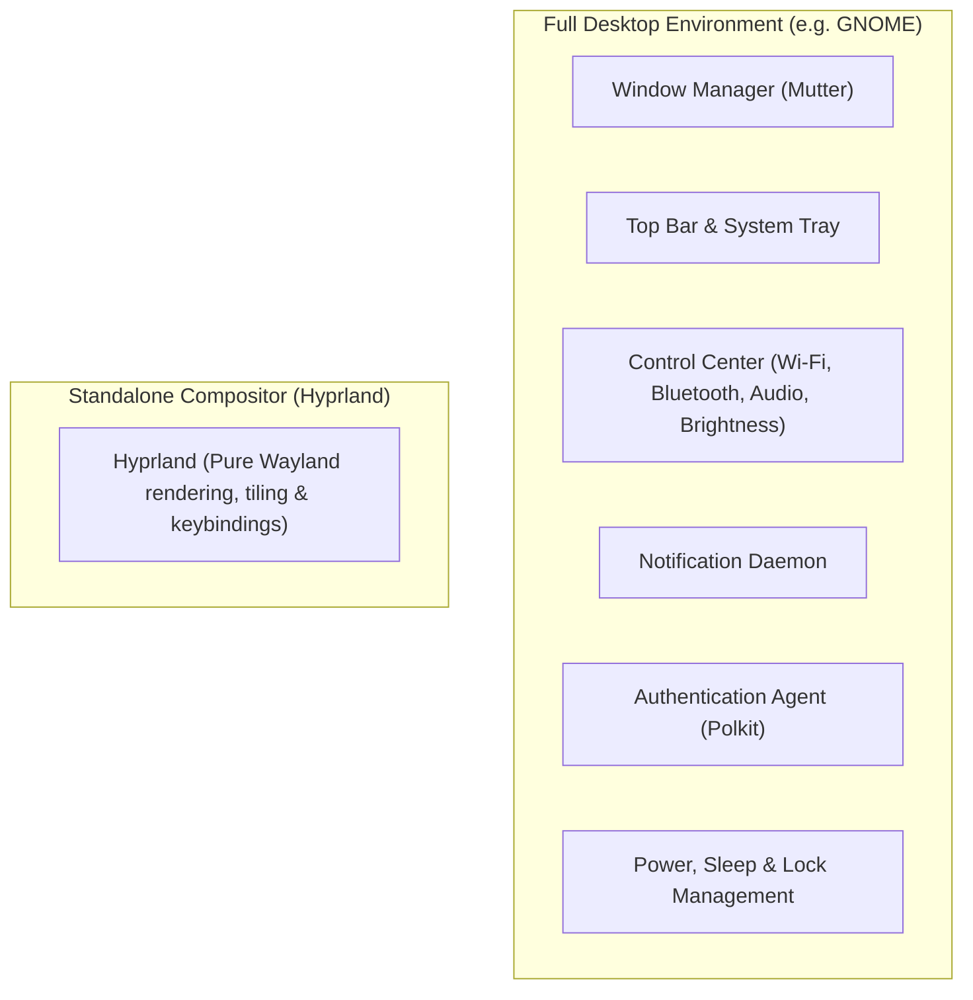

import TerminalWindow from '../../../components/TerminalWindow.astro';
import CodeBlockWindow from '../../../components/CodeBlockWindow.astro';

For the past 7 years using Linux as my daily operating system, I have relied heavily on floating window managers (GNOME, KDE, Cinnamon, etc.). I won't lie: I've tried pretty much every environment out there, and I always ended up back on GNOME. It has always been a love-hate relationship: I love its clean, standalone design language, but I constantly missed the next-level customizability that KDE offers—while simultaneously breaking GNOME after every system update because half my extensions stopped working.

After 7 years, there was a persistent voice in my head telling me: *"tiling window manager"*. I've spent countless hours admiring setups on Reddit (r/unixporn) and it was finally time to make the jump. Thanks to this leap, I now have the exact interface I wanted and built precisely how I want it, but getting here wasn't easy.

---

## Table of Contents

1. [The Catalyst: Why leave GNOME?](#1-the-catalyst-why-leave-gnome)
2. [Reality Check: Desktop Environment vs. Compositor / Tiling WM](#2-reality-check-desktop-environment-vs-compositor--tiling-wm)
3. [The Survival Kit: Assembling the Puzzle Pieces](#3-the-survival-kit-assembling-the-puzzle-pieces)
4. [First Steps on Fedora: Installation, GDM, and Startup](#4-first-steps-on-fedora-installation-gdm-and-startup)
5. [Taming the Configuration: From .conf to Lua in Hyprland](#5-taming-the-configuration-from-conf-to-lua-in-hyprland)
6. [The Terminal: Kitty, Zsh, and Daily CLI Tools](#6-the-terminal-kitty-zsh-and-daily-cli-tools)
7. [Daily Battles: The Biggest Headaches](#7-daily-battles-the-biggest-headaches)
8. [Managing Dotfiles: Order Amidst the Chaos](#8-managing-dotfiles-order-amidst-the-chaos)
9. [Muscle Memory and Adaptation: The First Week](#9-muscle-memory-and-adaptation-the-first-week)
10. [Conclusions: Was the Adventure Worth It?](#10-conclusions-was-the-adventure-worth-it)
11. [Screenshots](#11-screenshots)

---

## 1. The Catalyst: Why leave GNOME?

I think the real question isn't "why leave GNOME?", but rather "why stop using floating window managers?". In my case, there were three key reasons:
1. **Embracing the terminal more:** Tiling window managers are designed around keyboard-driven workflows, which naturally encourages using the command line much more frequently.
2. **Curiosity and learning:** Traditional desktop environments give you everything preconfigured on a silver platter; with a tiling manager, you must get your hands dirty with every single component and utility you add.
3. **Tailor-made customization:** It's not that I dislike KDE or GNOME, but I wanted the best of both worlds: GNOME's minimalist, clean look that doesn't resemble Windows, combined with KDE's deep customization capabilities.

After a brief research phase to decide which tiling manager to choose, I went with **Hyprland**, which runs natively on Wayland—something my NVIDIA graphics card definitely appreciates.

---

## 2. Reality Check: Desktop Environment vs. Compositor / Tiling WM

For anyone coming from traditional desktop environments like GNOME, KDE Plasma, Windows, or macOS, we are used to the word "desktop" doing all the heavy lifting out of the box. You click in the top right corner and immediately have sliders for volume, Wi-Fi, Bluetooth, screen brightness, battery percentage, and the power off button. Plug in a USB drive and a notification pops up ready to open the file manager. If an application asks for root privileges, an authentication modal appears asking for your password.

None of that is magic: it is what defines a **Desktop Environment (DE)**—a massive collection of applications, background daemons, and system services operating harmoniously under a unified visual design.

When you transition to **Hyprland**, the first thing you must understand is a fundamental difference: **Hyprland is not a desktop environment; it is strictly a Wayland compositor with automated tiling window management**.

Here is an architectural diagram to illustrate the contrast clearly:



Technically speaking, Hyprland only handles its core duties:
1. **Communicates with Wayland protocols and GPU drivers** to render hardware-accelerated windows smoothly.
2. **Captures keyboard and mouse events** to send inputs to the focused window or trigger your configured keybindings.
3. **Calculates window geometry** to automatically arrange them in a tiled layout without overlap, applying your chosen borders, gaps, animations, and blur filters.

And that's it. Don't expect it to do anything else. It doesn't know what display brightness is, it doesn't care whether you have internet access, it doesn't manage Bluetooth devices, and it has no concept of what time it is.

### The Initial Shock: The Blank Screen

I won't sugarcoat it: the moment I logged out of GNOME after drooling over gorgeous screenshots on Reddit (r/unixporn), I was completely stunned. In the login screen (GDM), I selected "Hyprland", typed my password, and hit Enter expecting a futuristic, turnkey workstation.

The screen flickered for a second, leaving me with a neutral wallpaper and a plain text banner warning that no user configuration file was found.
* Right-clicked on the desktop: **nothing**.
* Looked for a top bar to check the clock or battery: **didn't exist**.
* Pressed volume keys on the keyboard: **complete silence**.
* Tapped the `Super` key expecting an application grid: **absolutely nothing happened**.

In that instant, a cold sweat kicks in and you wonder: *"Did I just brick my installation?"*. The answer is no; you simply collided with a bare-bones *window manager*.

Think of it this way: using GNOME is like moving into a **fully furnished apartment**. You unpack your bags, everything matches, and everything works from minute one. However, if you want to knock down a wall or repaint with wild colors, the architects won't let you touch a thing. 
Installing Hyprland, on the other hand, is like being handed **an empty plot with a reinforced concrete foundation**: the architecture is the fastest and most modern available, you have 100% freedom to build whatever you want, but every piece of furniture, door, cable, and light switch has to be chosen, wired, and assembled by hand, file by file.

### Why Put Yourself Through This?

From that perspective, anyone might think this is an unnecessary hassle. But in my case, there were two compelling reasons:
* **Operating entirely via keyboard:** In a tiling environment, you stop wasting time dragging window borders with the mouse or hunting for minimized icons in taskbars. Spawning a terminal, splitting the screen in half, or hopping between 10 virtual workspaces becomes instant muscle memory.
* **Zero bloat and complete transparency:** In traditional environments, dozens of background services consume RAM and CPU cycles just in case you might need them someday. In Hyprland, every daemon, script and megabyte of memory in use is there because you explicitly chose to run it.

To achieve that state, however, you first have to gather and configure all the missing pieces that GNOME used to handle for you.

---

## 3. The Survival Kit: Assembling the Puzzle Pieces

To build a reliable daily driver, I had to find and configure a modern replacement for every component of the desktop:

| Need | In GNOME | In My Hyprland Setup |
| :--- | :--- | :--- |
| **Status bar** | GNOME Top Bar | Waybar (based on [HANCORE-linux/waybar-themes](https://github.com/HANCORE-linux/waybar-themes)) |
| **App launcher** | GNOME App Grid | Rofi-wayland (themes from [adi1090x/rofi](https://github.com/adi1090x/rofi)) |
| **Notifications** | GNOME Notification Center | SwayNC |
| **Wallpaper** | GNOME Settings | Hyprpaper |
| **Lock / Idle** | GDM / Native Lockscreen | Hyprlock + Hypridle |
| **Terminal** | GNOME Terminal / Ptyxis | Kitty |
| **Screenshots** | Native GNOME Screenshot Tool | Grim + Slurp + Swappy |
| **Clipboard** | Native Clipboard | wl-clipboard + cliphist |
| **Network / BT** | Quick Settings | nmtui / blueman |
| **File Manager** | Nautilus | Yazi |

---

## 4. First Steps on Fedora: Installation, GDM, and Startup

I'll be honest here: during my very first attempt, I took the shortcut. There are community projects that install and preconfigure an entire environment for you. Initially, I tried [ML4W](https://www.ml4w.com/), which offers a dedicated installer for Fedora. 
For various reasons, it didn't completely win me over—partly due to the color palette, the bundle of utilities included, and the fact that I hadn't built it from scratch myself, which took away that feeling of total ownership. In the end, I reinstalled Fedora, though I kept some residual files that I ended up repurposing for my current build.

My next step was installing Hyprland cleanly without pre-made wrapper scripts. In Fedora, Hyprland is not yet in the official base repositories, so we need to enable a community *COPR* repository:

<TerminalWindow title="user@fedora:~$ Installing Hyprland and utilities">
```bash
# Example: installing Hyprland and foundational tools on Fedora
sudo dnf copr enable lionheartp/Hyprland -y 
sudo dnf install hyprland waybar rofi-wayland kitty grim slurp wl-clipboard
```
</TerminalWindow>

My initial boot with leftover configuration files was quite chaotic: broken paths, missing dependencies, and misconfigured utilities. Fortunately, I had installed Fedora Workstation with GNOME: I don't use it every day, but if something breaks, I always have a complete rescue desktop environment available.
From there, I followed the removal steps to purge unneeded packages.

The first clean launch of Hyprland greets you with a notice indicating that a default configuration file has been generated: no status bar and no application launcher. Your immediate priority is finding the keybinding to launch the terminal: the master key is **SUPER** (the Windows key). Pressing **SUPER** + another key triggers your hotkeys. This is fully customizable, but since my keyboard has a useless Windows logo key, I might as well put it to good use. By default in my setup, the terminal launches via `SUPER + Q`.

Once you have a working terminal open, the real fun begins: customizing hundreds of lines across various configuration files.

### 4.1 Reusing GDM: The GNOME Login Screen as a Lifesaver

When switching to a tiling WM, many users rush to replace their display manager with lightweight alternatives like SDDM, Ly, or Greetd. In my case, I chose a much more pragmatic and dependable strategy: **keeping and reusing GDM (GNOME Display Manager)**.

Why is keeping the GNOME login screen such a smart move?
1. **Native Wayland detection:** GDM on Fedora automatically detects any session installed under `/usr/share/wayland-sessions/`, including `hyprland.desktop`. On the login screen, you simply click the gear icon in the bottom corner and pick Hyprland.
2. **Transparent credential unlocking:** GNOME Keyring unlocks seamlessly using your standard account password, sparing you annoying authentication popups when opening web browsers or SSH agents.
3. **The ultimate safety net:** When tweaking advanced compositor settings, proprietary NVIDIA drivers, or Lua scripts, a syntax error can easily prevent Hyprland from launching. If that happens, you don't have to troubleshoot blind inside a text-only TTY: log out, choose "GNOME" from GDM, and boot into a fully functional graphical desktop to edit your files comfortably.

---

## 5. Taming the Configuration: From .conf to Lua in Hyprland

This is the core of the entire experience. Traditionally, Hyprland was configured through its custom declarative syntax (`hyprlang` in `hyprland.conf`). However, after stripping out pre-packaged installers to understand my system nut by bolt, I took advantage of Hyprland's modern capabilities (v0.55+) to switch to native **Lua** configuration (`~/.config/hypr/hyprland.lua`).

Configuring your compositor in a real programming language like Lua grants real superpowers: structured tables, direct API calls (`hl.*`), dynamic loops to generate workspace bindings, and freedom from rigid parser constraints.

### 5.1 Monitor Setup and Refresh Rates

I frequently use a laptop connected to an external secondary monitor. Using `hl.monitor`, I anchor the integrated display (`eDP-1`) at position `0x0` and let Hyprland automatically place the external HDMI display to the right (`auto-right`), preserving each panel's native resolution and refresh rate:

<CodeBlockWindow title="~/.config/hypr/hyprland.lua (Monitors)">
```lua
------------------
---- MONITORS ----
------------------
-- Laptop integrated display
hl.monitor({
    output = "eDP-1",
    mode = "preferred",
    position = "0x0",
    scale = "auto",
})

-- External HDMI display placed to the right
hl.monitor({
    output = "HDMI-A-1",
    mode = "preferred",
    position = "auto-right",
    scale = "auto",
})
```
</CodeBlockWindow>

### 5.2 Keybindings and Daily Workflow

A tiling window manager lives or dies by its keybindings. Everything centers on the `SUPER` key. Here, the advantage of Lua shines: instead of writing 20 manual lines to switch and move windows across 10 workspaces, it takes just a 5-line `for` loop:

I personally remapped several bindings early on: for instance, `SUPER + Q` felt much more natural for closing windows. The rest is simply building muscle memory over time.

For the application launcher (`SUPER + CTRL + Return`), rather than starting a Rofi theme from scratch, I adopted a clean preset from [adi1090x/rofi](https://github.com/adi1090x/rofi) (specifically the `launchers/type-1/launcher.sh` script), which provides an elegant, modern foundation that is easy to customize to match the overall palette.

<CodeBlockWindow title="~/.config/hypr/hyprland.lua (Keybindings)">
```lua
---------------------
---- KEYBINDINGS ----
---------------------
local mainMod = "SUPER" -- Main modifier key
local terminal = "kitty"
local fileManager = "dolphin"
local menu = "~/.config/rofi/launchers/type-1/launcher.sh"

-- Launchers and window management
hl.bind(mainMod .. " + Return", hl.dsp.exec_cmd(terminal)) -- Open terminal
hl.bind(mainMod .. " + E", hl.dsp.exec_cmd(fileManager)) -- File manager
hl.bind(mainMod .. " + CTRL + Return", hl.dsp.exec_cmd(menu)) -- App launcher
hl.bind(mainMod .. " + Q", hl.dsp.window.close()) -- Close window
hl.bind(mainMod .. " + F", hl.dsp.window.fullscreen()) -- Fullscreen toggle
hl.bind(mainMod .. " + V", hl.dsp.window.float({ action = "toggle" })) -- Floating toggle
hl.bind(mainMod .. " + L", hl.dsp.exec_cmd("hyprlock")) -- Lock screen

-- Terminal file manager in dedicated Kitty window
hl.bind(mainMod .. " + Y", hl.dsp.exec_cmd(terminal .. " --title yazi -e yazi"))

-- Clipboard history via Cliphist + Rofi
hl.bind(mainMod .. " + V", hl.dsp.exec_cmd("cliphist list | rofi -dmenu | cliphist decode | wl-copy"))

-- Interactive screenshots with Hyprshot
hl.bind(mainMod .. " + PRINT", hl.dsp.exec_cmd("hyprshot -m region")) -- Save to file
hl.bind(mainMod .. " + SHIFT + PRINT", hl.dsp.exec_cmd("hyprshot -m region --clipboard-only")) -- Copy to clipboard

-- Dynamic Lua loop for 10 workspaces (SUPER + 1..0 and SUPER + SHIFT + 1..0)
for i = 1, 10 do
    local key = i % 10
    hl.bind(mainMod .. " + " .. key, hl.dsp.focus({ workspace = i }))
    hl.bind(mainMod .. " + SHIFT + " .. key, hl.dsp.window.move({ workspace = i }))
end
```
</CodeBlockWindow>

### 5.3 Aesthetics: Catppuccin Mocha, Borders, and Bézier Curves

When it came to visuals, I chose the iconic **Catppuccin Mocha** palette. For active window borders, rather than a flat, boring color, I configured a gentle 45-degree gradient blending **Catppuccin Blue** (`#89b4fa`) and **Mauve** (`#cba6f7`), with inactive windows featuring subtle translucent borders.

Aesthetics are personal: I tend to gravitate toward dark blue and purple tones, but the beauty of this setup is experimenting until you find the look that feels right for you.

<CodeBlockWindow title="~/.config/hypr/hyprland.lua (Look and Feel)">
```lua
-----------------------
---- LOOK AND FEEL ----
-----------------------
hl.config({
    general = {
        gaps_in = 4,
        gaps_out = 10,
        border_size = 2,
        col = {
            -- 45-degree gradient: Blue -> Mauve
            active_border = { colors = { "rgba(89b4faee)", "rgba(cba6f7ee)" }, angle = 45 },
            inactive_border = "rgba(595959aa)",
        },
        layout = "dwindle",
    },
    decoration = {
        rounding = 10,
        rounding_power = 2,
        active_opacity = 1.0,
        inactive_opacity = 0.95,
        shadow = {
            enabled = true,
            range = 4,
            render_power = 3,
            color = 0xee1a1a1a,
        },
        blur = {
            enabled = true,
            size = 3,
            passes = 2,
            vibrancy = 0.17,
        },
    },
    animations = {
        enabled = true,
        bezier = {
            { name = "wind",  cp = { 0.05, 0.9, 0.1, 1.05 } },
            { name = "winIn", cp = { 0.1, 1.1, 0.1, 1.1 } },
            { name = "winOut",cp = { 0.3, -0.3, 0, 1 } },
            { name = "liner", cp = { 0, 0, 1, 1 } },
        },
        animation = {
            "windows, 1, 4, wind, slide",
            "windowsIn, 1, 4, winIn, slide",
            "windowsOut, 1, 3, winOut, slide",
            "border, 1, 1, liner",
            "fade, 1, 4, default",
            "workspaces, 1, 3, wind, slide",
        },
    },
})
```
</CodeBlockWindow>

To complete the desktop, I customized **Waybar** using base layouts from [HANCORE-linux/waybar-themes](https://github.com/HANCORE-linux/waybar-themes). From there, I restructured the module groupings, wired up custom helper scripts (like `tuned.sh` for power profile toggling), and updated `style.css` to apply my full **Catppuccin Mocha** palette with floating pill borders, a dark base (`#1e1e2e`), `#cdd6f4` foreground text, and `JetBrainsMono Nerd Font Propo`:

<CodeBlockWindow title="~/.config/waybar/style.css (Catppuccin Mocha Palette)">
```css
/* Catppuccin Mocha Palette */
@define-color base         #1e1e2e;
@define-color mantle       #181825;
@define-color crust        #11111b;
@define-color text         #cdd6f4;
@define-color mauve        #cba6f7;
@define-color blue         #89b4fa;
@define-color red          #f38ba8;
@define-color peach        #fab387;

/* Semantic variables */
@define-color background   #1e1e2e;
@define-color foreground   #cdd6f4;
@define-color primary      #cba6f7;
@define-color accent       #89b4fa;

* {
  font-family: 'JetBrainsMono Nerd Font Propo';
  font-size: 11px;
}

#workspaces {
  border-radius: 11px;
  background-color: @background;
}
```
</CodeBlockWindow>

The lock screen follows the same visual consistency: inside `~/.config/hypr/hyprlock.conf`, it captures the active desktop (`screenshot`), applies a 3-pass Gaussian blur to obscure private information, displays a large digital clock in `JetBrainsMono Bold`, and styles the password input field with a purple accent (`#cba6f7`).

### 5.4 Waybar: My Custom Quickapps Menu

While a tiling manager encourages doing everything via keyboard, there are times when you just want to click, especially for your most frequently used everyday applications.

For those moments, I built a custom Waybar module in `~/.config/waybar/config.jsonc` called `group/quickapps`. Positioned directly in the center of the bar with crisp Nerd Font icons (``, `󰨞`, ``, etc.), it provides one-click access to the 7 apps I launch most often:

<CodeBlockWindow title="~/.config/waybar/config.jsonc (Quickapps Module)">
```jsonc
"group/quickapps": {
  "orientation": "horizontal",
  "modules": [
    "custom/app-chromium",
    "custom/app-code",
    "custom/app-feishin",
    "custom/app-obsidian",
    "custom/app-podman",
    "custom/app-kitty",
    "custom/app-lmstudio"
  ]
},

"custom/app-chromium": {
  "format": "",
  "tooltip": true,
  "tooltip-format": "Chromium",
  "on-click": "chromium-browser"
},
"custom/app-code": {
  "format": "󰨞",
  "tooltip": true,
  "tooltip-format": "VS Code",
  "on-click": "code"
},
"custom/app-feishin": {
  "format": "",
  "tooltip": true,
  "tooltip-format": "Feishin",
  "on-click": "flatpak run org.feishin.Feishin"
}
```
</CodeBlockWindow>

This gives me Chromium (web browsing), VS Code (coding), Feishin (music client connected to my Navidrome homelab server), Obsidian (notes), Podman (local containers), Kitty, and LM Studio (local AI testing) right at my fingertips without cluttering the screen.

---

## 6. The Terminal: Kitty, Zsh, and Daily CLI Tools

In a tiling setup, the terminal becomes the undisputed center of your workstation: it's where you spend 80% of your time. That's why setting it up properly was essential.

### 6.1 Kitty: GPU Acceleration and Crisp Performance
For my terminal emulator, I chose **Kitty**. By utilizing OpenGL to render text on the GPU, it delivers instantaneous responsiveness compared to legacy terminal emulators:

* **Font:** `JetBrainsMono Nerd Font` at size 12, with full ligature and icon support.
* **Transparency:** Dynamic `background_opacity 0.7` so the blurred wallpaper shows through subtly without hindering legibility.
* **Clean, borderless layout:** `hide_window_decorations yes` to eliminate bulky title bars, paired with a 10px inner padding (`window_padding_width 10`).
* **Cursor trail:** A subtle visual detail I love (`kitty-cursor-trail.conf`) that draws a sleek animated trail behind the text cursor as you navigate.

### 6.2 Zsh and Modular Configuration Structure
My `.zshrc` architecture is an idea I borrowed from ML4W's setup: I liked having configuration divided into modular, self-contained files under `~/.config/zshrc/`, so I kept that structure:
- `00-init`: Core environment variables, default editor (`EDITOR=nano` or `nvim`), and PATH additions for Cargo and local binaries.
- `20-customization`: Oh My Zsh plugins, shell prompt integration, and completion engines.
- `25-aliases`: Custom short commands to avoid typing repetitive arguments daily.
- `30-autostart`: Welcome greeting scripts and custom helper functions.

For **Oh My Zsh** plugins, I only load tools that provide practical value: `git`, `sudo` (double-tapping Escape prefixes the previous command with sudo), `zsh-autosuggestions` (real-time command suggestions), `fast-syntax-highlighting` (valid commands turn green, errors turn red), `dirhistory`, and container plugins for `docker` and `podman`.

### 6.3 Life-Saving CLI Utilities
Here are several modern command-line tools that completely outperform traditional Unix utilities:

1. **Atuin (`eval "$(atuin init zsh)"`):** An absolute game-changer. Replaces standard flat history with an indexed SQLite database. Pressing Up or `Ctrl+R` launches an interactive search interface where you can filter commands by date, working directory, or exit status.
2. **Zoxide (`z`):** Replaces tedious `cd` paths. Zoxide remembers your most visited directories; jumping to my blog is as simple as typing `z blog` from anywhere.
3. **FZF (`source <(fzf --zsh)`):** Lightning-fast fuzzy finding for files, directories, and processes.
4. **Eza:** A modern `ls` alternative with icons, file permissions, and directory trees:
   ```bash
   alias ls='eza -a --icons=always'
   alias ll='eza -al --icons=always'
   alias lt='eza -a --tree --level=1 --icons=always'
   ```
5. **Fastfetch with custom images:** Every time a new interactive shell opens, a script picks a random image from `~/.termicon` and renders it via Kitty's graphics protocol (`fastfetch --logo-type kitty --logo "$img"`) alongside system information.
6. **Oh-My-Posh with the Zen theme:** A minimal, informative prompt displaying the current Git branch, uncommitted status, and execution duration without slowing down terminal startup.

The terminal is one of my primary daily tools, and it was a main motivator for migrating to a tiling manager: pushing myself to live in the command line and rely less on heavy graphical user interfaces.

---

## 7. Daily Battles: The Biggest Headaches

Every customization journey has its roadblocks. In a system built from scratch, getting everything working seamlessly requires solving a few tricky problems:

### 7.1 Electron Apps, Chromium, and NVIDIA on Wayland
The first major obstacle: applications like Google Chrome, Discord, VS Code, and Spotify running through the **XWayland** translation layer. The symptoms are familiar: blurry text under display scaling, micro-stutters during scrolling, and awkward frame pacing with NVIDIA drivers.

To force Electron and Chromium apps to render natively through Wayland, the cleanest fix is placing these flags in `~/.config/` (`electron-flags.conf` and `chromium-flags.conf`):

<CodeBlockWindow title="~/.config/electron-flags.conf & chromium-flags.conf">
```text
--ozone-platform-hint=auto
--enable-features=WaylandWindowDecorations
```
</CodeBlockWindow>

Inside `hyprland.lua`, exporting NVIDIA environment variables is mandatory to ensure compositor stability:

```lua
hl.env("LIBVA_DRIVER_NAME", "nvidia")
hl.env("GBM_BACKEND", "nvidia-drm")
hl.env("__GLX_VENDOR_LIBRARY_NAME", "nvidia")
hl.env("NVD_BACKEND", "direct")
```

*(Even with these tweaks, the occasional Electron window may still display minor scaling artifacts, but that remains a reality of current desktop Linux tooling).*

### 7.2 Screen Sharing and XDG Desktop Portals
The dreaded screen-sharing hiccup: starting a call in Google Meet, Discord, or Slack only for other attendees to see a black screen, or having the browser crash immediately.

The fix lies in maintaining the proper XDG Desktop Portal packages:
- `xdg-desktop-portal-hyprland`: Handles native Pipewire capture for Hyprland windows and outputs.
- `xdg-desktop-portal-gtk`: Provides standard file pickers and GTK dialogs.

For quick screenshots, I use `hyprshot` (which wraps `grim` and `slurp`) bound to two shortcuts:
- `SUPER + PRINT`: Drag to select a region and save the image to disk.
- `SUPER + SHIFT + PRINT`: Select a region and copy it directly to the clipboard for pasting into chat apps.

### 7.3 Audio, Brightness, and Media Keys with OSD
Pressing laptop volume or brightness keys in GNOME displays a built-in on-screen display (OSD). In a bare compositor, nothing appears.

To solve this, I installed **SwayOSD** (`swayosd-client`) and linked it to media key handlers in `hyprland.lua`. Now, adjusting volume or display brightness brings up a modern, unobtrusive floating pill.

For music playback, `playerctl` allows playing, pausing, or skipping tracks globally without switching focus to whichever window is playing audio.

Additionally, I created a custom Waybar module to toggle `tuned-adm` power profiles (power-saver, balanced, performance) paired with a rule in `/etc/sudoers.d/99-tuned-waybar`, enabling mode switching with a single click without needing to enter a root password.

### 7.4 File Managers and Root Prompts (Polkit)
Have you ever tried formatting a drive, connecting to Wi-Fi, or launching an admin tool only for the app to freeze indefinitely?

The cause is a missing **Polkit Authentication Agent**—the daemon responsible for prompting you with a graphical password modal for elevated tasks. GNOME runs one automatically, but in Hyprland you must autostart it. In my `hyprland.lua`:

```lua
hl.on("hyprland.start", function()
    -- Authentication agent for elevated privileges
    hl.exec_cmd("/usr/libexec/polkit-gnome-authentication-agent-1")
    hl.exec_cmd("waybar")
    hl.exec_cmd("hypridle")
    hl.exec_cmd("dunst")
    hl.exec_cmd("copyq --start-server")
    hl.exec_cmd("wl-paste --type text --watch cliphist store")
end)
```

For file management, I combine both worlds: **Dolphin** when I need to transfer large files between drives with the mouse (`SUPER + E`), and **Yazi** in Kitty (`SUPER + Y`) for navigating directories at full speed via keyboard.

---

## 8. Managing Dotfiles: Order Amidst the Chaos

After investing hours fine-tuning margins, color schemes, and window rules, leaving those files unversioned is asking for trouble. If a drive fails or you reinstall your system, recreating everything from memory is painful.

Instead of symlink managers like GNU Stow, I manage my dotfiles using a **Bare Git Repository** stored at `~/.dotfiles`. All my scripts, configs, and assets are publicly tracked on GitHub: [**github.com/jrodriiguezg/dotfiles**](https://github.com/jrodriiguezg/dotfiles).

### The Bare Git Repository Advantage
With a bare repository, your `$HOME` serves directly as the working tree without moving configuration files to arbitrary folders:

<TerminalWindow title="user@fedora:~$ Dotfiles alias configuration">
```bash
# Clone the bare repository
git clone --bare git@github.com:jrodriiguezg/dotfiles.git $HOME/.dotfiles

# Alias to manage configs from any directory
alias dotfiles='/usr/bin/git --git-dir=$HOME/.dotfiles/ --work-tree=$HOME'

# Hide untracked files in home directory
dotfiles config --local status.showUntrackedFiles no

# Manage just like standard git:
dotfiles status
dotfiles add .config/hypr/hyprland.lua
dotfiles commit -m "feat: adjust catppuccin border gradient"
dotfiles push
```
</TerminalWindow>

### Real Environment Structure
Here is how my configuration tree is organized:

<TerminalWindow title="user@fedora:~/.config">
```bash
~/.dotfiles (Central bare repository)
~/.config/
├── hypr/
│   ├── hyprland.lua          # Main compositor config in Lua
│   ├── hyprlock.conf         # Blur lockscreen
│   ├── hypridle.conf         # Sleep and monitor standby timers
│   ├── hyprpaper.conf        # Wallpaper manager
│   └── wallpapers/           # High-resolution wallpapers
├── waybar/
│   ├── config.jsonc          # Grouped modules (CPU, battery, tuned, audio)
│   ├── style.css             # Full Catppuccin Mocha stylesheet
│   └── scripts/              # Custom scripts (tuned, window, clock)
├── electron-flags.conf       # Native Wayland flags for Discord/VSCode
├── chromium-flags.conf       # Native Wayland flags for Chromium/Chrome
└── .dotfiles/
    └── install_dots.sh       # Automated installation and deployment script
```
</TerminalWindow>

To automate bootstrapping new machines on Fedora, I maintain an `install_dots.sh` script that enables COPR repositories (including CachyOS kernel optimizations and `ananicy-cpp`), installs all packages and Wayland utilities, automatically backs up colliding files into a timestamped directory (`~/.dotfiles-backup-YYYYMMDDHHMMSS`), and configures necessary sudoers rules. This script is tailored specifically to my hardware, providing a fast and repeatable way to restore my preferred setup.

---

## 9. Muscle Memory and Adaptation: The First Week

I won't lie: the first three days are rough; you might even question why you voluntarily chose this path.

Your brain has ingrained instincts to reach for the mouse whenever a window appears, or glance at the top right corner to check the time or volume. In a newly installed tiling WM, you catch yourself searching for minimize or maximize buttons that simply don't exist.

By day four or five, everything clicks:
* Need documentation while coding? Press `SUPER + Return`, and Kitty splits the screen vertically with balanced proportions.
* Need to edit a config file quickly? Press `SUPER + Y`, Yazi opens in TUI, and you locate and open the file in seconds.
* Copied a code snippet earlier? Press `SUPER + V`, Rofi searches your `cliphist` history, and pressing Enter pastes it immediately.
* Workspace getting crowded? Press `SUPER + 2` to jump to a clean workspace, or take the active window along with `SUPER + SHIFT + 2`.

(I still occasionally mix up bindings, but it quickly becomes second nature).

---

## 10. Conclusions: Was the Adventure Worth It?

After weeks of daily use, the verdict is overwhelmingly positive. Migrating from GNOME to Hyprland comes with real friction: it demands patience, curiosity to troubleshoot when something misbehaves, and willingness to assemble your desktop component by component.

### What I Gained:
* **Unmatched smoothness and performance:** Instantaneous window response, zero animation stutter, and negligible idle resource usage.
* **A unified, personal look:** A cohesive visual aesthetic (Catppuccin Mocha) harmonizing terminal, status bar, borders, and applications.
* **Accelerated workflow:** Keyboard-driven navigation minimizes distractions and eliminates time wasted resizing windows.
* **Deep Linux understanding:** Learning how Wayland, XDG portals, Pipewire, D-Bus, and Polkit communicate gives you complete mastery over your operating system.

### The Downside:
* **Initial setup time:** You will spend several afternoons tuning scripts, keybindings, and CSS rules.
* **Occasional maintenance:** Keeping an eye on protocol updates and upstream compositor changes.

If you'd like to explore my configuration files, custom Waybar themes, helper scripts, or installation setup for Fedora, my full repository is available on GitHub:
👉 [**jrodriiguezg/dotfiles on GitHub**](https://github.com/jrodriiguezg/dotfiles)

---

## 11. Screenshots

To give you a real sense of how the entire environment looks and functions in daily use, here are direct captures from my setup:

### 1. Split Windows (Symmetric Tiling)
Two windows arranged side by side: the core characteristic of a tiling window manager, utilizing every display pixel efficiently without overlapping or manual alignment.


### 2. Customized Waybar with Quickapps Dock
My customized Waybar status bar featuring the Catppuccin Mocha theme, floating pill styling, and a central quickapps dock (`group/quickapps`) for launching daily tools with one click.


### 3. Rofi Launcher
The Rofi application menu (adapted from adi1090x's repository), configured to prioritize my most used software right at the top for instant keyboard launching.


### 4. Daily Workspace
My typical daily workspace: Visual Studio Code open in full view while writing this very blog post.


### 5. Kitty Terminal with Fastfetch
The Kitty terminal running Fastfetch with high-resolution image rendering via Kitty's graphics protocol, the Zen Oh-My-Posh prompt, and the Catppuccin Mocha color palette.


> [!TIP]
> If you are considering transitioning to Hyprland on your main workstation, **do not uninstall your current desktop environment right away**. Keep GNOME or KDE installed as a fallback on your login screen while you build and test your dotfiles at your own pace. Once your setup is mature, you'll naturally find yourself never needing to log back into your old desktop.
