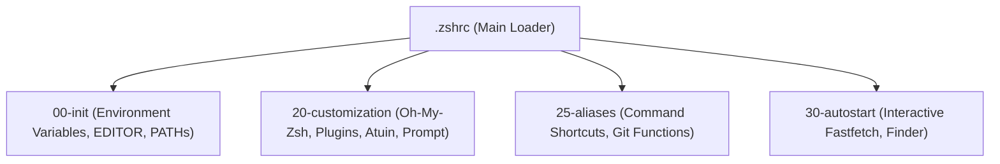
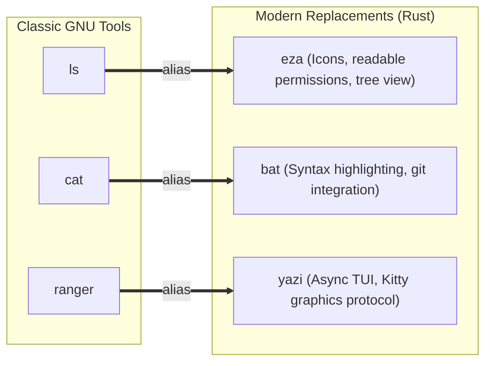

```mermaid
flowchart LR
    subgraph Legacy["Classic Terminal (Default)"]
        B_Shell["Bash"]
        B_Hist[".bash_history (Linear flat text)"]
        B_Nav["Manual cd (Absolute/relative paths)"]
        B_Utils["Coreutils (ls, cat, grep)"]
        B_Prompt["Static and monochrome PS1"]
    end

    subgraph Modern["Modern Terminal (My setup)"]
        Z_Shell["Zsh + Modular Oh-My-Zsh"]
        Z_Hist["Atuin (SQLite Database + Fuzzy TUI)"]
        Z_Nav["Zoxide (Frecency ranking + fzf)"]
        Z_Utils["Modern Ecosystem (eza, bat, yazi, rg, fd)"]
        Z_Prompt["Oh-My-Posh (Zen theme + Git + Transient)"]
    end

    Legacy -.->|"Productivity leap"| Modern
```

import TerminalWindow from '../../../components/TerminalWindow.astro';
import CodeBlockWindow from '../../../components/CodeBlockWindow.astro';

In my previous article discussing my transition from KDE/GNOME to **Hyprland**, I highlighted a fundamental reality that anyone adopting a tiling window manager quickly learns: **the terminal is the epicenter of everything, and you work significantly faster once you master it**.

I won't lie: for years, I stuck with default `bash` (and I still use it across my remote servers), with its monotone white or green prompt, navigating with tedious `cd ../../projects/something` chains, desperately hammering `Ctrl + R` hoping to stumble upon a Docker command I ran last week, and settling for the monochrome flat output of `ls` or `cat`. It worked, of course. But it was like pedaling a bicycle while having a sports car parked in the garage.

Modernizing your terminal isn't just about aesthetic flexes or posting eye candy to Reddit's r/unixporn; it is primarily about **optimizing workflow**, eliminating wasted keystrokes, and adopting modern tools written in languages like Rust or Go that leverage modern hardware acceleration.

In this post, I will break down my daily setup step by step: from the core shell with **Zsh** and its modular architecture, to relational command indexing with **Atuin** and predictive navigation with **Zoxide**, all the way through modern replacements for classic utilities like `eza`, `bat`, `yazi`, and dynamic graphic rendering with **Fastfetch** in Kitty.

---



---

## Table of Contents

1. [The Catalyst: Tired of the Defaults](#1-the-catalyst-tired-of-the-defaults)
2. [The Invisible Foundation: Kitty and Nerd Fonts](#2-the-invisible-foundation-kitty-and-nerd-fonts)
3. [From Bash to Zsh: Staying Organized Without Performance Loss](#3-from-bash-to-zsh-staying-organized-without-performance-loss)
4. [Essential Zsh Plugins](#4-essential-zsh-plugins)
5. [Atuin: Command History Reimagined with SQLite](#5-atuin-command-history-reimagined-with-sqlite)
6. [Zoxide: Intelligent Navigation Powered by Frecency](#6-zoxide-intelligent-navigation-powered-by-frecency)
7. [FZF: The Glue of Interactive Fuzzy Search](#7-fzf-the-glue-of-interactive-fuzzy-search)
8. [Modern Replacements for Classic Tools: Eza, Bat, and Yazi](#8-modern-replacements-for-classic-tools-eza-bat-and-yazi)
9. [The Prompt: Oh My Posh with Zen Theme and Transient Prompt](#9-the-prompt-oh-my-posh-with-zen-theme-and-transient-prompt)
10. [A Touch of Personality: Dynamic Fastfetch Images in Kitty](#10-a-touch-of-personality-dynamic-fastfetch-images-in-kitty)
11. [Dotfiles Management: Bare Git Repository and Automation](#11-dotfiles-management-bare-git-repository-and-automation)
12. [Comparison Table and Conclusions](#12-comparison-table-and-conclusions)
13. [Useful Links](#13-useful-links)

---

## 1. The Catalyst: Tired of the Defaults

When you spend hours inside a terminal, you start noticing friction that quietly drains your productivity:

* **Lost context in command history:** You want to recall that specific multi-flag command you ran last week inside a particular folder. In Bash, you rely on `Ctrl + R`, type a search fragment, and jump blindly through a linear text file without knowing the execution date, directory, or whether it exited with `exit code 0` or failed (`exit code 1`).
* **Directory navigation fatigue:** If you are editing an article in `~/Documentos/Proyectos/blog/src/content/blog/` and need to inspect a compose file in `~/docker/ollama/data/`, you must type out the entire path or repeatedly spam the Tab key.
* **Archaic tools with monochrome output:** `ls` offers no instant visual cues for file types; `cat` dumps raw uncolored text with no line numbers; and locating files using legacy `find` or `grep` feels sluggish compared to contemporary fuzzy filtering tools.

Fixing this does not require reinventing the wheel: it requires gathering the right set of tools, configuring them cleanly so the terminal launches in milliseconds, and committing the keybindings to muscle memory.


---

## 2. The Invisible Foundation: Kitty and Nerd Fonts

Before touching the shell itself, two prerequisite setup requirements are often overlooked, causing configurations to render with broken or missing glyphs: **fonts** and the **terminal emulator**.

### 2.1 Why a Nerd Font is Mandatory

If you have ever tried installing a modern prompt or a CLI utility with icons like `eza` and ended up staring at blank squares (``) or broken question marks, your font is the issue.

Standard terminal fonts only include basic monospace characters. A **Nerd Font** patches popular monospaced fonts with thousands of additional vector glyphs (icons from Font Awesome, Material Design, Devicons, Octicons, etc.). In my setup, I use **JetBrainsMono Nerd Font**:

<CodeBlockWindow title="~/.config/kitty/kitty.conf (Typography & Aesthetics)">
```conf
# Primary font with full support for ligatures and icons
font_family                 JetBrainsMono Nerd Font
font_size                   12
bold_font                   auto
italic_font                 auto
bold_italic_font            auto

# Clean window with zero titlebar borders
remember_window_size        no
initial_window_width        950
initial_window_height       500
window_padding_width        10
hide_window_decorations     yes
background_opacity          0.7
dynamic_background_opacity  yes

# Default interactive shell
shell                       zsh

# Dynamic cursor trail effect
include $HOME/.config/ml4w/settings/kitty-cursor-trail.conf

# Matugen color scheme synchronized with wallpaper
include colors-matugen.conf
```
</CodeBlockWindow>

### 2.2 Kitty: GPU Acceleration and Graphics Protocol

The decision to choose **Kitty** over traditional emulators like GNOME Terminal or Alacritty comes down to two major strengths:
1. **OpenGL Rendering:** Text rendering runs entirely on the graphics card, ensuring smooth 60/120 FPS performance without CPU spikes during heavy log streams.
2. **Native Graphics Protocol:** Kitty allows CLI utilities (such as `fastfetch` or the terminal file manager `yazi`) to display actual high-resolution images inline within the terminal buffer without relying on pixelated ASCII art hacks.

---

## 3. From Bash to Zsh: Staying Organized Without Performance Loss

Switching from Bash to **Zsh** is driven by superior contextual autocompletion, advanced globbing, and rich ecosystem support. However, there is a common pitfall: blindly installing frameworks like **Oh My Zsh** and enabling 30 plugins, resulting in sluggish 500ms terminal startup times.

To prevent an unwieldy `.zshrc` file spanning hundreds of lines, I follow a modular configuration structure inspired by the ML4W dotfiles:

<CodeBlockWindow title="~/.zshrc (Modular Loader)">
```bash
# -----------------------------------------------------
# Modular configuration loader
# -----------------------------------------------------
for f in ~/.config/zshrc/*; do
    if [ ! -d $f ]; then
        c=`echo $f | sed -e "s=.config/zshrc=.config/zshrc/custom="`
        [[ -f $c ]] && source $c || source $f
    fi
done

# Load local overrides if present
if [ -f ~/.zshrc_custom ]; then
    source ~/.zshrc_custom
fi
```
</CodeBlockWindow>

This separates configuration into four dedicated scripts inside `~/.config/zshrc/`:



* `00-init`: Exports default editor preferences (`export EDITOR=nano`) and appends local binaries (`~/.cargo/bin`, `~/.local/bin`) to `$PATH`.
* `20-customization`: Loads Oh My Zsh, essential plugins, Atuin initialization, and the prompt theme.
* `25-aliases`: Houses short, ergonomic aliases for frequently executed commands.
* `30-autostart`: Handles visual logic executed when launching an interactive session.

---

## 4. Essential Zsh Plugins

Inside `20-customization`, the Oh My Zsh plugin list is carefully curated to boost typing speed without adding cursor lag:

<CodeBlockWindow title="~/.config/zshrc/20-customization (Selected Plugins)">
```bash
plugins=(
    git
    sudo
    web-search
    archlinux
    zsh-autosuggestions
    fast-syntax-highlighting
    copyfile
    copybuffer
    dirhistory
    aliases
    alias-finder
    docker
    podman
)
```
</CodeBlockWindow>

The most impactful plugins in daily use are:

* **`zsh-autosuggestions`:** As you type, it previews the latest matching command from your history in dim gray. Pressing the right arrow key (`→`) or `End` completes the line instantly without typing it in full.

  

* **`fast-syntax-highlighting`:** Provides real-time syntax highlighting. Valid commands and arguments appear in green; syntax mistakes or missing binaries highlight in red before you press Enter.

  

* **`sudo`:** Have you ever executed an administrative command only to be hit with *Permission Denied*? Instead of manually retyping `sudo !!`, double-tap **Escape** and it automatically prepends `sudo ` to your current line.

  <video src="https://assets.jrodriiguezg.link/modernizar-la-terminal/3.sudo.mp4" controls autoplay loop muted playsinline width="750" style="max-width: 100%; height: auto; display: block; margin: 1.5rem auto; border-radius: 12px; box-shadow: var(--box-shadow);"></video>

* **`dirhistory`:** Allows you to navigate forward and backward through recently visited directory history using `Alt + Left Arrow` and `Alt + Right Arrow`, mirroring web browser navigation.

  <video src="https://assets.jrodriiguezg.link/modernizar-la-terminal/4.dishistory.mp4" controls autoplay loop muted playsinline width="750" style="max-width: 100%; height: auto; display: block; margin: 1.5rem auto; border-radius: 12px; box-shadow: var(--box-shadow);"></video>

---

## 5. Atuin: Command History Reimagined with SQLite

Traditional shell history (`.bash_history` or `.zsh_history`) is a primitive flat file. It loses directory context, corrupts easily across concurrent terminal tabs, and its reverse search (`Ctrl + R`) is cumbersome.

**Atuin** completely replaces that flat file with a **local SQLite relational database** enriched with rich metadata for every executed command.

<TerminalWindow title="jrodriiguezg@fedora: ~ (Interactive Search with Atuin)">
```text
  17:42:10 │ docker compose -f ~/docker/ollama/docker-compose.yaml up -d
  17:41:05 │ git commit -m "feat(ui): synchronize themes with matugen"
  17:39:20 │ sudo dnf update && flatpak update -y
  17:30:15 │ eza -al --icons=always ~/Documentos/Proyectos/blog/
  ────────────────────────────────────────────────────────────────────────
  [1/2840] > docker compose                                         [0ms] 0
```
</TerminalWindow>

### 5.1 What Metadata Does Atuin Track?

For every command invocation, Atuin transparently records:
1. **The exact, complete command line string.**
2. **Current working directory (`cwd`):** Allows filtering history strictly to commands run within the current project folder.
3. **Exit status code (`exit code`):** Filter exclusively for commands that failed to diagnose errors, or only those that finished successfully (`0`).
4. **Execution timestamp and duration:** Identify whether a script completed in 200ms or took 14 minutes.

### 5.2 Initialization and Zsh Integration

Activation requires a single entry in `~/.config/zshrc/20-customization`:

<CodeBlockWindow title="~/.config/zshrc/20-customization (Atuin Init)">
```bash
# Initialize Atuin for interactive Zsh sessions
eval "$(atuin init zsh)"
```
</CodeBlockWindow>

Pressing `Ctrl + R` or the Up arrow (`↑`) opens a full-screen fuzzy-search TUI overlay, allowing you to filter by prefix, relative timeframe, or specific directories.

<video src="https://assets.jrodriiguezg.link/modernizar-la-terminal/atuin.mp4" controls autoplay loop muted playsinline width="850" style="max-width: 100%; height: auto; display: block; margin: 1.5rem auto; border-radius: 12px; box-shadow: var(--box-shadow);"></video>

It also includes built-in statistics via `atuin stats`, providing an instant visual breakdown of your most frequently executed commands:

<TerminalWindow title="atuin stats">
```text
❯ atuin stats
[▮▮▮▮▮▮▮▮▮▮] 642 cd         
[▮▮▮▮▮▮▮▮▮ ] 579 ls         
[▮▮▮▮▮     ] 370 ssh        
[▮▮▮▮▮     ] 354 nano       
[▮▮▮▮      ] 310 dnf install
[▮▮        ] 178 flatpak    
[▮▮        ] 144 git push   
[▮▮        ] 130 python3    
[▮         ] 128 mkdir      
[▮         ] 125 git add    
Total commands:   6829
Unique commands:  3433
```
</TerminalWindow>

> [!TIP]
> Atuin includes optional support for **End-to-End Encrypted (E2EE) synchronization**. If you work across multiple machines (laptop, desktop workstation, and a homelab server), you can run your own self-hosted Atuin sync server or use their hosted service so your shell history stays in sync without exposing plaintext secrets.

---

## 6. Zoxide: Intelligent Navigation Powered by Frecency

Navigating directory trees using traditional `cd` requires memorizing long paths or pressing Tab dozens of times:

<TerminalWindow title="Traditional cd navigation">
```bash
jrodriiguezg@fedora:~$ cd Documentos/Proyectos/blog/src/content/blog/
jrodriiguezg@fedora:~/Documentos/Proyectos/blog/src/content/blog$ cd ../../../../../docker/ollama/
```
</TerminalWindow>

**Zoxide** eliminates this friction using an algorithm based on **"Frecency"** (a metric combining **frequency** of access with **recency**).

### 6.1 Transparently Replacing `cd`

Instead of learning a new utility command like `z`, you can configure Zoxide to alias directly over `cd`, keeping muscle memory unchanged:

<CodeBlockWindow title="~/.zshrc (Override cd with Zoxide)">
```bash
# Replace standard cd command with Zoxide's predictive engine
eval "$(zoxide init zsh --cmd cd)"
```
</CodeBlockWindow>

From that point forward, Zoxide silently tracks visited directories and assigns weighted scores. Jumping to the blog project from anywhere in the filesystem is as simple as:

<TerminalWindow title="Instant Navigation with Zoxide">
```bash
# Jump directly from root or any nested subfolder
cd blog

# Or if you have multiple projects with similar names:
cd blog content
```
</TerminalWindow>

Zoxide identifies matching paths with the highest frecency score, landing directly in `~/Documentos/Proyectos/blog/src/content/blog/` instantly. If multiple targets exist, an interactive selection menu powered by FZF can be opened:

```bash
cd foo <SPACE> <TAB>
```

This brings up an interactive fuzzy menu of matching destinations sorted by rank.

<video src="https://assets.jrodriiguezg.link/modernizar-la-terminal/zoxide.mp4" controls autoplay loop muted playsinline width="700" style="max-width: 100%; height: auto; display: block; margin: 1.5rem auto; border-radius: 12px; box-shadow: var(--box-shadow);"></video>

---

## 7. FZF: The Glue of Interactive Fuzzy Search

**FZF** (*Fuzzy Finder*) is the general-purpose interactive search backbone across the terminal. Native integration with Zsh adds convenient default keybindings:

<CodeBlockWindow title="~/.config/zshrc/20-customization (FZF Integration)">
```bash
# Load FZF keybindings and fuzzy autocompletion
source <(fzf --zsh)
```
</CodeBlockWindow>

This unlocks:
* `Ctrl + T`: Launches an interactive fuzzy file and directory picker, inserting selected paths into the command line.
* `Alt + C`: Searches subdirectories interactively and switches into the chosen directory upon pressing Enter.

In my autostart configuration (`30-autostart`), I pair FZF with a custom search script (`finder`) to locate files or folders and open them directly in Neovim or switch directories automatically:

<CodeBlockWindow title="~/.config/zshrc/30-autostart (Finder Function)">
```bash
# Interactive quick search function
finder() {
    local result=$($HOME/.config/ml4w/bin/ml4w-finder)

    if [[ "$result" == TYPE_DIR:* ]]; then
        local target_dir="${result#TYPE_DIR:}"
        cd "$target_dir" && ls
    elif [[ "$result" == TYPE_FILE:* ]]; then
        ${EDITOR:-nvim} "${result#TYPE_FILE:}"
    else
        echo "Could not read $result" >&2
        return 1
    fi
}
```
</CodeBlockWindow>


<video src="https://assets.jrodriiguezg.link/modernizar-la-terminal/fzf%202.mp4" controls autoplay loop muted playsinline width="770" style="max-width: 100%; height: auto; display: block; margin: 1.5rem auto; border-radius: 12px; box-shadow: var(--box-shadow);"></video>

---

## 8. Modern Replacements for Classic Tools: Eza, Bat, and Yazi

For decades, developers relied on GNU Coreutils originating from the 1970s and 1980s. Today, modern open-source alternatives rewritten in **Rust** deliver parallelism, semantic color schemes, and enhanced readability.

In `~/.config/zshrc/25-aliases`, these replacements are mapped seamlessly:



### 8.1 Eza: The Successor to `ls`

`eza` goes beyond basic colored output: it maps file extensions to corresponding Nerd Font icons, formats file permissions clearly, and includes built-in tree visualization without requiring the `tree` utility.

<CodeBlockWindow title="~/.config/zshrc/25-aliases (Eza Configuration)">
```bash
# Replace ls with automatic icons and tree view
alias ls='eza -a --icons=always'
alias ll='eza -al --icons=always'
alias lt='eza -a --tree --level=1 --icons=always'
```
</CodeBlockWindow>

<TerminalWindow title="eza -al --icons=always">
```text
drwxr-xr-x   - jrodriiguezg 22 Oct 21:50  .
drwxr-xr-x   - jrodriiguezg 22 Oct 20:00  ..
-rw-r--r-- 12k jrodriiguezg 22 Oct 21:49  README.md
-rw-r--r-- 1.2k jrodriiguezg 22 Oct 21:30  package.json
-rw-r--r-- 5.4k jrodriiguezg 22 Oct 21:20  astro.config.mjs
drwxr-xr-x   - jrodriiguezg 22 Oct 21:00  src
```
</TerminalWindow>

### 8.2 Bat: A Feature-Rich Replacement for `cat`

`bat` replaces `cat` by adding syntax highlighting across hundreds of languages, margin line numbers, and Git diff integration (marking modified or added lines with red/green markers relative to HEAD).

<CodeBlockWindow title="~/.config/zshrc/25-aliases (Bat Alias)">
```bash
alias cat=bat
```
</CodeBlockWindow>


### 8.3 Yazi: Asynchronous TUI File Manager

Compared to Python-based tools like Ranger, **Yazi** is an event-driven file manager written in Rust. In Kitty, its biggest advantage is leveraging the terminal graphics protocol to deliver instant, high-resolution image previews as you navigate with `hjkl`:

<CodeBlockWindow title="~/.config/zshrc/25-aliases (Yazi Alias)">
```bash
alias ranger=yazi
```
</CodeBlockWindow>


---

## 9. The Prompt: Oh My Posh with Zen Theme and Transient Prompt

The prompt is in front of your eyes 100% of the time spent in the shell. While prompt engines like Starship or Oh My Posh are versatile, avoid overloading them with 15 segments that introduce command latency.

My configuration uses **Oh My Posh** with a streamlined template (`zen.toml`):

<CodeBlockWindow title="~/.config/zshrc/20-customization (Prompt Init)">
```bash
# Initialize Oh My Posh with the Zen configuration
eval "$(oh-my-posh init zsh --config $HOME/.config/ohmyposh/zen.toml)"
```
</CodeBlockWindow>

It focuses on three essentials:
1. **Clean, compact directory path:** Highlighted in soft blue for fast recognition.
2. **Instant Git state:** Branch identifier (`HEAD`), dirty status indicators (`*`), and remote synchronization indicators (`⇣` behind, `⇡` ahead).
3. **Transient Prompt enabled:** When pressing Enter, prior command lines collapse into a simple `❯ `, keeping terminal scrollback history clean and free from duplicate path clutter.

<TerminalWindow title="Oh My Posh in action">
```text
~/Documentos/Proyectos/blog main* ⇣1 
❯ git status
```
</TerminalWindow>


---

## 10. A Touch of Personality: Dynamic Fastfetch Images in Kitty

Moving away from static calls to `fastfetch` or legacy `neofetch`, I wanted every newly opened terminal instance to feature a distinct visual touch.

Leveraging Kitty's graphics protocol, `~/.config/zshrc/30-autostart` picks a random graphic or meme from a local `~/.termicon` folder and renders it alongside system specifications:

<CodeBlockWindow title="~/.config/zshrc/30-autostart (Dynamic Fastfetch)">
```bash
# Execute fastfetch with a random image exclusively in interactive sessions
if [[ -o interactive ]]; then
    local img=$(find "$HOME/.termicon" -maxdepth 1 -type f \( -iname "*.jpg" -o -iname "*.jpeg" -o -iname "*.png" -o -iname "*.webp" \) | shuf -n 1)
    if [[ -n "$img" ]]; then
        fastfetch --logo-type kitty --logo "$img"
    fi
fi
```
</CodeBlockWindow>

The Fastfetch configuration template (`~/.config/fastfetch/config.jsonc`) displays key metrics with Nerd Font icons: user, hostname, OS installation age (`os age`), system uptime, kernel, window manager (`Hyprland`), terminal emulator (`Kitty`), and active shell (`Zsh`).

<TerminalWindow title="fastfetch in Kitty">
```text
    ┌──────────────┐   jrodriiguezg@fedora
    │              │   ───────────────────
    │   [ Random   │    user     jrodriiguezg
    │    Image in  │   󰇅 hname    fedora
    │    Kitty ]   │    os age   142 days
    │              │   󰅐 uptime   6 hours, 21 mins
    └──────────────┘    shell    zsh 5.9
```
</TerminalWindow>


---

## 11. Dotfiles Management: Bare Git Repository and Automation

Having a customized terminal is useless if reinstalling or moving to a new laptop requires spending days setting everything up from scratch.

Rather than relying on external symlink utilities like GNU Stow, I manage dotfiles using a **bare Git repository** mapped straight to `$HOME`:

<CodeBlockWindow title="~/.config/zshrc/25-aliases (Bare Git Workflow)">
```bash
# Base aliases for managing bare dotfiles repository
alias dotfiles='/usr/bin/git --git-dir=$HOME/.dotfiles/ --work-tree=$HOME'
alias dotst='dotfiles status'
alias dotdiff='dotfiles diff'

# Streamlined synchronization with automatic commit and push
dotsync() {
    local msg="${*:-sync: dotfiles update}"
    dotfiles add -u
    dotfiles commit -m "$msg"
    dotfiles push origin main
}

# Native Git autocompletion for the 'dotfiles' alias
compdef _git dotfiles=git
```
</CodeBlockWindow>

With `dotsync`, any adjustment made across `~/.config/zshrc/`, `kitty.conf`, or Oh My Posh themes is staged, committed, and pushed to remote storage with a single command:

<TerminalWindow title="dotsync in execution">
```bash
jrodriiguezg@fedora:~$ dotsync "feat(zsh): optimize plugin load times"
[main a8f9c12] feat(zsh): optimize plugin load times
 1 file changed, 4 insertions(+), 2 deletions(-)
To github.com:jrodriiguezg/dotfiles.git
   f4e2b01..a8f9c12  main -> main
```
</TerminalWindow>


---

## 12. Comparison Table and Conclusions

| Feature / Task | Classic Approach (Traditional Bash) | Modern Approach (Zsh + Rust Stack) | Practical Benefit |
| :--- | :--- | :--- | :--- |
| **Command History** | Linear `.bash_history` with blind `Ctrl + R` | **Atuin** with SQLite, rich metadata, and fuzzy search | Find any command in seconds by directory or execution date |
| **Directory Navigation** | Manual `cd` with tedious path typing | **Zoxide** with *frecency* ranking | Instant jump between projects using a single keyword |
| **File Listing** | Monochrome `ls -la` without context | **Eza** with Nerd Font icons and tree view | Immediate visual recognition of file types and permissions |
| **Viewing Code / Logs** | Plain `cat` without line numbers | **Bat** with syntax highlighting and git diff margins | Quick reading and inspecting without launching a full editor |
| **Fuzzy Search** | `find` and `grep` with cumbersome syntax | **FZF** integrated into shell and custom scripts | Real-time, interactive fuzzy filtering on the fly |
| **Terminal Prompt** | Flat `PS1` without system or git status | **Oh My Posh** with Zen theme and Transient prompt | Git branch status and current directory always visible with zero lag |

### Was the Effort Worth It?

Without question. The learning curve for Zoxide and Atuin takes essentially an afternoon; but once committed to muscle memory, attempting to work in a plain, unconfigured Bash environment immediately makes you miss predictive suggestions, relational history, and instant directory jumping.

This setup isn't about decorating the terminal with superficial gimmicks; it is about crafting an agile, visually comfortable, and responsive environment where spending hours at the keyboard feels effortless.


---

## 13. Useful Links

* [Atuin Documentation & Sync](https://atuin.sh/)
* [Zoxide GitHub Repository](https://github.com/ajeetdsouza/zoxide)
* [FZF Interactive Fuzzy Finder](https://github.com/junegunn/fzf)
* [Eza Modern File Lister](https://github.com/eza-community/eza)
* [Bat Syntax Highlighting Cat](https://github.com/sharkdp/bat)
* [Yazi Terminal File Manager](https://yazi-rs.github.io/)
* [Oh My Posh Prompt Engine](https://ohmyposh.dev/)
* [Kitty Terminal Graphics Protocol](https://sw.kovidgoyal.net/kitty/)
