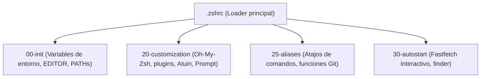
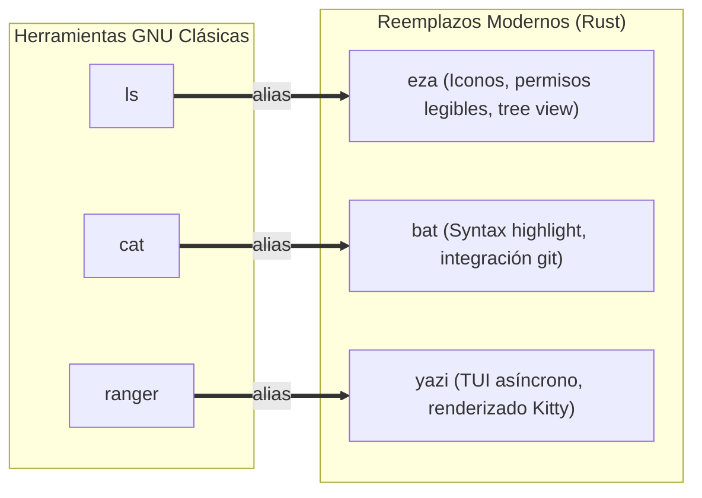

```mermaid
flowchart LR
    subgraph Legacy["Terminal Clásica (Default)"]
        B_Shell["Bash"]
        B_Hist[".bash_history (Texto plano lineal)"]
        B_Nav["cd manual (Rutas absolutas/relativas)"]
        B_Utils["Coreutils (ls, cat, grep)"]
        B_Prompt["PS1 Estático y monocromo"]
    end

    subgraph Modern["Terminal Moderna (Mi configuracion)"]
        Z_Shell["Zsh + Oh-My-Zsh modular"]
        Z_Hist["Atuin (Base de datos SQLite + TUI difusa)"]
        Z_Nav["Zoxide (Ranking Frecency + fzf)"]
        Z_Utils["Ecosistema Moderno (eza, bat, yazi, rg, fd)"]
        Z_Prompt["Oh-My-Posh (Tema Zen + Git + Transient)"]
    end

    Legacy -.->|"Salto de productividad"| Modern
```

import TerminalWindow from '../../components/TerminalWindow.astro';
import CodeBlockWindow from '../../components/CodeBlockWindow.astro';

En mi artículo anterior hable sobre mi salto de Kde/Gnome a **Hyprland**, ya comenté una verdad que cualquier persona que use gestores de ventanas en mosaico (*tiling window managers*) aprende rápido y sabe antes de cambiar: **la terminal es el epicentro de todo y vas a trabajar mas rapido si la usas**.

No os voy a engañar: durante años estuve utilizando lo que venia por defecto `bash` (lo sigo usando en mis servidores), con su prompt monótono en blanco o verde, navegando a base de `cd ../../proyectos/algo`, pulsando desesperadamente `Ctrl + R` para ver si encontraba un comando de Docker que habia usado en el pasdo y conformándome con la salida plana en blanco y negro de `ls` o `cat`. Funcionaba, claro que sí. Pero era como ir en bicicleta teniendo un deportivo aparcado en el garaje.

Modernizar la terminal no va únicamente de "postureo" estético o de subir una captura bonita a Reddit (r/unixporn); va principalmente de **optimizar el flujo de trabajo**, de reducir pulsaciones innecesarias de teclas y de contar con herramientas modernas escritas en lenguajes como Rust o Go que aprovechan la aceleración por hardware de nuestros equipos actuales.

En esta publicación voy a explicar paso a paso mi configuración diaria: desde el núcleo de la shell con **Zsh** y su arquitectura, pasando por la indexación relacional de comandos con **Atuin** y la navegación predictiva con **Zoxide**, hasta los reemplazos modernos de utilidades clásicas como `eza`, `bat`, `yazi` o el despliegue gráfico de **Fastfetch** en Kitty.

---



---

## Índice de Contenidos

1. [El Detonante: Cansado del por defecto](#1-el-detonante-cansado-del-por-defecto)
2. [La base Invisibles: Kitty y Tipografías Nerd Fonts](#2-la-base-invisibles-kitty-y-tipografías-nerd-fonts)
3. [De Bash a Zsh: Como organizarse sin perder rendimiento](#3-de-bash-a-zsh-como-organizarse-sin-perder-rendimiento)
4. [Plugins de Zsh](#4-plugins-de-zsh)
5. [Atuin: El Historial de Comandos Reimaginado con SQLite](#5-atuin-el-historial-de-comandos-reimaginado-con-sqlite)
6. [Zoxide: Navegación Inteligente por frecuencia](#6-zoxide-navegación-inteligente-por-frecuencia)
7. [FZF: El Pegamento de la Búsqueda Difusa Interactiva](#7-fzf-el-pegamento-de-la-búsqueda-difusa-interactiva)
8. [Remplazos modernos a lo tradicional: Eza, Bat y Yazi](#8-remplazos-modernos-a-lo-tradicional-eza-bat-y-yazi)
9. [El Prompt: Oh My Posh con Tema Zen y Transient Prompt](#9-el-prompt-oh-my-posh-con-tema-zen-y-transient-prompt)
10. [El postureo: Fastfetch con Imágenes Dinámicas en Kitty](#10-el-postureo-fastfetch-con-imágenes-dinámicas-en-kitty)
11. [Gestión de Dotfiles: Repositorio Bare Git y Sincronización](#11-gestión-de-dotfiles-repositorio-bare-git-y-sincronización)
12. [Tabla Comparativa y Conclusiones](#12-tabla-comparativa-y-conclusiones)
13. [Enlaces de Interes](#13-enlaces-de-interes)

---

## 1. El Detonante: Cansado del por defecto

Cuando pasas horas delante de una terminal, empiezas a notar pequeñas cosas que hacen que la productividad cueste mas:

* **Pérdida de contexto en el historial:** Quieres volver a ejecutar aquel comando complejo con 8 flags que pusiste hace una semana en una carpeta concreta. En Bash tiras de `Ctrl + R`, tecleas un fragmento y vas dando saltos a ciegas en una lista lineal de texto sin saber en qué fecha lo ejecutaste, en qué carpeta lo hiciste ni si terminó con éxito o error (`exit code 1`).
* **Fatiga por navegación en el árbol de directorios:** Si estas escribiendo código en `~/Documentos/Proyectos/blog/src/content/blog/` y necesitas bajar a `~/docker/ollama/data/` para consultar un compose, tienes que teclear toda la ruta o abusar del tabulador como si no hubiera un mañana.
* **Comandos arcaicos con salida monocroma:** `ls` no te da contexto visual de qué tipo de archivo tienes delante; `cat` vuelca texto plano sin numeración de líneas ni coloreado de sintaxis (por defecto); y buscar archivos o patrones con `find` o `grep` tradicional se siente torpe comparado con los filtros difusos actuales.

Resolver esto no requiere reinventar la rueda: requiere juntar las herramientas adecuadas, configurarlas de forma ligera para que la terminal siga abriendo en milisegundos y aprender a usarlas y guardarlas en la memoria muscular.


---

## 2. La base Invisibles: Kitty y Tipografías Nerd Fonts

Antes de tocar la shell, hay dos requisitos técnicos de los que nadie te avisa al principio y que provocan que media configuración se vea rota y fea: **las fuentes** y el **emulador de terminal**.

### 2.1 ¿Por qué es obligatoria una Nerd Font?

Si alguna vez has intentado instalar un prompt moderno o una herramienta con iconos como `eza` y lo único que has visto han sido cuadraditos vacíos (``) o caracteres corruptos con signos de interrogación, el culpable es tu tipografía, te faltan fuentes.

Las terminales clásicas usan fuentes monoespaciadas estándar. Una **Nerd Font** es una fuente monoespaciada a la que se le han parcheado miles de glifos vectoriales adicionales (iconos de Font Awesome, Material Design, Devicons, Octicons, etc.). En mi caso utilizo **JetBrainsMono Nerd Font**:


<CodeBlockWindow title="~/.config/kitty/kitty.conf (Tipografía y Estética)">
```conf
# Tipografía principal con soporte completo para ligaduras e iconos
font_family                 JetBrainsMono Nerd Font
font_size                   12
bold_font                   auto
italic_font                 auto
bold_italic_font            auto

# Ventana limpia y sin marcos
remember_window_size        no
initial_window_width        950
initial_window_height       500
window_padding_width        10
hide_window_decorations     yes
background_opacity          0.7
dynamic_background_opacity  yes

# Shell por defecto
shell                       zsh

# Efecto dinámico de estela en el cursor
include $HOME/.config/ml4w/settings/kitty-cursor-trail.conf # Esta configuracion la saque de los dotfiles de ml4w

# Paleta de colores sincronizada con el fondo mediante matugen
include colors-matugen.conf
```
</CodeBlockWindow>

### 2.2 Kitty: Aceleración por GPU y Protocolo Gráfico

El motivo de elegir **Kitty** frente a emuladores tradicionales como GNOME Terminal o Alacritty es doble:
1. **Renderizado OpenGL:** Todo el texto se dibuja en la tarjeta gráfica, manteniendo 60/120 FPS sin saturar la CPU aunque hagas un volcado masivo de logs.
2. **Protocolo gráfico nativo:** Kitty permite a utilidades CLI (como `fastfetch` o el gestor de archivos `yazi`) mostrar imágenes reales en alta resolución directamente dentro de la de la terminal, sin trucos ASCII degradados.

---

## 3. De Bash a Zsh: Como organizarse sin perder rendimiento

El cambio natural de Bash a **Zsh** viene motivado por sus capacidades superiores en autocompletado contextual, globbing avanzado y soporte de ecosistema. Sin embargo, existe un peligro recurrente: instalar frameworks como **Oh My Zsh** a ciegas y cargar 30 plugins que transforman la apertura de la terminal en una experiencia lenta de 500 milisegundos.

Para evitar tener un archivo `.zshrc` inmanejable de cientos de líneas, sigo una arquitectura modular inspirada en los dotfiles de ML4W:

<CodeBlockWindow title="~/.zshrc (Cargador Modular)">
```bash
# -----------------------------------------------------
# Carga modular de configuraciones
# -----------------------------------------------------
for f in ~/.config/zshrc/*; do
    if [ ! -d $f ]; then
        c=`echo $f | sed -e "s=.config/zshrc=.config/zshrc/custom="`
        [[ -f $c ]] && source $c || source $f
    fi
done

# Carga de personalizaciones locales si existen
if [ -f ~/.zshrc_custom ]; then
    source ~/.zshrc_custom
fi
```
</CodeBlockWindow>

De este modo, mi configuración se divide en cuatro bloques independientes y limpios dentro de `~/.config/zshrc/`:



* `00-init`: Exporta el editor por defecto (`export EDITOR=nano`) y añade las rutas locales y de Cargo (`~/.cargo/bin`, `~/.local/bin`) al `$PATH`.
* `20-customization`: Carga Oh My Zsh, los plugins estrictamente necesarios, la inicialización de Atuin y el prompt.
* `25-aliases`: Define alias de una o dos letras para no repetir comandos extensos.
* `30-autostart`: Contiene la lógica visual al abrir una sesión interactiva.

---

## 4. Plugins de Zsh

En `20-customization`, la lista de plugins de Oh My Zsh está elegida estrategicamente para maximizar la velocidad de escritura sin penalizar la latencia del cursor:

<CodeBlockWindow title="~/.config/zshrc/20-customization (Plugins seleccionados)">
```bash
plugins=(
    git
    sudo
    web-search
    archlinux
    zsh-autosuggestions
    fast-syntax-highlighting
    copyfile
    copybuffer
    dirhistory
    aliases
    alias-finder
    docker
    podman
)
```
</CodeBlockWindow>

Los más destacados en el día a día son:

* **`zsh-autosuggestions`:** A medida que vas tecleando un comando, te sugiere en color gris la última coincidencia de tu historial. Con pulsar la flecha derecha (`→`) o `End`, completas la orden al instante sin tener que escribirla entera.

  

* **`fast-syntax-highlighting`:** Resalta la sintaxis en vivo. Si el comando existe o la sintaxis es válida, se pinta en verde; si tienes una errata o el comando no está instalado, se pinta en rojo antes de que pulses Intro.

  

* **`sudo`:** ¿Cuántas veces has lanzado un comando de administración y el sistema te ha escupido *Permission Denied*? En vez de escribir `sudo !!`, con este plugin pulsas dos veces la tecla **Escape** y automáticamente añade `sudo ` al principio de la línea actual.

  <video src="https://assets.jrodriiguezg.link/modernizar-la-terminal/3.sudo.mp4" controls autoplay loop muted playsinline width="750" style="max-width: 100%; height: auto; display: block; margin: 1.5rem auto; border-radius: 12px; box-shadow: var(--box-shadow);"></video>

* **`dirhistory`:** Permite navegar hacia adelante y hacia atrás por el historial de carpetas que has visitado utilizando `Alt + Flecha Izquierda` y `Alt + Flecha Derecha`, exactamente igual que en un navegador web.

  <video src="https://assets.jrodriiguezg.link/modernizar-la-terminal/4.dishistory.mp4" controls autoplay loop muted playsinline width="750" style="max-width: 100%; height: auto; display: block; margin: 1.5rem auto; border-radius: 12px; box-shadow: var(--box-shadow);"></video>

---

## 5. Atuin: El Historial de Comandos Reimaginado con SQLite

El historial tradicional de Unix (`.bash_history` o `.zsh_history`) es un archivo de texto plano primitivo. No guarda contexto, se corrompe con facilidad si tienes múltiples ventanas abiertas escribiendo a la vez y su búsqueda por omisión (`Ctrl + R`) es frustrante.

**Atuin** sustituye por completo ese archivo plano por una **base de datos relacional SQLite** local enriquecida con metadatos de cada comando ejecutado.

<TerminalWindow title="jrodriiguezg@fedora: ~ (Búsqueda interactiva con Atuin)">
```text
  17:42:10 │ docker compose -f ~/docker/ollama/docker-compose.yaml up -d
  17:41:05 │ git commit -m "feat(ui): sincronizar temas con matugen"
  17:39:20 │ sudo dnf update && flatpak update -y
  17:30:15 │ eza -al --icons=always ~/Documentos/Proyectos/blog/
  ────────────────────────────────────────────────────────────────────────
  [1/2840] > docker compose                                         [0ms] 0
```
</TerminalWindow>

### 5.1 ¿Qué información guarda Atuin que el historial clásico ignora?

Para cada ejecución, Atuin indexa de manera transparente:
1. **El comando completo y exacto.**
2. **Directorio de trabajo (`cwd`):** Puedes filtrar comandos que solo ejecutaste dentro de la carpeta del proyecto actual.
3. **Código de salida (`exit code`):** Puedes filtrar solo los comandos que fallaron para ver qué salió mal, o solo los que terminaron en `0` (éxito).
4. **Hora exacta y duración de ejecución:** Saber si un script tardó 200ms o 14 minutos.

### 5.2 Inicialización e Integración en Zsh

 
Para ponerlo en marcha basta con una sola línea en `~/.config/zshrc/20-customization`:

<CodeBlockWindow title="~/.config/zshrc/20-customization (Atuin Init)">
```bash
# Inicializar Atuin para la shell interactiva Zsh
eval "$(atuin init zsh)"
```
</CodeBlockWindow>

Al pulsar `Ctrl + R` o la flecha arriba (`↑`), en lugar de la búsqueda lineal de Bash, se despliega una interfaz TUI flotante a pantalla completa con búsqueda difusa (*fuzzy search*), permitiendo filtrar por prefijos, fechas relativas o carpetas.

<video src="https://assets.jrodriiguezg.link/modernizar-la-terminal/atuin.mp4" controls autoplay loop muted playsinline width="850" style="max-width: 100%; height: auto; display: block; margin: 1.5rem auto; border-radius: 12px; box-shadow: var(--box-shadow);"></video>

Además, incluye utilidades estadísticas muy interesantes como `atuin stats`, que te genera un desglose visual de cuáles son tus comandos más utilizados:

<TerminalWindow title="atuin stats">
```text
❯ atuin stats
[▮▮▮▮▮▮▮▮▮▮] 642 cd         
[▮▮▮▮▮▮▮▮▮ ] 579 ls         
[▮▮▮▮▮     ] 370 ssh        
[▮▮▮▮▮     ] 354 nano       
[▮▮▮▮      ] 310 dnf install
[▮▮        ] 178 flatpak    
[▮▮        ] 144 git push   
[▮▮        ] 130 python3    
[▮         ] 128 mkdir      
[▮         ] 125 git add    
Total commands:   6829
Unique commands:  3433
```
</TerminalWindow>


> [!TIP]
> Atuin incluye soporte opcional para **sincronización cifrada de extremo a extremo (E2EE)**. Si tienes varios equipos (el portátil, la torre y un servidor en tu homelab), puedes registrar tu propio servidor de Atuin o usar su servicio para que el historial esté disponible en todos tus terminales sin exponer contraseñas en texto claro.

---

## 6. Zoxide: Navegación Inteligente por frecuencia

Moverse por el sistema de ficheros con `cd` clásico requiere acordarse de la estructura completa de rutas o pulsar tabulador docenas de veces:

<TerminalWindow title="cd tradicional">
```bash
jrodriiguezg@fedora:~$ cd Documentos/Proyectos/blog/src/content/blog/
jrodriiguezg@fedora:~/Documentos/Proyectos/blog/src/content/blog$ cd ../../../../../docker/ollama/
```
</TerminalWindow>

**Zoxide** elimina este problema implementando un algoritmo basado en **"Frecency"** (un término que combina **frecuencia** de visitas y **recencia**, es decir, cuándo fue la última vez que entraste). 

### 6.1 Sustituyendo a `cd` de forma transparente

En lugar de aprender un nuevo comando como `z`, puedes configurar Zoxide para que sobreescriba directamente la orden `cd`. Así tu memoria muscular no cambia absolutamente nada:

<CodeBlockWindow title="~/.zshrc (Sobrescribir cd con Zoxide)">
```bash
# Reemplazar la orden cd por el motor predictivo de Zoxide
eval "$(zoxide init zsh --cmd cd)"
```
</CodeBlockWindow>

A partir de ese momento, Zoxide monitoriza silenciosamente cada carpeta por la que pasas y le asigna una puntuación ponderada. Si quieres ir al directorio de tu blog desde cualquier rincón del sistema, te basta con teclear:

<TerminalWindow title="Navegación instantánea con Zoxide">
```bash
# Salto directo desde la raíz o cualquier subcarpeta
cd blog

# O si tienes varios proyectos que se llaman parecido:
cd blog content
```
</TerminalWindow>

Zoxide calcula qué carpeta coincide con esos términos y tiene mayor puntuación, saltando a `~/Documentos/Proyectos/blog/src/content/blog/` en un abrir y cerrar de ojos. Y si tienes dudas de a dónde va a saltar, puedes hacer uso del modo interactivo combinado con FZF:

```bash
cd foo <SPACE> <TAB>
```

Se abrirá un menú interactivo con la lista de carpetas coincidentes ordenadas por relevancia para que elijas con las flechas.

<video src="https://assets.jrodriiguezg.link/modernizar-la-terminal/zoxide.mp4" controls autoplay loop muted playsinline width="700" style="max-width: 100%; height: auto; display: block; margin: 1.5rem auto; border-radius: 12px; box-shadow: var(--box-shadow);"></video>

---

## 7. FZF: El Pegamento de la Búsqueda Difusa Interactiva

**FZF** (*Fuzzy Finder*) es la herramienta que une todos los componentes de búsqueda en la consola. Su integración nativa en Zsh proporciona atajos de teclado esenciales:

<CodeBlockWindow title="~/.config/zshrc/20-customization (Integración FZF)">
```bash
# Carga de atajos y completado interactivo de FZF
source <(fzf --zsh)
```
</CodeBlockWindow>

Con esta sola línea tienes acceso a:
* `Ctrl + T`: Abre un selector interactivo difuso de todos los ficheros y carpetas del directorio actual, insertando la ruta seleccionada en la línea de comandos.
* `Alt + C`: Permite buscar cualquier subdirectorio de forma difusa y saltar directamente a él con un solo golpe de Intro.

En mi archivo de autostart (`30-autostart`), combino FZF con un script personalizado (`finder`) para buscar archivos o directorios y abrirlos directamente en Neovim o cambiar de carpeta automáticamente:

<CodeBlockWindow title="~/.config/zshrc/30-autostart (Función Finder)">
```bash
# Función interactiva de búsqueda rápida
finder() {
    local result=$($HOME/.config/ml4w/bin/ml4w-finder)

    if [[ "$result" == TYPE_DIR:* ]]; then
        local target_dir="${result#TYPE_DIR:}"
        cd "$target_dir" && ls
    elif [[ "$result" == TYPE_FILE:* ]]; then
        ${EDITOR:-nvim} "${result#TYPE_FILE:}"
    else
        echo "Could not read $result" >&2
        return 1
    fi
}
```
</CodeBlockWindow>


<video src="https://assets.jrodriiguezg.link/modernizar-la-terminal/fzf%202.mp4" controls autoplay loop muted playsinline width="770" style="max-width: 100%; height: auto; display: block; margin: 1.5rem auto; border-radius: 12px; box-shadow: var(--box-shadow);"></video>
---

## 8. Remplazos modernos a lo tradicional: Eza, Bat y Yazi

Durante décadas hemos convivido con herramientas de GNU Coreutils que datan de los años 70 y 80. Hoy en día, la comunidad ha reescrito prácticamente todo el set de utilidades en **Rust**, aportando paralelismo, colores semánticos y mayor claridad visual.

En `~/.config/zshrc/25-aliases` tengo configurados los reemplazos inmediatos de mi sistema:



### 8.1 Eza: El sustituto definitivo de `ls`

`eza` no solo pinta los nombres de archivo en color; lee la extensión y le asocia el icono vectorial correspondiente de la Nerd Font, muestra permisos con formato legible y permite ver estructuras en árbol sin necesidad del paquete `tree`.

<CodeBlockWindow title="~/.config/zshrc/25-aliases (Configuración de Eza)">
```bash
# Reemplazo de ls con iconos automáticos y árbol
alias ls='eza -a --icons=always'
alias ll='eza -al --icons=always'
alias lt='eza -a --tree --level=1 --icons=always'
```
</CodeBlockWindow>

<TerminalWindow title="eza -al --icons=always">
```text
drwxr-xr-x   - jrodriiguezg 22 Oct 21:50  .
drwxr-xr-x   - jrodriiguezg 22 Oct 20:00  ..
-rw-r--r-- 12k jrodriiguezg 22 Oct 21:49  README.md
-rw-r--r-- 1.2k jrodriiguezg 22 Oct 21:30  package.json
-rw-r--r-- 5.4k jrodriiguezg 22 Oct 21:20  astro.config.mjs
drwxr-xr-x   - jrodriiguezg 22 Oct 21:00  src
```
</TerminalWindow>


### 8.2 Bat: El `cat` con esteroides

`bat` sustituye a `cat` incorporando coloreado de sintaxis para cientos de lenguajes de programación, números de línea en el margen izquierdo e integración con Git (marcando con líneas verdes o rojas en el borde qué líneas han sido añadidas o modificadas frente al último commit).

<CodeBlockWindow title="~/.config/zshrc/25-aliases (Alias de bat)">
```bash
alias cat=bat
```
</CodeBlockWindow>


### 8.3 Yazi: Gestión de Archivos TUI Asíncrona

Frente a gestores clásicos en Python como Ranger, **Yazi** es un explorador de consola programado en Rust con arquitectura orientada a eventos. Su gran ventaja en mi entorno con Kitty es que aprovecha el protocolo gráfico del emulador para previsualizar imágenes en alta fidelidad al instante mientras te desplazas con `hjkl`:

<CodeBlockWindow title="~/.config/zshrc/25-aliases (Alias de yazi)">
```bash
alias ranger=yazi
```
</CodeBlockWindow>


---

## 9. El Prompt: Oh My Posh con Tema Zen y Transient Prompt

El prompt es lo que ves el 100% del tiempo que estás en la terminal. Herramientas como Starship u Oh My Posh son fantásticas, pero hay que tener cuidado con no saturar la barra con 15 segmentos que retrasen la ejecución de cada línea.

En mi sistema utilizo **Oh My Posh** cargando un tema minimalista (`zen.toml`):

<CodeBlockWindow title="~/.config/zshrc/20-customization (Prompt Init)">
```bash
# Inicializar Oh My Posh con la plantilla Zen
eval "$(oh-my-posh init zsh --config $HOME/.config/ohmyposh/zen.toml)"
```
</CodeBlockWindow>

Mi configuración prioriza tres aspectos fundamentales:
1. **Ruta compacta y limpia:** La ruta de trabajo actual destacada con color azul claro.
2. **Contexto Git instantáneo:** Nombre de la rama (`HEAD`), indicador de cambios en staging/working tree (`*`) y flechas de sincronización con el repositorio remoto (`⇣` behind, `⇡` ahead).
3. **Transient Prompt activado:** Al pulsar Intro, la línea anterior reduce su longitud y se convierte en un simple `❯ `, evitando que tu historial de pantalla (*scrollback*) quede saturado con información duplicada de rutas pasadas.

<TerminalWindow title="Oh My Posh en acción">
```text
~/Documentos/Proyectos/blog main* ⇣1 
❯ git status
```
</TerminalWindow>


---

## 10. El postureo: Fastfetch con Imágenes Dinámicas en Kitty

Lejos de la clásica llamada estática a `fastfetch` o al ya descontinuado `neofetch`, en mi setup quería que cada nueva ventana de terminal tuviera un toque desenfadado y propio.

Aprovechando el protocolo gráfico de Kitty, configuré en `~/.config/zshrc/30-autostart` un pequeño script que selecciona de forma aleatoria una imagen o meme de mi carpeta personal `~/.termicon` y la proyecta al lado de la información del sistema:

<CodeBlockWindow title="~/.config/zshrc/30-autostart (Fastfetch Dinámico)">
```bash
# Cargar fastfetch con imagen aleatoria únicamente en sesiones interactivas
if [[ -o interactive ]]; then
    local img=$(find "$HOME/.termicon" -maxdepth 1 -type f \( -iname "*.jpg" -o -iname "*.jpeg" -o -iname "*.png" -o -iname "*.webp" \) | shuf -n 1)
    if [[ -n "$img" ]]; then
        fastfetch --logo-type kitty --logo "$img"
    fi
fi
```
</CodeBlockWindow>

La plantilla de `fastfetch` (`~/.config/fastfetch/config.jsonc`) define los módulos esenciales con iconos de Nerd Fonts: usuario, hostname, tiempo de vida de la instalación (`os age`), tiempo de actividad (`uptime`), kernel, gestor de ventanas (`Hyprland`), terminal (`Kitty`) y shell (`Zsh`).

<TerminalWindow title="fastfetch en Kitty">
```text
    ┌──────────────┐   jrodriiguezg@fedora
    │              │   ───────────────────
    │   [ Imagen   │    user     jrodriiguezg
    │   Aleatoria  │   󰇅 hname    fedora
    │   en Kitty ] │    os age   142 days
    │              │   󰅐 uptime   6 hours, 21 mins
    └──────────────┘    shell    zsh 5.9
```
</TerminalWindow>


---

## 11. Gestión de Dotfiles: Repositorio Bare Git y Sincronización

Tener una terminal vitaminada no sirve de nada si el día que formateas o cambias de portátil tienes que volver a pasar tres tardes configurando todo desde cero.

En lugar de usar gestores de enlaces simbólicos externos como GNU Stow, mantengo todos mis archivos mediante un **repositorio bare de Git** apuntando directamente a mi `$HOME`:

<CodeBlockWindow title="~/.config/zshrc/25-aliases (Flujo Bare Git)">
```bash
# Alias base para el repositorio bare de dotfiles
alias dotfiles='/usr/bin/git --git-dir=$HOME/.dotfiles/ --work-tree=$HOME'
alias dotst='dotfiles status'
alias dotdiff='dotfiles diff'

# Sincronización rápida con commit y push automatizado
dotsync() {
    local msg="${*:-sync: actualizacion de dotfiles}"
    dotfiles add -u
    dotfiles commit -m "$msg"
    dotfiles push origin main
}

# Autocompletado nativo de Git para el alias 'dotfiles'
compdef _git dotfiles=git
```
</CodeBlockWindow>

Con esta función `dotsync`, cualquier ajuste que haga en `~/.config/zshrc/`, `kitty.conf` o el tema de Oh My Posh se añade, commitea y sube a mi repositorio remoto ejecutando una sola palabra en la consola:

<TerminalWindow title="dotsync en ejecución">
```bash
jrodriiguezg@fedora:~$ dotsync "feat(zsh): optimizar tiempo de carga de plugins"
[main a8f9c12] feat(zsh): optimizar tiempo de carga de plugins
 1 file changed, 4 insertions(+), 2 deletions(-)
To github.com:jrodriiguezg/dotfiles.git
   f4e2b01..a8f9c12  main -> main
```
</TerminalWindow>


---

## 12. Tabla Comparativa y Conclusiones

| Característica / Tarea | Enfoque Clásico (Bash Tradicional) | Enfoque Moderno (Zsh + Rust Stack) | Beneficio Práctico |
| :--- | :--- | :--- | :--- |
| **Historial de comandos** | `.bash_history` lineal con `Ctrl + R` ciego | **Atuin** con SQLite, metadatos y búsqueda difusa | Encuentras cualquier comando en segundos por carpeta o fecha |
| **Navegación de directorios** | `cd` manual con rutas completas | **Zoxide** con ranking *frecency* | Salto instantáneo entre proyectos con una sola palabra clave |
| **Listado de archivos** | `ls -la` monocromo y sin contexto | **Eza** con iconos de Nerd Fonts y árbol | Identificación visual instantánea de tipos de archivos |
| **Lectura de código / logs** | `cat` plano sin números de línea | **Bat** con syntax highlighting y git diff | Lectura rápida sin abrir un editor completo |
| **Búsqueda difusa** | `find` y `grep` con sintaxis farragosa | **FZF** integrado en la shell y scripts | Filtrado interactivo en tiempo real al vuelo |
| **Prompt de la consola** | `PS1` plano sin estado del sistema | **Oh My Posh** con tema Zen y Transient | Estado de Git y carpetas siempre a la vista sin lag |

### ¿Merece la pena el esfuerzo?

Rotundamente sí. La curva de adaptación a Zoxide y Atuin dura literalmente una tarde; pero a partir del segundo día, cuando intentas trabajar en una máquina con Bash plano por defecto, sientes de inmediato cómo echas en falta las sugerencias automáticas, el historial indexado y la velocidad de salto entre carpetas.

No se trata de recargar la terminal de florituras inútiles, sino de construir un entorno de trabajo ágil, cómodo y agradable para la vista donde pasar horas no suponga una batalla constante contra la consola.


---

## 13. Enlaces de interés

* [Documentación oficial de Atuin](https://atuin.sh/)
* [Repositorio de Zoxide en GitHub](https://github.com/ajeetdsouza/zoxide)
* [FZF - Fuzzy Finder en GitHub](https://github.com/junegunn/fzf)
* [Eza - Listador de archivos en Rust](https://github.com/eza-community/eza)
* [Bat - Alternativa moderna a cat](https://github.com/sharkdp/bat)
* [Yazi - Explorador de terminal asíncrono](https://yazi-rs.github.io/)
* [Oh My Posh - Motor de prompts](https://ohmyposh.dev/)
* [Kitty - Terminal con aceleración GPU](https://sw.kovidgoyal.net/kitty/)
